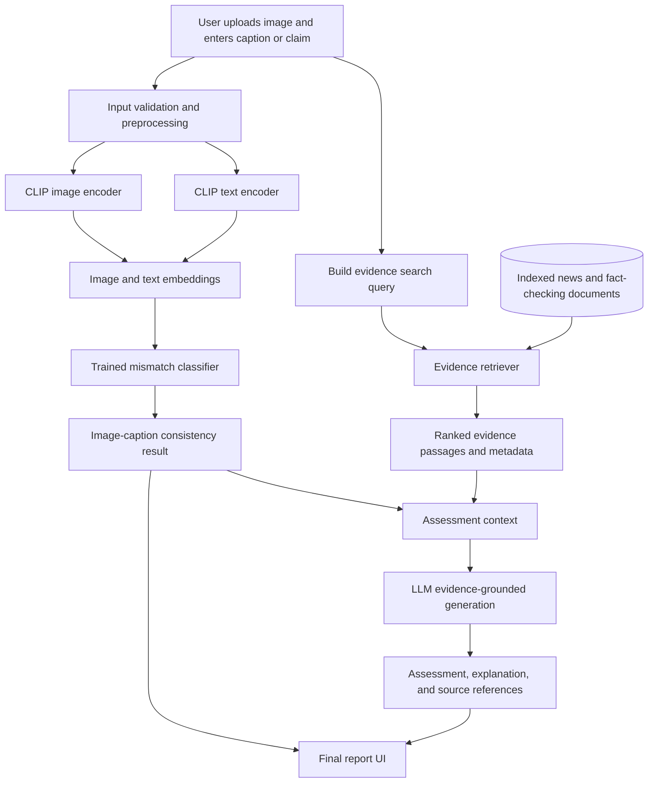
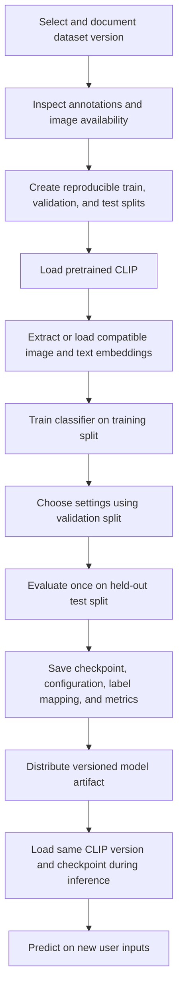
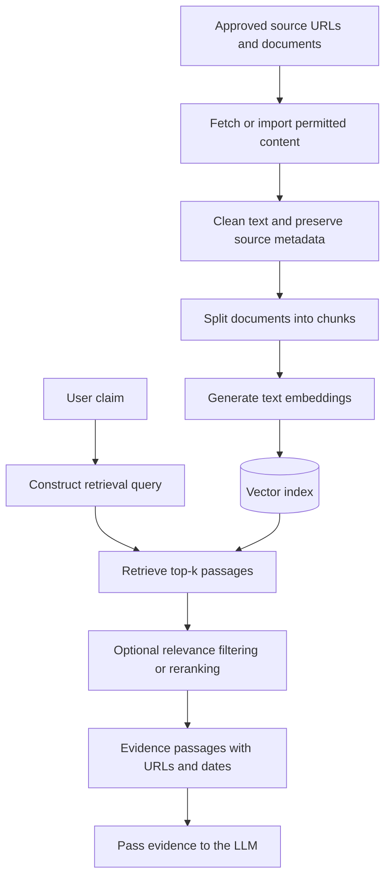

# 00 — Project Overview
## Multimodal Out-of-Context Misinformation Detection Using Retrieval-Augmented Generation (RAG)

**Document status:** Initial project specification  
**Document type:** Project overview and architecture  
**Primary task:** Detect potentially misleading image–caption pairs, retrieve external evidence, and generate an evidence-grounded assessment.  
**Implementation approach:** Modular Python application with local CLIP/classifier inference and a retrieval-augmented evidence workflow.

---

## 1. Project Summary

Online misinformation does not always use a fabricated image. A real photograph may be paired with an incorrect, outdated, or unrelated caption to imply that it depicts a different event. This is commonly described as **out-of-context misinformation**.

This project will build a multimodal system that accepts an image and a caption or news claim, evaluates the image–text relationship using CLIP features and a trained classifier, retrieves relevant external evidence, and generates an explanation grounded in the retrieved sources.

The system has two related but distinct jobs:

1. **Image–caption consistency assessment:** Estimate whether the image and supplied text appear consistent, using CLIP representations and a classifier trained on labeled examples.
2. **Evidence-based claim assessment:** Retrieve relevant articles and fact-checks, then assess what the evidence supports, contradicts, or leaves unresolved.

The first stage does **not** prove whether a news claim is true. A semantically compatible image can still be old, mislocated, or associated with a false claim. The RAG stage adds external context, but its output must also be treated carefully: retrieved sources may be incomplete, irrelevant, or contradictory. The system must be allowed to return **Inconclusive / Insufficient evidence**.

---

### 2.1 Project objectives

1. Build a reproducible input and preprocessing pipeline for images and captions.
2. Use a pretrained CLIP model to extract image and text features.
3. Prepare a labeled dataset and train a classifier for image–caption mismatch detection.
4. Save and load the classifier checkpoint consistently across local computers.
5. Build an inference pipeline that connects input processing, CLIP, and the classifier.
6. Create an evidence collection and retrieval pipeline using reliable sources.
7. Use an LLM to produce an evidence-grounded assessment with source references.
8. Present predictions, evidence, limitations, and explanations in a simple UI.
9. Evaluate each component separately and test the integrated system end to end.

### 2.2 Out of scope for the first prototype

Unless the project is deliberately extended, the first version will not:

- Prove that an image is authentic or detect every kind of image manipulation.
- Verify every factual statement in arbitrary long articles.
- Guarantee that every relevant web page can be retrieved.
- Automatically crawl the entire web without limits.
- Treat CLIP similarity as a calibrated probability of misinformation.
- Treat an LLM-generated explanation as proof.
- Require fine-tuning a large language model.
- Require a hosted inference server for the CLIP classifier.

---


## 4. End-to-End System Architecture



### 4.1 Main processing stages

1. **Input:** The user submits an image and a caption or claim.
2. **Validation:** Check that an image exists, is decodable, meets size limits, and that the text is non-empty and within the configured length limit.
3. **CLIP feature extraction:** Apply the selected CLIP processor and encoder to produce image and text embeddings.
4. **Classifier inference:** Pass the expected features to the trained classifier and return the predicted class and score.
5. **Evidence retrieval:** Construct a text search query from the claim and, where appropriate, relevant context. Search the prepared evidence index.
6. **Evidence-grounded generation:** Give the LLM the claim, classifier result, and retrieved passages with their source metadata. Ask it to distinguish evidence from inference and identify uncertainty.
7. **Report:** Display the classifier result separately from the evidence-based assessment, with citations and source links.

### 4.2 Important separation of responsibilities

The classifier and the RAG system have different responsibilities:

- The classifier estimates whether the image–caption pair resembles matched or mismatched examples from its training data.
- The retriever finds documents relevant to the claim.
- The LLM synthesizes the retrieved passages into an assessment. It must not invent sources or claim that a source supports a statement when it does not.
- The UI presents these outputs as distinct results rather than collapsing them into one unqualified “fake/real” label.

---

## 5. Model Development and Runtime Workflow



### 5.2 Reproducibility requirements

Record at minimum:

- Dataset name, version, source URL, and access date.
- Exact split-generation method and random seed.
- CLIP model identifier and preprocessing configuration.
- Classifier architecture and input feature dimensions.
- Training hyperparameters and software versions.
- Label mapping and any class weighting.
- Validation and held-out test metrics.
- Checkpoint version or checksum.
- Known limitations and unresolved issues.

Avoid train/test leakage. If the same underlying image or near-duplicate image appears in both training and test examples with different captions, performance can be overstated. Inspect dataset construction and use grouping or split strategies that reduce this risk where feasible.

---

## 6. Dataset

The project needs **two kinds of data**:

1. **Labeled image–caption pairs** for training and evaluating the mismatch classifier.
2. **Evidence documents** for the RAG index, including article text, title, source, publication date, URL, and, where available, a relevant excerpt.

A labeled pair dataset is not automatically a RAG knowledge base. The two serve different purposes and should be prepared separately.

### 6.1 Primary training dataset: NewsCLIPpings

**Recommended starting point:** [NewsCLIPpings — official GitHub repository](https://github.com/g-luo/news_clippings)

Paper: [NewsCLIPpings: Automatic Generation of Out-of-Context Multimodal Media (EMNLP 2021)](https://arxiv.org/abs/2104.05893)

Why it fits:

- It is specifically designed for out-of-context image–caption pair detection.
- It provides matched/original and generated mismatched examples.
- Its annotations include a binary `falsified` indicator.
- The repository documents precomputed CLIP image and text embeddings, including 512-dimensional embeddings generated with CLIP ViT-B/32.
- Using compatible precomputed embeddings may make the first classifier baseline easier to develop without repeatedly running the encoder.

Important limitations and setup notes:

- Its data links and image paths depend on the VisualNews dataset, so image setup requires following the repository instructions.
- Verify the exact split files, annotations, feature IDs, and embedding compatibility before training.
- Do not assume the provided binary label means the same thing as the project's own label mapping; confirm the official annotation semantics.
- Check dataset terms and the permissions for any redistribution. Do not commit the full dataset or downloaded image collection to this project's Git repository.
- Precomputed features are useful for a baseline, but the final inference code must use the same feature representation, model version, and preprocessing assumptions as the trained classifier.

Official setup and data documentation: [NewsCLIPpings repository README](https://github.com/g-luo/news_clippings).

### 6.2 Secondary evaluation benchmark: VERITE

**Recommended for a separate evaluation:** [VERITE official repository](https://github.com/stevejpapad/image-text-verification)

Paper: [VERITE: A Robust Benchmark for Multimodal Misinformation Detection Accounting for Unimodal Bias](https://link.springer.com/article/10.1007/s13735-023-00312-6)

Why it fits:

- It focuses on fine-grained image–text verification.
- It distinguishes three categories: `truthful`, `miscaptioned`, and `out-of-context`.
- Its published benchmark contains approximately 1,000 image–text pairs.
- It can reveal whether the system distinguishes different types of mismatch instead of relying on a simplistic binary signal.

Important limitations:

- The current official repository notes that many original image URLs are no longer accessible and that raw images are available through Hugging Face with institutional-email access verification.
- Check current access requirements, license, and research-use conditions before attempting to download or use the images.
- If the classifier is trained as a binary model on NewsCLIPpings, define and justify how VERITE's three classes will be mapped for binary evaluation. Prefer reporting the original three-class results separately when the model supports them; do not silently merge labels.
- Do not tune the classifier on the benchmark test examples and then report those same examples as an independent test.

### 6.3 Optional real-world fact-checking dataset: M4FC

**Useful for future RAG and real-world assessment experiments:** [M4FC official repository](https://github.com/UKPLab/M4FC)

Paper: [M4FC — Multimodal, Multilingual, Multicultural, Multitask Real-world Fact-Checking Dataset](https://arxiv.org/abs/2510.23508)

The repository describes 4,982 images paired with approximately 6,980 claims and six fact-checking tasks. It includes evidence-related resources and links to reverse-image-search evidence. The repository reports the code under Apache 2.0 and the dataset under CC-BY-SA-4.0; verify the current terms and conditions before using or redistributing any data.

M4FC is particularly relevant to the evidence-based part of this project, but it may require more setup than NewsCLIPpings. Some images may be graphic, and the repository indicates that it provides image URLs rather than directly distributing the image files. Review the content warning and collection instructions first.

### 6.4 Dataset decision for the first version

| Purpose | Recommended choice | Reason |
|---|---|---|
| Train initial binary mismatch classifier | NewsCLIPpings | Directly targets out-of-context image–caption mismatch |
| Independent fine-grained evaluation | VERITE | Includes truthful, miscaptioned, and out-of-context categories |
| Explore real-world fact-checking and evidence | M4FC | Contains real-world claims, multiple tasks, and evidence-related resources |
| RAG knowledge base | Curated source articles and permissible dataset-linked evidence | RAG needs searchable document text and metadata, not just class labels |

**Practical sequence:** begin with NewsCLIPpings, establish a reproducible baseline, and only then add VERITE evaluation. Explore M4FC for the evidence-oriented extension after the initial pipeline is stable.

---

## 7. RAG Evidence Knowledge Base

The RAG system requires a separate collection of documents. Suitable source categories include:

- Fact-checking articles from established fact-checking organizations.
- News reports with clear publication dates and source URLs.
- Official government, scientific, emergency-management, or other primary-source documents when relevant.
- Dataset-linked evidence articles, where access and reuse terms permit.

Each stored document should preserve useful metadata:

| Field | Purpose |
|---|---|
| `document_id` | Stable identifier for the indexed document |
| `title` | Human-readable source title |
| `source_name` | Publisher or organization |
| `url` | Original source URL |
| `published_at` | Publication date, if known |
| `retrieved_at` | Date the team collected the document |
| `text` | Cleaned document text or relevant passage |
| `chunk_id` | Identifier for an indexed text chunk |
| `claim_or_event` | Optional metadata to aid search and evaluation |

Do not invent publication dates or source details. If a field is unavailable, store it as unknown rather than guessing.

### 7.1 Evidence ingestion and retrieval workflow



### 7.2 Retrieval requirements

- Return ranked passages, not just a list of document names.
- Preserve the source URL and metadata with every passage.
- Evaluate whether relevant evidence is retrieved at `k` results, for example using Recall@k where ground-truth evidence labels are available.
- Avoid using the answer generated by the LLM as evidence for itself.
- Handle missing, contradictory, stale, or weak evidence explicitly.
- Respect the source website's terms, access restrictions, and applicable copyright rules when collecting article text.

---

## 8. Evidence-Grounded Assessment

The LLM receives the original claim and a bounded set of retrieved passages. It should be instructed to:

1. Restate the claim being assessed.
2. Summarize what the retrieved evidence says.
3. Identify which evidence supports, contradicts, or fails to resolve the claim.
4. Distinguish direct source statements from its own interpretation.
5. Include source references tied to the supplied retrieved documents.
6. Explain uncertainty, missing context, and conflicts between sources.
7. Return an inconclusive assessment when evidence is insufficient.
8. Never fabricate citations, article details, or quotations.

The CLIP classifier output can be included as an additional signal, but it must not override contradictory factual evidence automatically. A mismatch prediction is not proof that a claim is false, and a matched prediction is not proof that it is true.

### 8.1 Suggested assessment outcomes

- **Supported by retrieved evidence:** the available evidence supports the relevant claim, within the stated scope.
- **Contradicted by retrieved evidence:** reliable evidence conflicts with the claim.
- **Inconclusive / insufficient evidence:** the retrieval results do not justify either conclusion.
- **Conflicting evidence:** credible sources materially disagree and the system cannot resolve the conflict.

The project may simplify the displayed labels for the first prototype, but it should preserve the underlying explanation and uncertainty.

---

## 9. Output and User Interface

The application should show the following sections.

### 9.1 Input summary

- Uploaded image preview.
- User-provided caption or claim.
- Validation status.

### 9.2 Image–caption result

- Predicted class, using the documented label mapping.
- Model score, clearly identified as a score or probability depending on calibration.
- A short explanation of what the classifier measures.
- A note that this result does not establish the truth of the entire news claim.

### 9.3 Evidence and assessment

For each retrieved source, show:

- Title and source name.
- Publication date, if known.
- Relevant retrieved excerpt.
- Clickable original URL.
- Relevance information, if available and clearly explained.

Then show the generated assessment, including uncertainty and conflicting evidence where applicable.

### 9.4 Error and fallback states

The UI should handle:

- Missing or unsupported images.
- Corrupt image uploads.
- Empty or excessively long captions.
- Missing classifier checkpoints.
- Model-loading failures.
- No relevant retrieved evidence.
- LLM/API failure or rate limits.
- Invalid or missing source metadata.

A failed component must not silently generate a fabricated prediction or report.

---

## 10. Testing and Evaluation Strategy

Testing begins with the first module and continues through final integration. A final evaluation document will define the detailed test cases and reporting procedure; this overview establishes the overall strategy.

### 10.1 Input pipeline tests

- Valid JPG/PNG images are accepted.
- Unsupported and corrupt images are rejected.
- Oversized images are rejected.
- Images are decoded and converted to RGB consistently.
- Empty or whitespace-only captions are rejected.
- Text-length limits are enforced.
- Valid input produces the agreed request structure.
- Errors are understandable and do not expose secrets or stack traces to users.

### 10.2 CLIP feature extraction tests

- The documented CLIP model can be loaded.
- Image and text encoders return finite embeddings of the expected dimensions.
- The same input produces compatible feature shapes across runs.
- Training and inference use compatible model versions and preprocessing.
- Model download or cache failures are handled clearly.

### 10.3 Dataset and classifier tests

- Annotation records and image references are valid.
- Label mapping is consistent.
- Train/validation/test splits are reproducible.
- Near-duplicate or paired samples are examined for split leakage.
- The classifier can train on a small sample and save a checkpoint.
- Checkpoint loading reproduces the expected model configuration.
- Evaluation is performed on held-out test data.
- Report accuracy, precision, recall, F1-score, and confusion matrix; include per-class results where useful.
- Inspect class imbalance and the consequences of false positives and false negatives.

### 10.4 Retrieval and RAG tests

- A known query retrieves expected relevant evidence in the top-k results.
- Source titles, URLs, and dates remain attached to retrieved passages.
- Irrelevant queries do not produce unsupported confident claims.
- Missing evidence leads to an inconclusive assessment.
- Conflicting evidence is acknowledged.
- Generated citations point to retrieved sources and support the adjacent statements.
- The LLM is tested against prompts or documents containing misleading instructions; retrieved text is treated as untrusted evidence, not as instructions to the system.

### 10.5 End-to-end tests

- A valid image–caption pair completes the whole workflow.
- A mismatch example produces a classifier output and a separate evidence assessment.
- A case with insufficient evidence is not forced into a confident true/false conclusion.
- UI errors are shown when a required component is unavailable.
- A second computer can load the documented dependencies and checkpoint.
- The app works without relying on another developer's private local paths.
- Results are reproducible enough for a project demonstration.

### 10.6 Metrics by component

| Component | Suggested measurements |
|---|---|
| Classifier | Accuracy, precision, recall, F1-score, confusion matrix, per-class results |
| Retrieval | Recall@k, Precision@k or MRR when suitable relevance labels exist; manual relevance review otherwise |
| Generated assessment | Citation correctness, evidence support, unsupported-claim rate, uncertainty handling, human review |
| Application | End-to-end success rate, error handling, latency and resource use |

Do not combine these into one score without a justified evaluation design. Good classification performance does not prove good retrieval, and good retrieval does not guarantee faithful generation.

---

## 11. Repository Structure

The codebase should keep each feature modular. The following is a conceptual target structure; adapt it to the directories already created in the repository.

```text
multimodal-misinformation-rag/
├── app.py
├── README.md
├── requirements.txt
├── .gitignore
├── .env.example
│
├── src/
│   ├── input_pipeline/
│   │   ├── image_preprocessing.py
│   │   ├── text_preprocessing.py
│   │   └── input_schema.py
│   ├── clip_model/
│   │   ├── clip_encoder.py
│   │   ├── dataset.py
│   │   ├── classifier.py
│   │   └── inference.py
│   ├── retrieval/
│   │   ├── ingest_documents.py
│   │   ├── chunk_documents.py
│   │   ├── embed_documents.py
│   │   └── retriever.py
│   ├── rag/
│   │   ├── prompts.py
│   │   └── generate_report.py
│   ├── reporting/
│   │   └── format_report.py
│   └── utils/
│       └── config.py
│
├── scripts/
│   ├── prepare_dataset.py
│   ├── train_classifier.py
│   └── build_index.py
│
├── tests/
│   ├── test_input_pipeline.py
│   ├── test_clip_encoder.py
│   ├── test_classifier.py
│   ├── test_retriever.py
│   ├── test_rag.py
│   └── test_integration.py
│
├── data/
│   ├── README.md
│   ├── manifests/
│   └── evidence/
│
├── models/
│   └── README.md
│
├── notebooks/
│
└── docs/
    ├── 00_PROJECT_OVERVIEW.md
    ├── 01_INPUT_PIPELINE.md
    ├── 02_CLIP_FEATURE_EXTRACTION.md
    ├── 03_DATASET_PREPARATION.md
    ├── 04_CLASSIFIER_TRAINING.md
    ├── 05_MODEL_CHECKPOINTS.md
    ├── 06_INFERENCE_PIPELINE.md
    ├── 07_RAG_EVIDENCE_RETRIEVAL.md
    ├── 08_EVIDENCE_GROUNDED_GENERATION.md
    ├── 09_REPORTING_AND_UI.md
    └── 10_TESTING_AND_EVALUATION.md
```

### 11.1 Git and artifact management

- Commit source code, documentation, small test fixtures, and reproducible scripts.
- Do not commit API keys, `.env` files, private data, full datasets, large downloaded image collections, or large model checkpoints.
- Use a versioned release or approved artifact storage for large model files.
- Document how to acquire each external dataset and model.
- Pin compatible dependency versions once the implementation is tested.
- Use feature branches and pull requests so each change can be reviewed before merging.

---

## 12. Development Phases and Acceptance Criteria

| Phase | Main work | Acceptance criteria |
|---|---|---|
| 1. Input pipeline | Upload, validate, normalize image and text | Valid and invalid inputs are tested; a stable request object is produced |
| 2. CLIP features | Load pretrained CLIP and extract features | Correct, finite embeddings with documented dimensions |
| 3. Dataset preparation | Inspect labels and create reproducible splits | Dataset loader works and leakage checks are documented |
| 4. Classifier training | Train and evaluate the classification head | Checkpoint saved; held-out metrics and label mapping documented |
| 5. Checkpoints and inference | Load shared artifacts and predict on new inputs | Inference works on a fresh setup with compatible model versions |
| 6. Evidence retrieval | Build knowledge base and retriever | Queries return ranked passages with source metadata |
| 7. Grounded generation | Generate evidence-linked assessments | Citations are checked; insufficient evidence yields an inconclusive result |
| 8. UI integration | Present predictions, evidence and assessment | End-to-end demo works and handles failures clearly |
| 9. Final evaluation | Test each component and the whole application | Metrics, limitations, test results and reproducible setup are documented |

These phases are a development sequence, not a claim that the work is already implemented. Feature work may overlap when interfaces are stable.

---

## 13. Risks and Mitigations

| Risk | Mitigation |
|---|---|
| CLIP detects semantic mismatch but misses date/location context | Treat CLIP as one signal and use external evidence for contextual verification |
| Dataset labels or class definitions are misunderstood | Verify official annotations and maintain one documented label mapping |
| Train/test leakage inflates metrics | Use reproducible splits and inspect duplicate or related image–caption pairs |
| Dataset images or URLs are unavailable | Validate image availability early and document missing records |
| Model artifacts are too large for Git | Use a release or approved artifact storage and provide download instructions |
| Different PCs use incompatible CLIP versions | Record the exact model identifier, preprocessing and dependency versions |
| Retriever finds irrelevant or outdated material | Evaluate retrieval relevance and preserve dates/source metadata |
| LLM fabricates facts or citations | Require evidence-linked claims, validate citations, and allow inconclusive output |
| Retrieved documents contain prompt injection | Treat retrieved text as untrusted content and separate it from system instructions |
| External APIs or LLM services are unavailable | Handle failures and explain which parts of the assessment could not be completed |
| Project claims more than its evidence supports | Present classifier prediction and factual assessment separately and state limitations |

---

## 14. Project Success Criteria

The project will be considered successful when:

1. A user can submit an image and caption through the UI.
2. The application validates and preprocesses the input consistently.
3. CLIP features are extracted using a documented model configuration.
4. A classifier trained on labeled data produces repeatable predictions.
5. The model checkpoint can be loaded on another computer using documented setup instructions.
6. The RAG system retrieves relevant evidence passages with traceable source metadata.
7. The LLM generates an assessment that distinguishes support, contradiction, and insufficient evidence.
8. The UI presents the prediction, retrieved sources, explanation, and limitations clearly.
9. The team reports classification, retrieval, and grounding evaluations separately.
10. The repository contains sufficient documentation to reproduce the major steps without relying on undocumented local paths or assumptions.

---

## 15. References and Dataset Links

1. **NewsCLIPpings — dataset and code**  
   https://github.com/g-luo/news_clippings  
   Paper: https://arxiv.org/abs/2104.05893

2. **VERITE — official repository**  
   https://github.com/stevejpapad/image-text-verification  
   Paper: https://link.springer.com/article/10.1007/s13735-023-00312-6  
   Hugging Face dataset access: https://huggingface.co/datasets/stefpapad/VERITE

3. **M4FC — real-world multimodal fact-checking dataset**  
   https://github.com/UKPLab/M4FC  
   Paper: https://arxiv.org/abs/2510.23508

4. **VisualNews — source dataset dependency for NewsCLIPpings**  
   https://github.com/FuxiaoLiu/VisualNews-Repository

5. **CLIP paper**  
   https://arxiv.org/abs/2103.00020

### Dataset-use reminder

Before downloading, training on, or redistributing any dataset, check the current official repository instructions, license, access conditions, and source image/article rights. A public GitHub repository does not automatically mean that all underlying images and articles can be redistributed freely. Keep the project's repository free of dataset dumps and copyrighted article collections unless redistribution is expressly permitted.

---

## 16. Immediate Next Step

Use this document as the shared architecture reference. Next, complete `01_INPUT_PIPELINE.md` with concrete implementation contracts:

- Accepted image formats and size limits.
- Caption validation and maximum text length.
- Exact request object and error behavior.
- Which module performs RGB conversion and which processor handles CLIP normalization.
- Unit and integration tests.
- Acceptance criteria for the first working milestone.

Once the input contract is agreed upon, the CLIP, dataset, training, and inference work can proceed in parallel without each component inventing incompatible interfaces.
