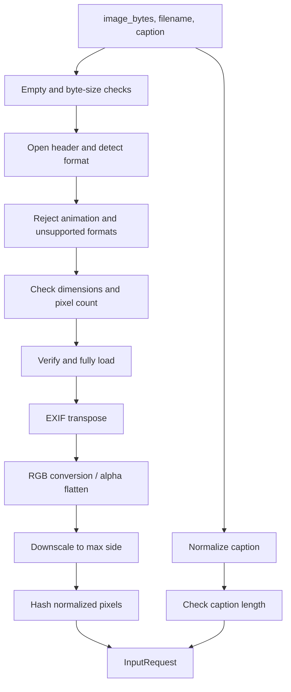

# 01 — Input Pipeline

## Multimodal Out-of-Context Misinformation Detection Using Retrieval-Augmented Generation (RAG)

**Document status:** Accepted — implementation contract for Phase 1  
**Document type:** Component specification  
**Depends on:** `00_PROJECT_OVERVIEW.md`  
**Last updated:** 2026-10-20

---

## 1. Purpose

The input pipeline converts raw user input — an uploaded image plus a caption or claim — into a single validated, immutable request object that every downstream component consumes.

It is the only place where user input is decoded, checked, and normalized. Downstream modules must not re-implement validation or accept raw uploads directly.

The pipeline has four responsibilities:

1. Reject invalid, corrupt, unsupported, or oversized input with a clear, user-safe error.
2. Decode the image deterministically and convert it to RGB.
3. Normalize the caption without destroying meaning.
4. Produce an `InputRequest` with stable dimensions, hashes, warnings, and metadata.

---

## 2. Execution and deployment context

The application runs **locally** on a single machine as a Streamlit app. This has concrete consequences for this module:

| Constraint | Implementation |
|---|---|
| No hosted inference service | All input processing happens in the local Python process. |
| No persistence | Images and captions are held **in memory only**. Nothing is written to `data/`, a temp directory, or a cache. |
| No network calls | The input pipeline never fetches URLs, calls APIs, or downloads models. |
| No telemetry | No analytics, remote logging, or usage reporting. |
| Single user | No multi-tenant isolation or authentication is required. |
| Reproducibility | The same bytes and caption must produce the same request object on the same dependency versions. |

The later retrieval and LLM stages may use network access depending on configuration. That is outside this document. **This module is fully offline.**

### 2.1 In-memory lifecycle

- `image_bytes` comes from the Streamlit uploader (`UploadedFile.getvalue()`).
- Decoded pixels live in a `PIL.Image.Image` owned by the `InputRequest`.
- No file handles remain open after `build_input_request` returns.
- When the Streamlit session ends or reruns, the object is garbage-collected.
- Images are not cached across sessions, so the user must re-upload after an app restart.

---

## 3. Scope and boundaries

### 3.1 In scope

- Byte-size, format, dimension, decode, and truncation validation.
- EXIF orientation handling.
- RGB conversion and alpha flattening.
- Aspect-preserving downscaling to a bounded preview size.
- Caption Unicode and whitespace normalization.
- Caption length validation.
- Structured errors and non-fatal warnings.
- A frozen request schema shared with CLIP, retrieval, RAG, and reporting.

### 3.2 Out of scope

- Resizing or cropping to the CLIP input size.
- CLIP normalization (mean/std) or tensor conversion.
- Image authenticity, manipulation, or forensic analysis.
- OCR or text extraction from the image.
- Claim extraction, spelling correction, or translation.
- Language detection beyond documenting English-centric behavior.
- Storing uploads, building a cache, or writing temporary files.
- Batch or multi-image requests.
- UI layout and Streamlit rendering.

### 3.3 Responsibility split

| Step | Owner |
|---|---|
| Read upload bytes | UI / Streamlit |
| Byte-size, format, decode, dimension checks | Input pipeline |
| EXIF transpose | Input pipeline |
| Mode conversion to RGB, alpha flattening | Input pipeline |
| Downscale longest side to ≤ 2048 px | Input pipeline |
| Unicode/whitespace normalization | Input pipeline |
| Caption length validation | Input pipeline |
| Resize to 224 px, center crop, tensor conversion | CLIP processor |
| CLIP mean/std normalization | CLIP processor |
| Displaying errors and warnings | UI |
| Deciding whether to continue after a warning | UI |

**Critical rule:** the input pipeline returns a PIL image, never a tensor. The CLIP processor performs all model-specific preprocessing. This keeps the input contract independent of the CLIP model version.

---

## 4. Accepted inputs

| Property | Accepted value |
|---|---|
| Image formats | **JPEG** and **PNG** only |
| Format detection | Decoded content via Pillow (`img.format`), not filename or client MIME type |
| Color modes | Any Pillow-decodable mode; converted to RGB |
| Alpha/transparency | Flattened onto white |
| Animation | Rejected (animated GIF, APNG, multi-frame files) |
| Caption | A single string, 3–1000 characters after normalization |
| Language | English-centric for v1; not enforced |

A file named `photo.jpg` that actually contains PNG data is accepted **as PNG**. The filename is retained for display only and is never used to determine format.

Files named `.jpg` or `.png` that contain non-image data are rejected with `UNSUPPORTED_FORMAT`.

---

## 5. Validation rules

### 5.1 Limits

| Rule | Value | Error code |
|---|---|---|
| Empty upload | 0 bytes | `EMPTY_FILE` |
| Maximum upload size | 10 MB (10,485,760 bytes) | `IMAGE_TOO_LARGE` |
| Maximum pixel count | 40,000,000 pixels | `IMAGE_TOO_MANY_PIXELS` |
| Minimum side length | 32 px (both width and height) | `IMAGE_TOO_SMALL` |
| Maximum stored side | 2048 px (longest side, aspect preserved) | warning `IMAGE_DOWNSCALED` |
| Supported formats | JPEG, PNG | `UNSUPPORTED_FORMAT` |
| Multi-frame images | Not supported | `ANIMATED_IMAGE` |
| Decode/load failure | — | `CORRUPT_IMAGE` |
| Caption minimum | 3 characters after normalization | `CAPTION_TOO_SHORT` |
| Caption maximum | 1000 characters after normalization | `CAPTION_TOO_LONG` |
| Caption content | At least one non-whitespace character | `CAPTION_EMPTY` |

Character counts are Unicode code points (`len()` after normalization), not grapheme clusters or bytes.

### 5.2 Validation order

Image validation runs before caption validation. If both are invalid, the image error is reported first. This gives the user one clear problem to fix per attempt and avoids decoding work for an invalid caption only after a costly image decode.



### 5.3 Validation notes

- **Byte-size check first:** reject > 10 MB before attempting to decode, so a malicious or accidental large upload does not consume decode memory.
- **Pixel-count check before full decode:** `Image.open` reads the header lazily. Reject > 40 MP using the header dimensions before `load()`.
- **Pillow bomb guard:** catch `PIL.Image.DecompressionBombError` and `DecompressionBombWarning` and map them to `IMAGE_TOO_MANY_PIXELS`. The application's 40 MP limit is stricter than Pillow's default.
- **Truncated images:** `ImageFile.LOAD_TRUNCATED_IMAGES` must remain `False`. A truncated JPEG that opens but fails to `load()` is `CORRUPT_IMAGE`.
- **`verify()` then reopen:** `Image.verify()` invalidates the image object. Reopen from the same in-memory bytes before loading pixels.
- **No partial result:** if any check fails, no `InputRequest` is returned.
- **Programmer errors are not user errors:** passing `None` or a non-bytes object raises `TypeError`. The UI must ensure it passes bytes.

---

## 6. Image preprocessing

### 6.1 Decode and verify

1. Wrap bytes in `io.BytesIO`. Never write to disk.
2. Call `Image.open(buffer)` inside a `try` block.
3. Map `UnidentifiedImageError` to `UNSUPPORTED_FORMAT`.
4. Reject multi-frame images:
   ```python
   if getattr(img, "n_frames", 1) > 1:
       raise InputValidationError(InputErrorCode.ANIMATED_IMAGE, ...)
   ```
5. Check `img.format in {"JPEG", "PNG"}`.
6. Read `width` and `height` from the header and apply the dimension/pixel checks.
7. Call `img.verify()`, reopen, then call `img.load()` with truncated loading disabled.

### 6.2 Orientation

Apply `PIL.ImageOps.exif_transpose` before any resize or color conversion.

- Read the orientation tag (`0x0112`) before transposing.
- If the orientation is present and not `1`, emit warning `EXIF_ROTATED`.
- After transposition, the image's pixel dimensions reflect the visual orientation.
- EXIF metadata is **not** carried into the request. This avoids leaking GPS, device, or timestamp data and keeps the request small.

### 6.3 Color handling and ICC policy

**ICC profiles are ignored for v1.** This is an explicit, documented limitation, not an oversight:

- No `ImageCms.profileToProfile` call is made.
- No `icc_profile` argument is passed when converting or saving.
- `convert("RGB")` uses Pillow's default channel conversion.
- Wide-gamut (Adobe RGB, Display P3) and CMYK images may therefore appear differently than in a color-managed viewer.
- The same policy is applied consistently to every input, so CLIP features remain internally consistent across requests.

**Conversion rules:**

| Source mode | Handling |
|---|---|
| `RGB` | Unchanged |
| `RGBA`, `LA` | Composite over a white background, emit `ALPHA_FLATTENED` |
| `P` with `transparency` in `info` | Convert to RGBA, composite over white, emit `ALPHA_FLATTENED` |
| `P` without transparency | `convert("RGB")` |
| `L`, `CMYK`, `YCbCr`, other | `convert("RGB")` |
| 16-bit / high bit depth | Reduced to 8-bit RGB by Pillow |

White is `(255, 255, 255)`. The background is deterministic and documented so training and inference use the same rule.

### 6.4 Downscaling

Downscale only when `max(width, height) > 2048`:

```python
scale = 2048 / max(width, height)
new_width = max(1, round(width * scale))
new_height = max(1, round(height * scale))
image = image.resize((new_width, new_height), Image.Resampling.LANCZOS)
```

- Aspect ratio is preserved.
- The longest side is ≤ 2048 px after resizing.
- **No cropping** is performed. Crop decisions belong to the CLIP processor.
- Emit warning `IMAGE_DOWNSCALED` with the original and final dimensions.
- The original image resolution is not retained in memory; only the metadata fields `original_width` and `original_height` are kept.

The 2048 px bound is a preview/processing bound, not a model input size. CLIP still receives its own 224 px resize and center crop.

### 6.5 Content hash

Compute a SHA-256 over the **normalized** pixels, not the uploaded file:

```python
digest = hashlib.sha256()
digest.update(f"{width}x{height}:RGB:".encode("ascii"))
digest.update(image.tobytes())
sha256 = digest.hexdigest()
```

Consequences:

- The same decoded image uploaded as JPEG or PNG with identical pixels produces the same hash.
- Different compression, EXIF orientation, or metadata does not change the hash if the normalized pixels match.
- The hash is **not** perceptual; near-duplicate detection is out of scope.
- The hash is safe to log and can identify a request without logging the image.

### 6.6 Filename and metadata

- `filename` is sanitized to its basename (`Path(filename).name`), control characters removed, and truncated to 255 characters.
- An empty filename becomes `"upload"`.
- The filename is for display only. It is never used for format detection or filesystem access.
- `mime_type` comes from `img.get_format_mimetype()` with a fallback mapping (`JPEG` → `image/jpeg`, `PNG` → `image/png`).

---

## 7. Text preprocessing

### 7.1 Normalization

The pipeline preserves the original text and computes a normalized version:

1. Replace `\r\n` and `\r` with `\n`.
2. Apply Unicode **NFKC** normalization. This unifies full-width characters, ligatures, and compatibility forms for consistent retrieval.
3. Remove zero-width space (`U+200B`), byte-order mark (`U+FEFF`), and soft hyphen (`U+00AD`).
4. Remove control characters (`Unicode category Cc`) except `\n`, `\r`, and `\t`; convert those three to a space.
5. Collapse every run of Unicode whitespace to a single space.
6. Strip leading and trailing spaces.

**Zero-width joiner (`U+200D`) and non-joiner (`U+200C`) are preserved** because they carry meaning in emoji sequences and some scripts. Removing them would corrupt legitimate text.

### 7.2 Length rules

Length is checked **after** normalization:

| Condition | Result |
|---|---|
| `len == 0` | `CAPTION_EMPTY` |
| `1 <= len < 3` | `CAPTION_TOO_SHORT` |
| `3 <= len <= 1000` | accepted |
| `len > 1000` | `CAPTION_TOO_LONG` |

The normalized text is used for retrieval, CLIP text encoding, and any downstream comparison. The raw text is retained for display so the user sees exactly what they typed.

### 7.3 Warning

If `caption_normalized != caption_raw`, emit `TEXT_NORMALIZED`. This covers whitespace cleanup, NFKC changes, and removed zero-width characters.

### 7.4 Important CLIP caveat

The 1000-character limit applies to display and retrieval. The CLIP text encoder has a **77-token context window**. A caption longer than 77 tokens is truncated by the CLIP processor before encoding, so the classifier sees only the beginning of the text.

This is intentional and documented:

- The full normalized caption is used for evidence retrieval.
- The classifier's text embedding may represent only the first 77 tokens.
- The UI should state this limitation when the caption is long.
- The input pipeline does not truncate the caption itself; that is a model-specific concern.

---

## 8. Request schema

### 8.1 Dataclasses

```python
from dataclasses import dataclass
from datetime import datetime
from enum import Enum
from PIL import Image


class InputErrorCode(str, Enum):
    EMPTY_FILE = "EMPTY_FILE"
    IMAGE_TOO_LARGE = "IMAGE_TOO_LARGE"
    IMAGE_TOO_MANY_PIXELS = "IMAGE_TOO_MANY_PIXELS"
    IMAGE_TOO_SMALL = "IMAGE_TOO_SMALL"
    UNSUPPORTED_FORMAT = "UNSUPPORTED_FORMAT"
    ANIMATED_IMAGE = "ANIMATED_IMAGE"
    CORRUPT_IMAGE = "CORRUPT_IMAGE"
    CAPTION_EMPTY = "CAPTION_EMPTY"
    CAPTION_TOO_SHORT = "CAPTION_TOO_SHORT"
    CAPTION_TOO_LONG = "CAPTION_TOO_LONG"


class WarningCode(str, Enum):
    IMAGE_DOWNSCALED = "IMAGE_DOWNSCALED"
    EXIF_ROTATED = "EXIF_ROTATED"
    ALPHA_FLATTENED = "ALPHA_FLATTENED"
    TEXT_NORMALIZED = "TEXT_NORMALIZED"


@dataclass(frozen=True)
class ImageInput:
    image: Image.Image          # RGB, longest side <= 2048
    format: str                 # "JPEG" or "PNG"
    mime_type: str
    filename: str               # sanitized basename, display only
    width: int                  # final width after transpose/resize
    height: int                 # final height after transpose/resize
    original_width: int         # after EXIF transpose, before resize
    original_height: int        # after EXIF transpose, before resize
    size_bytes: int             # original upload size
    sha256: str                 # hash of normalized pixels


@dataclass(frozen=True)
class InputRequest:
    request_id: str             # uuid4 string
    image: ImageInput
    caption_raw: str            # exactly as submitted
    caption: str                # normalized
    warnings: tuple[WarningCode, ...]
    created_at: datetime        # timezone-aware UTC
    schema_version: int = 1
```

### 8.2 Invariants

Every returned `InputRequest` satisfies:

1. `image.image.mode == "RGB"`.
2. `max(image.width, image.height) <= 2048`.
3. `image.width >= 32` and `image.height >= 32`.
4. `3 <= len(caption) <= 1000`.
5. `caption == caption.strip()`.
6. `image.sha256` is 64 lowercase hexadecimal characters.
7. `request_id` is a valid UUID4 string.
8. `created_at.tzinfo is not None`.
9. No file handle, `BytesIO`, or upload object is retained.
10. `warnings` contains no duplicates and preserves emission order.

### 8.3 Entry point

```python
def build_input_request(
    image_bytes: bytes,
    filename: str,
    caption: str,
    config: InputConfig = DEFAULT_INPUT_CONFIG,
) -> InputRequest:
    """Validate and normalize one image-caption pair.

    Raises:
        InputValidationError: for any user-correctable input problem.
        TypeError: if arguments have the wrong type.
    """
```

`build_input_request` is the only public entry point for raw input. It is pure with respect to the filesystem and network: no writes, no reads, no HTTP.

Frozen dataclasses prevent reassignment of fields. The contained `PIL.Image.Image` is mutable by nature; callers must treat it as read-only and copy it before drawing or modifying.

---

## 9. Errors and warnings

### 9.1 Error type

```python
class InputValidationError(ValueError):
    code: InputErrorCode
    field: str          # "image" or "caption"
    message: str        # safe to display to the user
```

Rules:

- `str(exc)` returns `message` only.
- Never include local paths, stack traces, raw bytes, or library internals.
- Raise with `from None` at the public boundary to avoid chaining internal exceptions into the UI.
- The UI must not display `exc.__traceback__` or `repr(exc)`.

### 9.2 Error codes and default messages

Messages are generated from the active `InputConfig`, so the displayed numbers match the configured limits.

| Code | Field | Default message |
|---|---|---|
| `EMPTY_FILE` | image | "Please upload an image file." |
| `IMAGE_TOO_LARGE` | image | "The image is larger than 10 MB. Please upload a smaller file." |
| `IMAGE_TOO_MANY_PIXELS` | image | "The image resolution is too large. Please upload an image under 40 megapixels." |
| `IMAGE_TOO_SMALL` | image | "The image is too small. Minimum dimensions are 32 × 32 pixels." |
| `UNSUPPORTED_FORMAT` | image | "Unsupported image format. Please upload a JPEG or PNG." |
| `ANIMATED_IMAGE` | image | "Animated images are not supported. Please upload a single still image." |
| `CORRUPT_IMAGE` | image | "The image could not be read. It may be corrupted." |
| `CAPTION_EMPTY` | caption | "Please enter a caption or claim." |
| `CAPTION_TOO_SHORT` | caption | "The caption must be at least 3 characters." |
| `CAPTION_TOO_LONG` | caption | "The caption must be 1,000 characters or fewer." |

Unsupported format versus corrupt image:

- `UnidentifiedImageError` at open time → `UNSUPPORTED_FORMAT`.
- A recognized header followed by a decode/load failure → `CORRUPT_IMAGE`.
- A file with a valid header but an unsupported format (e.g., GIF, WebP) → `UNSUPPORTED_FORMAT`.

### 9.3 Warning codes

| Code | Meaning | UI treatment |
|---|---|---|
| `IMAGE_DOWNSCALED` | Longest side exceeded 2048 px and was resized | Informational notice |
| `EXIF_ROTATED` | Image was rotated according to EXIF orientation | Informational notice |
| `ALPHA_FLATTENED` | Transparency was replaced with white | Informational notice |
| `TEXT_NORMALIZED` | Caption whitespace/Unicode was normalized | Informational notice |

Warnings do not block processing. They are informational and should be shown near the input preview, not in the main assessment.

### 9.4 UI behavior

```python
try:
    request = build_input_request(
        image_bytes=uploaded.getvalue(),
        filename=uploaded.name,
        caption=caption,
    )
except InputValidationError as exc:
    st.error(exc.message)
    st.stop()
```

- Show exactly one error at a time.
- Do not continue to CLIP, retrieval, or the LLM after an input error.
- Warnings are shown with `st.info` or `st.warning` and do not prevent analysis.
- The UI must not catch `TypeError` and present it as a user error; that indicates a programming bug.

---

## 10. Configuration

Configuration is a frozen dataclass so tests can override individual limits without global state.

```python
from dataclasses import dataclass


@dataclass(frozen=True)
class InputConfig:
    max_upload_bytes: int = 10 * 1024 * 1024
    max_pixels: int = 40_000_000
    min_side: int = 32
    max_side: int = 2048
    caption_min_chars: int = 3
    caption_max_chars: int = 1000
    accepted_formats: frozenset[str] = frozenset({"JPEG", "PNG"})


DEFAULT_INPUT_CONFIG = InputConfig()
```

Tests use `dataclasses.replace(DEFAULT_INPUT_CONFIG, max_pixels=100)` or `max_side=64` to exercise limits without allocating enormous images.

`InputConfig` lives in `src/input_pipeline/input_schema.py`. Shared environment settings (model identifiers, index paths, API keys) belong in `src/utils/config.py` and are not part of this contract.

---

## 11. Module layout

```text
src/input_pipeline/
├── __init__.py               # public exports
├── input_schema.py           # dataclasses, enums, InputConfig, messages
├── image_preprocessing.py    # decode -> validate -> RGB -> downscale -> hash
├── text_preprocessing.py     # normalize -> validate
└── pipeline.py               # build_input_request orchestration
```

Public exports from `src/input_pipeline/__init__.py`:

```python
from .pipeline import build_input_request
from .input_schema import (
    InputConfig,
    InputErrorCode,
    InputRequest,
    InputValidationError,
    ImageInput,
    WarningCode,
    DEFAULT_INPUT_CONFIG,
)
```

Dependency rules:

- `image_preprocessing.py` imports Pillow and the schema. It does not import Streamlit.
- `text_preprocessing.py` imports only the standard library and the schema.
- `pipeline.py` imports both, plus `uuid` and `datetime`.
- No module in `src/input_pipeline/` imports `torch`, `transformers`, `openai`, `requests`, or `streamlit`.

---

## 12. Integration contract

### 12.1 Streamlit

```python
uploaded = st.file_uploader("Upload an image", type=["jpg", "jpeg", "png"])
caption = st.text_area("Caption or claim")

if uploaded is not None and caption:
    request = build_input_request(
        uploaded.getvalue(),
        uploaded.name,
        caption,
    )
```

Streamlit's uploader has its own server-side size limit. For a local app, keep Streamlit's limit at or above 10 MB and rely on `build_input_request` for the authoritative check. If Streamlit rejects a file earlier, show its message rather than a misleading input error.

### 12.2 CLIP

```python
inputs = processor(
    images=request.image.image,
    text=request.caption,
    return_tensors="pt",
    truncation=True,
    max_length=77,
)
```

- Pass the PIL image directly. Do not convert to a tensor in the input pipeline.
- Let the processor perform resize, center crop, normalization, and tokenization.
- The same CLIP model identifier and processor version must be used for training and inference.
- Long captions are truncated to 77 tokens by the processor; the classifier should not be treated as having read the entire caption.

### 12.3 Retrieval

Use `request.caption` (the normalized text) as the query seed. The raw text is for display only. Retrieval should not re-normalize the text or strip characters differently, or query behavior will diverge from the validated input.

### 12.4 Reporting

The report can display:

- `request.image.filename`, `width`, `height`, `format`.
- `request.image.sha256` as a content identifier.
- `request.caption_raw` as the user's original wording.
- Input warnings and the ICC limitation.

The report must not imply that the input pipeline verified the image's authenticity.

---

## 13. Logging and privacy

Log only non-sensitive metadata at `INFO`:

```text
input.accepted request_id=<uuid> sha256=<first 12 chars> size=<bytes>
               dimensions=<w>x<h> caption_chars=<n> warnings=<codes>
```

Never log:

- Raw caption text.
- Image bytes or base64.
- Filenames containing personal information (log only if necessary; prefer omitting).
- Full filesystem paths.

Errors may be logged at `WARNING` with the error code and request context, but not with the raw input.

Because processing is in-memory, there is no retention to manage. If logging is configured to a file locally, that is the operator's responsibility; the default should be console output.

---

## 14. Test plan

Tests live in `tests/test_input_pipeline.py` and run with `pytest`. They require no network, no CLIP model, no GPU, and no downloaded data.

### 14.1 Test cases

| # | Case | Expected result |
|---|---|---|
| 1 | Valid JPEG | Accepted; RGB; dimensions unchanged |
| 2 | Valid PNG | Accepted; RGB |
| 3 | PNG with alpha | RGB; transparent pixel becomes white; `ALPHA_FLATTENED` |
| 4 | Palette PNG with transparency | RGB; flattened; warning |
| 5 | Grayscale PNG | RGB |
| 6 | EXIF orientation 6 JPEG | Correctly transposed; `EXIF_ROTATED` |
| 7 | PNG bytes named `.jpg` | Accepted as PNG; `format == "PNG"` |
| 8 | Text file renamed `.jpg` | `UNSUPPORTED_FORMAT` |
| 9 | GIF bytes | `UNSUPPORTED_FORMAT` |
| 10 | Animated PNG/GIF | `ANIMATED_IMAGE` |
| 11 | Truncated JPEG | `CORRUPT_IMAGE` |
| 12 | Empty bytes | `EMPTY_FILE` |
| 13 | 10 MB + 1 byte | `IMAGE_TOO_LARGE`; no decode attempted |
| 14 | Pixels > configured max (small override) | `IMAGE_TOO_MANY_PIXELS` |
| 15 | Side < 32 px | `IMAGE_TOO_SMALL` |
| 16 | Longest side > 2048 px | Downscaled; aspect ratio preserved; `IMAGE_DOWNSCALED` |
| 17 | Downscale rounding edge case | Longest side is exactly ≤ 2048 |
| 18 | Caption whitespace only | `CAPTION_EMPTY` |
| 19 | 2-character caption | `CAPTION_TOO_SHORT` |
| 20 | 1001-character caption | `CAPTION_TOO_LONG` |
| 21 | Caption with `\r\n`, tabs, multiple spaces | Normalized to single spaces; `TEXT_NORMALIZED` |
| 22 | NFKC ligature (`fi`) | Normalized to `fi` |
| 23 | Zero-width space and BOM | Removed |
| 24 | Emoji with ZWJ | ZWJ preserved |
| 25 | Same input twice | Identical SHA-256, dimensions, caption |
| 26 | Different compression, same pixels | Identical SHA-256 |
| 27 | Error message content | No paths, stack traces, or raw bytes |
| 28 | No filesystem writes | Working directory remains empty |
| 29 | No network access | Socket connections blocked; test still passes |
| 30 | Config override | Custom limits honored in validation and messages |

### 14.2 Fixtures

Fixtures are generated in memory with Pillow; no binary image files are committed.

```python
def make_jpeg(size=(100, 100), color=(255, 0, 0), exif_orientation=None) -> bytes:
    ...

def make_png(size=(100, 100), mode="RGB", transparency=False) -> bytes:
    ...

def make_gif() -> bytes:
    ...
```

Use `io.BytesIO` for all image construction. For tests of large pixel counts, override `max_pixels` and use a small image rather than allocating a 40 MP buffer. For the 10 MB test, use `b"\x00" * (10 * 1024 * 1024 + 1)`; the byte-size check runs before decoding.

### 14.3 Offline and no-disk assertions

- An autouse fixture replaces `socket.socket` with a stub that raises on `connect`, proving the pipeline never opens a network connection.
- A test changes the working directory to `tmp_path`, calls `build_input_request`, and asserts that `tmp_path` is still empty.
- Import-time checks assert that `torch`, `transformers`, `streamlit`, and `requests` are not imported by any input pipeline module. A simple `sys.modules` check after importing the package is sufficient.

---

## 15. Acceptance criteria

Phase 1 is complete when:

1. `build_input_request` is implemented and is the only public way to create an `InputRequest`.
2. All invariants in §8.2 hold for every successful call.
3. Every error code and warning code in §9 is covered by at least one test.
4. The full test suite passes offline, with no model downloads and no network access.
5. No files are written during input processing.
6. `src/input_pipeline/` does not import CLIP, torch, Streamlit, or any HTTP client.
7. The UI renders every error code as a human-readable message and never displays a traceback.
8. The same bytes and caption produce an identical request (except `request_id` and `created_at`) across repeated runs on the same dependency versions.
9. The ICC limitation and the CLIP 77-token limitation are documented in the UI or its help text.
10. `requirements.txt` pins Pillow to a tested version.

---

## 16. Known limitations

| Limitation | Consequence | Mitigation |
|---|---|---|
| ICC profiles ignored | Wide-gamut and CMYK images may look different from a color-managed viewer | Documented; consistent across all inputs |
| No color management | Colors are approximate, especially for print-oriented images | Accepted for v1; revisit if evidence requires exact color |
| CLIP 77-token limit | Long captions are truncated for the classifier | Full caption used for retrieval; UI note |
| English-centric | Tokenization and retrieval may underperform on other languages | Documented; not enforced |
| In-memory only | Uploads disappear on restart; no audit trail | Re-upload; add persistence only if required |
| 10 MB / 40 MP limits | Some legitimate high-resolution photos are rejected | Raise limits deliberately after measuring memory |
| Hash is not perceptual | Near-duplicate images produce different hashes | Out of scope for input validation |
| EXIF metadata dropped | Capture date, camera, and GPS are unavailable downstream | Privacy benefit; retrieve context externally |
| 8-bit RGB only | 16-bit and HDR inputs lose precision | Acceptable for CLIP; documented |
| Single image only | No multi-image claims | Out of scope for the first prototype |
| Local single-user | No hardening against hostile multi-tenant uploads | Decompression-bomb and size guards only |

---

## 17. Resolved decisions

The following decisions were agreed before implementation and are binding for v1:

| Decision | Choice | Rationale |
|---|---|---|
| ICC profile handling | **Ignore for v1** | Simplicity and consistency; documented as a limitation in §6.3 and §16 |
| Maximum stored side | **2048 px** | Sufficient for Streamlit preview and downstream processing; keeps memory bounded |
| Image persistence | **In-memory only** | Local app; no writes to `data/`, temp directories, or caches |
| Caption minimum | **3 characters** | Rejects accidental single-character input without blocking short claims |
| Caption maximum | **1000 characters** | Covers realistic captions and claims while keeping retrieval and UI manageable |
| Upload size | **10 MB** | Practical for local uploads; checked before decode |
| Pixel limit | **40 MP** | Allows high-resolution phone/camera images while guarding memory |
| Accepted formats | **JPEG and PNG** | Matches the project overview; avoids format-specific edge cases |
| Transparency | **Flatten onto white** | Deterministic and matches common preview behavior |

---

## 18. Next document

The next specification is `02_CLIP_FEATURE_EXTRACTION.md`, covering:

- The exact CLIP model identifier and processor version.
- Image and text feature dimensions.
- Tokenization and truncation behavior.
- Batch versus single-item inference.
- Device selection (CPU/GPU) and fallback.
- Feature caching and compatibility with NewsCLIPpings precomputed embeddings.
- Numerical checks for finite embeddings and deterministic shapes.
- Tests for model loading, preprocessing parity, and failure handling.

Until that document exists, implementation should treat this input contract as fixed. Changes to limits, error codes, or the request schema require updating this document and the corresponding tests first.
