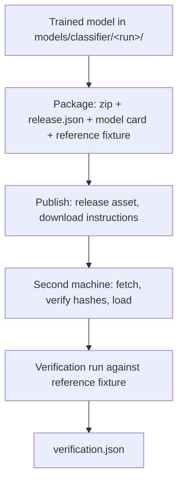

# 03 - Classifier Training and Model Checkpoints

## Multimodal Out-of-Context Misinformation Detection Using Retrieval-Augmented Generation (RAG)

**Document status:** Accepted - implementation contract for Phases 4 and 5  
**Document type:** Component specification  
**Depends on:** `../00_PROJECT_OVERVIEW.md`, `02_DATASET_PREPARATION.md`, `01_CLIP_FEATURE_EXTRACTION.md`  
**Consolidated from:** `04_CLASSIFIER_TRAINING.md` and `05_MODEL_CHECKPOINTS.md`  
**Last updated:** 2026-10-21

---

## 1. Purpose and boundary

This document defines how the project trains a **classification head on frozen CLIP features**, selects it using validation data, evaluates it once on a held-out test split, and produces the training artifacts.

The input is document 01's cached features and document 02's manifests. The output is a set of training artifacts that document 03 versions, distributes, and verifies.

### 1.1 What the classifier does and does not measure

The classifier estimates whether an image–caption pair **resembles the mismatched or matched examples in its training distribution**. That is a statement about similarity within a learned distribution, not a statement about the world.

| It measures | It does not measure |
|---|---|
| Whether the pair resembles a mismatched training example | Whether the claim is factually true |
| Whether the caption and image are semantically incongruent | Whether the image is authentic or unedited |
| Whether the pairing is anomalous for this dataset | Whether the event happened, where, or when |
| A calibrated class probability under this model and calibration procedure | The probability that a news claim is false |

Document 00 §8 states the rule this document exists to enforce: a mismatch prediction is not proof that a claim is false, and a matched prediction is not proof that it is true. The classifier output is one signal in a system that also retrieves external evidence. The UI presents them separately.

### 1.2 Explicit non-promises

| Non-promise | Why it matters |
|---|---|
| **A probability of falsity** | The output is a class probability under the trained model. It is not a truth judgment. |
| **A better result from a bigger head** | Family A is a deliberate reference point. A larger input dimension does not guarantee better generalization. |
| **A leakage-free evaluation** | The official configuration may carry leakage, which document 02 measures. The exposure fields travel with every metric. |
| **Complete reproducibility from the seed alone** | Seeds quantify training variability only. Validation-selection noise, data bias, and leakage are separate sources of uncertainty. |
| **A calibrated probability that is well calibrated** | Temperature scaling *can* improve calibration; it does not guarantee it. Calibration quality is measured on the test set. |
| **Bit-identical predictions across machines** | Verification uses a stated numerical tolerance, not bit-for-bit equality. |

---

## 2. Purpose and boundary

Document 03 defined **what a trained model contains**. This document defines **how that model becomes a versioned, distributable, verifiable artifact that another computer can load and reproduce**.

The scope is the artifact lifecycle:



| Concern | Owner |
|---|---|
| Model architecture, hyperparameters, selection, metrics | Document 03 |
| **Versioning, packaging, distribution, verification** | **This document** |
| Runtime inference behaviour on a user input | Document 04 |
| Feature extraction and the encoder | Document 01 |
| Training data, manifests, leakage audit | Document 02 |

### 2.1 Explicit non-promises

| Non-promise | Why it matters |
|---|---|
| **A promised archive size** | The size is measured at packaging time and recorded. No fixed figure is claimed in advance. |
| **A proven compatibility range** | A range is only as proven as the versions actually tested. The exact environment ships with the release. |
| **Bit-identical predictions across machines** | Verification uses a stated numerical tolerance. Floating-point results legitimately differ across PyTorch builds and hardware. |
| **A redistributable encoder** | The CLIP weights are referenced by a pinned revision, not shipped, unless their terms permit it. |
| **A score that proves a claim is false** | The model card and the UI both state that a calibrated probability is the model's class estimate, not a truth judgment. |

---

## 3. Input contract

### 3.1 What is inherited

| From | Contract |
|---|---|
| Document 01 §7 | Two aligned vectors per sample: `image_embedding` and `text_embedding`, each `(512,)`, float32, finite, L2-normalized |
| Document 01 §14 | Features cached per configuration, validated by per-row image and caption hashes |
| Document 01 §4.3 | `EncoderInfo` provenance: model ID, pinned revision, weights hash, library versions, preprocessing and extractor versions |
| Document 02 §12 | Manifests: one JSONL per configuration and split, with stable `sample_id`, hashes, and labels |
| Document 02 §6 | Labels `MATCHED`, `MISMATCHED`, `UNKNOWN`, with source labels retained |
| Document 02 §6.4 | Per-split class counts and the imbalance ratio |
| Document 02 §11.2.1 | The four leakage exposure fields |

### 3.2 What this document decides

| Decision | Owner |
|---|---|
| Head input representation and architecture | **This document** |
| Loss, class weighting, optimizer, hyperparameters | **This document** |
| Selection metric and protocol | **This document** |
| Operating threshold rule | **This document** |
| Calibration method | **This document** |
| Seed policy | **This document** |

### 3.3 What this document does not do

- It does not modify, rebuild, or repair document 02's manifests. A missing feature is a raised error, never a regeneration.
- It does not fine-tune CLIP. The encoder is frozen and its weights are not part of the checkpoint.
- It does not distribute the model. Document 03 owns versioning, checksums, and second-machine loading.
- It does not train on VERITE's test examples, and it does not tune on them.

---

## 4. Head input representations

### 4.1 Candidate families

All candidates are **pre-registered**. The selection protocol in §9 is applied identically to every one of them.

| Candidate | Input | Dim | Parameters | Head | Purpose |
|---|---|---|---|---|---|
| **A** | Cosine similarity `⟨v_i, v_t⟩` | 1 | 4 | Logistic regression on 1 feature | The improvement reference — the raw CLIP signal with no learning beyond a threshold |
| **B** | `[v_i ; v_t]` | 1024 | 2,050 | Linear | Standard concatenation baseline |
| **C** | `[v_i ; v_t ; v_i ⊙ v_t ; \|v_i − v_t\|]` | 2048 | 4,098 | Linear | Linear head with explicit interaction terms |
| **D-B** | B features | 1024 | 262,914 at h=256 | MLP | Nonlinearity over the concatenation |
| **D-C** | C features | 2048 | 525,058 at h=256 | MLP | Nonlinearity over the interaction features |

`v_i` and `v_t` are the normalized 512-d image and document 01's L2-normalized embeddings. Parameter counts include all trainable weights and biases: `Linear(in, out)` contributes `in × out + out`, and a family D model is `Linear(in, h) + Linear(h, 2)`.

| Candidate | Breakdown | Total |
|---|---|---|
| A | `1 × 2 + 2` | 4 |
| B | `1024 × 2 + 2` | 2,050 |
| C | `2048 × 2 + 2` | 4,098 |
| D-B | `1024 × 256 + 256` + `256 × 2 + 2` | 262,914 |
| D-C | `2048 × 256 + 256` + `256 × 2 + 2` | 525,058 |

**D-B and D-C are separate candidates, not one.** They differ in input dimension, in parameter count, and in what they can represent. Treating them as a single family with a "B or C" choice would make the tie-break rule ambiguous.

### 4.2 Family C feature construction

```text
z = [ v_i ; v_t ; v_i ⊙ v_t ; |v_i − v_t| ]        z ∈ ℝ²⁰⁴⁸
```

| Block | Size | Meaning |
|---|---|---|
| `v_i` | 512 | Image embedding |
| `v_t` | 512 | Text embedding |
| `v_i ⊙ v_t` | 512 | Element-wise product — a soft interaction signal |
| `\|v_i − v_t\|` | 512 | Element-wise absolute difference — distance-like signal |

The construction is fixed and computed in float32 before it reaches the head. No additional normalization is applied to `z`; the raw concatenation of unit vectors and their interactions is the input, and the head's first layer learns the scaling it needs.

### 4.3 Architecture specification for family D

```text
input (1024 or 2048)
  → Linear(hidden)      # hidden ∈ {128, 256}
  → ReLU
  → Dropout(p)          # p ∈ {0.1, 0.3}
  → Linear(2)           # logits
```

| Property | Value |
|---|---|
| Activation | ReLU, applied once |
| Output | **Logits**, shape `(batch, 2)`. Never probabilities |
| Initialization | PyTorch defaults for `Linear`, applied under a seeded generator |
| Regularization | Dropout on the hidden activation only; weight decay via the optimizer |
| Hidden width | 128 or 256, part of the tuning grid |
| Bias | Enabled on both layers, the PyTorch default |

### 4.4 Linear head specification (families A, B, C)

```text
input (1, 1024, or 2048) → Linear(2)   # logits
```

A single affine map from the input features to two logits. For family A this is logistic regression on the cosine similarity, which is the reference point the other families must beat.

### 4.5 No assumption that complexity helps

Family A is retained in the candidate set even though a trained head is expected to beat it, because it quantifies **how much the learned head adds over raw CLIP similarity**. That quantity is the number a reviewer asks for first, and it is only available if the baseline is trained and evaluated under the identical protocol.

Family C's larger input does not guarantee better generalization. The interaction blocks add 1,024 parameters of capacity to a linear map over a fixed 512-d space; whether that helps is an empirical question answered by the selection protocol, not an assumption.

---

## 5. Training data pipeline

### 5.1 Manifest-to-cache alignment

Every training run begins by verifying that the cached features and the manifest describe the same samples in the same order.

| Check | Assertion |
|---|---|
| Row count | `len(ids) == len(manifest_records) == len(image_embeddings) == len(text_embeddings)` |
| Sample identity | Every `sample_id` in the cache appears exactly once in the manifest, and vice versa |
| Image hash | Each manifest record's `image_sha256` matches the cache's per-row hash |
| Caption hash | Each manifest record's `caption_sha256` matches the cache's per-row hash |
| Split | Every record belongs to the requested split |
| Dimensions | `image_embeddings.shape == (N, 512)`, `text_embeddings.shape == (N, 512)` |
| Dtype | float32 exactly |
| Finiteness | No `NaN`, no `Inf` in either array |
| Norms | Every row within 1e-6 of unit length |
| Labels | Every label is in `{MATCHED, MISMATCHED}` after `UNKNOWN` exclusion |
| Encoder provenance | The cache's `EncoderInfo` matches the current configuration's model ID, revision, and versions |
| Split disjointness | No `sample_id` appears in more than one split |

A failed check raises and the run does not start. The training code does not rebuild the cache, does not regenerate a manifest, and does not silently drop the offending records.

### 5.2 Dataset class

```text
src/clip_model/dataset.py
```

- `FeaturePairDataset` — serves `(features, label, sample_id)` triples from the aligned arrays and manifest.
- Holds the arrays as **read-only NumPy** and converts to tensors per batch.
- Exposes `sample_ids` so index alignment can be verified end to end.
- Performs no shuffling, no augmentation, and no label transformation.

Shuffling and batching belong to the training loop, which is seeded independently.

### 5.3 `UNKNOWN` handling

| Rule | Detail |
|---|---|
| Training | `UNKNOWN` records are **excluded from supervised training** by default |
| Reporting | Count **and percentage** per split, reported in the run's metrics |
| Grouping | `UNKNOWN` records **remain part of leakage grouping**. Grouping reflects image and caption relationships, not labels; excluding them would weaken the leak guarantee |
| Manifests | They stay in the manifest and are never silently converted to either binary class |
| Evaluation | Excluded from the test metric denominators; the excluded count is stated next to the metric |

### 5.4 No modification of upstream artifacts

The training pipeline reads document 02's manifests and document 01's caches. It writes only to its own output directory. A missing feature is a raised error, never a regeneration — regeneration belongs to the scripts that own those artifacts.

---

## 6. Class imbalance

### 6.1 Counts and ratio

Document 02 §13 supplies the per-split, per-label counts. The imbalance ratio is `max(n_c) / min(n_c)` over the decided labels, reported with every run.

### 6.2 Weighting scheme

**Weighted cross-entropy** with inverse-frequency class weights:

```text
w_c = N / (C · n_c)
```

where `N` is the total number of training records, `C` is the number of classes, and `n_c` is the training-split count for class `c`.

| Rule | Detail |
|---|---|
| Computed from | The **training split only**. Never from validation or test labels |
| Recorded | The actual counts and the resulting weights are written to `config.json` and `metrics.json` |
| Applied to | The loss only. The metrics are computed on unweighted predictions |
| Verification | The weights sum to `C` when each class is weighted by its own frequency — asserted by test |

### 6.3 Alternatives considered and rejected for v1

| Alternative | Why not for v1 |
|---|---|
| Oversampling / undersampling | Changes the effective dataset and complicates the leakage accounting; weighting achieves the same imbalance correction without touching the data |
| Focal loss | A reasonable alternative, but it adds a hyperparameter to an already wide grid; recorded as a future option |
| No weighting at all | Retained as an **ablation** (§13) so the effect of weighting is measured rather than assumed |

### 6.4 Threshold sensitivity

The weighted loss changes the training signal, but it does not change the fact that a decision requires a threshold. Documented in §10 and reported as an operating-point table.

---

## 7. Training protocol

### 7.1 Optimization

| Item | Value |
|---|---|
| Loss | Weighted cross-entropy over 2 logits |
| Optimizer | AdamW |
| Learning rate | Grid: {3e-4, 1e-3, 3e-3} |
| Weight decay | Grid: {0, 1e-2} |
| Dropout | Grid: {0.1, 0.3} — family D only |
| Hidden units | Grid: {128, 256} — family D only |
| Batch size | 512, with the final smaller batch handled normally |
| Epoch cap | 50 |
| Early stopping | Patience 5 evaluations on validation macro-F1, `min_delta` 0.0005 |
| Checkpoint restore | Best validation state is restored before evaluation |
| Stopping epoch | Recorded in `config.json` |
| Device | **CPU** |
| Seeds | 5: 42, 43, 44, 45, 46 |

### 7.2 Why CPU

The features are cached and precomputed, so the head trains on a small fixed matrix. CPU training of a linear or small-MLP head over tens of thousands of 1,024-d rows takes seconds. Two consequences:

- **Exact reproducibility.** CPU training under a fixed seed reproduces the same weights bitwise on the same library versions, which removes one source of run-to-run variation entirely.
- **No GPU-specific numerics.** A mixed-precision or fused-kernel path would introduce device-dependent results into a stage that has no need for them.

If a GPU path is added later, it is a separate configuration with its own reproducibility caveat, not a silent change to this one.

### 7.3 Grid applicability

The grid is not applied uniformly, because some hyperparameters do not exist for some candidates.

| Candidate | Applicable grid | Configurations |
|---|---|---|
| A | weight decay only (no dropout, no hidden layer) | 2 |
| B, C | weight decay only | 2 each |
| D-B, D-C | learning rate × weight decay × dropout × hidden units | 3 × 2 × 2 × 2 = 24 each |

A candidate with no applicable hyperparameter is run once per seed, not padded with meaningless values.

### 7.4 Seeding

| Source | Seeded |
|---|---|
| `torch` | Manual seed, plus a dedicated `torch.Generator` for the DataLoader shuffle order |
| `numpy` | `numpy.random.seed` |
| `random` | `random.seed` |
| Weight initialization | Drawn from the seeded generator |
| Dropout masks | Determined by the seeded torch state |

Each seed produces an independent run within the same configuration. Seeds 42–46 are fixed in advance and are the same across all candidates, so family comparisons are paired.

### 7.5 Determinism

- `torch.use_deterministic_algorithms(True)` is enabled where the installed PyTorch version supports it, and any unsupported operation raises rather than silently falling back to a nondeterministic path.
- The DataLoader uses a seeded generator and `num_workers=0` by default, so worker seeding cannot introduce ordering variation.
- Dropout is active only in training mode, and `model.train()` / `model.eval()` transitions are explicit.

---

## 8. Metrics

### 8.1 Declared label order and positive class

```text
class order:  [MATCHED, MISMATCHED]
positive class: MISMATCHED
```

**The positive class is `MISMATCHED`**, meaning the pair is a mismatched or falsified pairing according to the source annotation. This single definition is used for ROC-AUC, average precision, threshold selection, the confusion matrix, the calibrated probability, and the UI. It is stated in every results table.

### 8.2 Calculation rules

| Metric | Rule |
|---|---|
| Accuracy | Correct predictions ÷ evaluated records |
| Precision (per class) | TP ÷ (TP + FP), with zero-denominator cases defined as 0 and reported |
| Recall (per class) | TP ÷ (TP + FN) |
| F1 (per class) | 2·P·R ÷ (P + R); defined as 0 when P + R = 0 |
| Macro-F1 | **Unweighted** mean of the two class F1 scores, in declared label order |
| Weighted-F1 | Class F1 scores weighted by the **true** support of each class |
| Confusion matrix | **Rows = true labels, columns = predicted labels**, fixed class order `[MATCHED, MISMATCHED]`. The orientation is asserted by test, because a transposed matrix is a common and quiet error |
| ROC-AUC | Computed from the **continuous score** for `MISMATCHED` (the softmax probability of the positive class), **not** from hard predictions |
| Average precision | Computed from the same positive-class continuous score; the positive-class definition is reported alongside the value |

Metrics are computed on **unweighted predictions**. Class weights affect the loss only.

### 8.3 No composite score

Accuracy, faithfulness, latency, and other system properties are reported **separately**. Document 00 §10.6 forbids collapsing them into one number without a justified evaluation design, and no such design is proposed here. The results table is a table, not a leaderboard.

### 8.4 Bootstrap confidence intervals

For the key metrics — accuracy, macro-F1, and per-class recall — a bootstrap confidence interval is computed over the **test examples**:

| Property | Value |
|---|---|
| Method | Percentile bootstrap over test records |
| Resamples | 1,000 |
| Interval | 95% |
| Seed | Fixed and recorded |

The interval describes **sensitivity of the metric to which test examples were drawn**. It says nothing about dataset bias or leakage, and it is presented separately from the seed-based variability (§11.3).

---

## 9. Selection protocol

### 9.1 Pre-registration

Before any run, the following are recorded:

- The candidate set: A, B, C, D-B, D-C.
- The selection metric: **validation macro-F1**.
- The applicable grid per candidate (§7.3).
- The seeds: 42–46.
- The tie-break tolerance and the tie-break order.
- The operating-threshold rule (§10).
- The calibration procedure (§12).

The search is deliberately small. A wide search over many families and hyperparameters on one validation split makes the winning validation score optimistic; a pre-registered, bounded search limits that effect. If stronger evidence for model selection is needed later, the options are a separate model-selection validation split or nested cross-validation within the training data — both recorded as future work, not added mid-experiment.

### 9.2 Stage 1 — family comparison

| Property | Value |
|---|---|
| Candidates | All 5 |
| Configuration per candidate | One pre-specified default (learning rate 1e-3, weight decay 1e-2, dropout 0.1, hidden 256 for D) |
| Seeds | 5 per candidate |
| Runs | 25 |
| Data | Train → validation, fixed within the split configuration |
| Selection | Highest mean validation macro-F1 across seeds |

Every candidate is evaluated under the identical protocol and the identical seeds, so the comparison is paired.

### 9.3 Stage 2 — hyperparameter tuning

Applies **only to the family selected in Stage 1**, across its applicable grid. Validation macro-F1 again, averaged over the 5 seeds. Runs: up to 120 for a family-D winner, 10 for a linear winner.

### 9.4 Tie-breaking

Ties are common with a small validation set, so the rule is fixed in advance.

| Rule | Detail |
|---|---|
| Tie tolerance | Validation macro-F1 within **0.005** of the best counts as a tie |
| Tie-break 1 | **Fewer parameters** |
| Tie-break 2 | **Pre-registered candidate order**: A → B → C → D-B → D-C |
| Final fallback | Deterministic by candidate order — never by run order, wall-clock time, or filesystem order |

The tolerance prevents a negligible numerical difference from defeating the purpose of the tie-break. The parameter-count rule is applied only within the tolerance band.

### 9.5 The selected configuration

The outcome is recorded as:

```json
{
  "selected_candidate": "D-B",
  "selection_metric": "validation_macro_f1",
  "tie_tolerance": 0.005,
  "tie_break_applied": "fewer_parameters",
  "stage1_mean_val_macro_f1": {"A": 0.0, "B": 0.0, "C": 0.0, "D-B": 0.0, "D-C": 0.0},
  "stage2_best_hyperparameters": {},
  "selected_epoch": 0,
  "seeds": [42, 43, 44, 45, 46]
}
```

---

## 10. Operating threshold and error costs

### 10.1 Predeclared rule

The operating threshold is chosen on **validation data only**, by a rule fixed in advance:

| Step | Rule |
|---|---|
| 1 | Among candidate thresholds, choose the one maximizing **validation macro-F1** |
| 2 | If tied within 0.005, choose the one with the **higher recall** on `MISMATCHED` |
| 3 | If still tied, choose the threshold closest to **0.5** |

The threshold is frozen in `config.json` before the test split is opened. It is never chosen by looking at test results.

**The threshold applies to the uncalibrated score.** The score is `softmax(logits)[positive_class]` — the model's native class probability, before any temperature scaling. Calibration is a separate, later transform (§12) that is presentational and never changes the label. Selecting the threshold on the uncalibrated score keeps the decision rule independent of whether a calibration artifact is present, and avoids applying a threshold that was fitted on one quantity to a differently-scaled one.

### 10.2 Error-cost analysis

The two error types have different consequences in the application, and the report presents them explicitly rather than letting a single accuracy figure hide the trade-off.

| Error | Consequence for a user | Consequence for the system |
|---|---|---|
| **False mismatch** — a genuine pairing flagged as mismatched | A legitimate image-caption pair is questioned, and the user may doubt a true statement | Trust in the tool drops; the RAG stage may appear to contradict the classifier |
| **Missed mismatch** — a falsified pairing reported as matched | A manipulated pairing passes unchallenged; the user may believe a false claim | The system fails at its stated purpose on that sample |

Neither is strictly worse, and the choice depends on how the tool is deployed. The report therefore includes an **operating-point table** — validation and test metrics at the selected threshold plus at thresholds achieving recall ≥ 0.80 and ≥ 0.90 — so a deployment decision can be made with the numbers in view. The **deployed** threshold remains the one the predeclared rule produced.

### 10.3 Threshold and calibration are separate decisions

The threshold selects a decision. The calibration (§12) makes a probability meaningful. They are fitted independently, both on validation, and both frozen before the test evaluation.

---

## 11. Uncertainty accounting

### 11.1 What each method quantifies

| Source | Method | Quantifies | Does not address |
|---|---|---|---|
| Training variability | 5 seeds, mean ± std | Initialization, minibatch order, dropout masks | Selection noise, bias, leakage |
| Test-sample variability | Bootstrap CI over test examples | Sensitivity to which test examples were drawn | Data bias, leakage |
| Selection uncertainty | Small pre-registered search, documented | Bounded by the search size, not eliminated | — |
| **Data uncertainty** | **Not reducible by any of the above** | — | **Dataset bias, label noise, residual leakage** |

### 11.2 Reporting

Per-seed metrics and the summary statistics are both reported. The mean and standard deviation are never presented without the per-seed values alongside, because a mean over 5 seeds can hide a high-variance run.

### 11.3 What the canonical seed means

The **seed-42 checkpoint is the canonical deployable artifact** by convention, because it is the first seed in the pre-registered list and therefore not chosen for its performance.

It is **not** the best model. If seed 43 scores higher, that is reported, and the deployment choice remains a convention rather than a performance claim. Document 03 states the same when it designates the released artifact.

### 11.4 The interaction of the two intervals

A narrow bootstrap interval and a small seed standard deviation together still do not imply a trustworthy result when the underlying data carries leakage. Wherever a test metric is published, the leakage exposure fields from document 02 §11.2.1 appear with it.

---

## 12. Calibration

### 12.1 What is calibrated

Three quantities are distinguished, because they are not interchangeable.

| Quantity | Definition | Range | Role |
|---|---|---|---|
| **Positive logit** | The positive-class logit from the 2-logit head | unbounded | Diagnostic only |
| **Score** | `softmax(logits)[positive_class]` — the **uncalibrated** class probability | [0, 1] | The model's native output. The operating threshold applies to this |
| **Calibrated probability** | `softmax(logits / T)[positive_class]` | [0, 1] | The quantity displayed as a probability |

**Calibration is presentational.** It changes the number shown and never changes the label, because the decision rule thresholds the uncalibrated score (§10.1). The label is therefore identical with and without a calibration artifact, which is asserted by test.

The displayed quantity is **P(MISMATCHED)**, the softmax probability of the positive class at the calibrated temperature. A checkpoint without a calibration artifact still produces a valid prediction with a score and a label; it simply has no calibrated probability to display.

### 12.2 Fitting procedure

| Property | Value |
|---|---|
| Method | Temperature scaling, a single scalar `T ≥ 1` |
| Fit data | **Validation predictions only** |
| Objective | Minimization of validation negative log-likelihood over `T` |
| Numerics | Logits are max-subtracted before scaling, for stability |
| Constraint | `T` is bounded below by a small positive value |
| Determinism | The fit is a 1-D search with a fixed procedure and a recorded result |

**No validation label is ever used for a gradient update.** Validation labels are used for early stopping, model selection, threshold selection, and the temperature fit — never to update weights.

### 12.3 Preventing calibration leakage

- The temperature is fit on validation predictions produced by a model that never trained on validation labels.
- The temperature is fit **after** the model and threshold are chosen, and **before** the test split is opened.
- The fitted temperature and the validation split identifier and hash are written to `calibration.json`.

### 12.4 Evaluating calibration

On the **test** set, after the pipeline is frozen:

| Metric | Rule |
|---|---|
| ECE | Expected calibration error, **10 equal-width bins** on the predicted probability, binning rule stated explicitly. Unreliable when a bin holds few samples, so the bin counts are reported |
| Reliability diagram | Binned observed frequency against predicted probability |
| Brier score | Proper scoring rule, reported for the positive class and as a multiclass score |
| Log loss | Proper scoring rule on the two-class distribution |

The proper scoring metrics carry the primary signal. ECE on a small test set with 10 bins can be unstable, and the document says so rather than presenting a precise-looking number with a wide hidden variance.

### 12.5 Validation overfitting, acknowledged

The same validation split drives model selection, threshold selection, and the temperature fit. These three decisions can overfit validation data, and for an MVP that is an acceptable, documented trade-off provided the test split remains untouched until the final evaluation.

The document records this as a known limitation rather than treating the validation metrics as clean estimates.

### 12.6 What the UI may claim

- The UI may display a calibrated probability, labelled as **the model's estimated probability that the pair is a mismatched pairing**.
- The UI may not state or imply that a calibrated `MISMATCHED` probability is the probability that a news claim is false, or that a `MATCHED` probability means the claim is true.
- Where the classifier and the retrieved evidence disagree, both are shown. The classifier does not override contrary evidence automatically.

---

## 13. Baselines and diagnostics

### 13.1 Required baselines

| Baseline | Rule | Purpose |
|---|---|---|
| **Majority** | Predict the **training-split** majority class. Validation and test metrics reported | The accuracy floor |
| **CLIP cosine** | Threshold on the cosine similarity, selected on validation by the §10.1 rule, then frozen | How much the learned head adds over raw CLIP similarity |
| **Random (uniform)** | Uniform random labels, seed recorded | The chance floor |
| **Random (training-frequency)** | Labels sampled from the training-split class frequencies, seed recorded | The chance floor under imbalance |
| **Image-only** | Trained on `v_i` alone, identical protocol | Shortcut diagnostic. **Read against the corpus's 94.8% in-split memorisation ceiling** - see document 02 §13.1 |
| **Text-only** | Trained on `v_t` alone, identical protocol | Shortcut diagnostic. **The corpus's caption-only ceiling is exactly 50%**, because every caption appears with both labels - see document 02 §13.1 |

### 13.2 The CLIP cosine baseline is the most important row

It answers the question the whole project is built around: how much does the classifier add over the raw CLIP signal? If the trained head does not beat the cosine baseline by a meaningful margin on validation, that is a finding to report, not to hide.

### 13.3 What the shortcut probes do and do not establish

A strong image-only result means the labels are partly predictable from image identity alone. That is consistent with dataset construction artifacts — for example, if particular images appear predominantly as mismatched examples.

**It is not proof of leakage.** Leakage is established by document 02's audit and its exposure fields, not by a model result. The probes and the audit answer different questions and are reported in separate sections.

### 13.4 Reported together

All baselines use the identical split, the identical protocol, and the identical seed set, so the comparison is paired. Their metrics appear in the same results table as the selected model's, and the selected model is required to beat the cosine baseline on validation for the project to claim the head adds value.

---

## 14. Ablations and sensitivity

### 14.1 Separate from the primary experiment

Ablations are **exploratory**. They are reported in a separate table, labelled as such, and they **never feed back into the primary selection rules**. A pre-registered search that is later adjusted in light of an ablation is no longer pre-registered.

### 14.2 Ablation set

| Ablation | Question | Budget |
|---|---|---|
| Feature blocks | Which of `v_i`, `v_t`, `v_i ⊙ v_t`, `\|v_i − v_t\|` carries the signal? | ≤ 20 runs |
| Class weighting on/off | What does the weighting buy? | ≤ 10 runs |
| Training-set size | How does performance scale with 10%, 25%, 50%, 100% of the training split? | ≤ 20 runs |
| Caption truncation | Does restricting training to captions that fit the 75-token content window change the result? | ≤ 10 runs |
| Threshold sensitivity | Metrics across the operating-point table | No extra training |

**Total secondary budget: ≤ 60 runs.**

### 14.3 Ablation reporting

Ablation results are reported with the same metric rules, the same seeds, and the same splits, and are explicitly labelled exploratory. They inform the limitations section and future work. They are not a second selection stage.

---

## 15. Split configurations and reporting

### 15.1 Rules

| Rule | Detail |
|---|---|
| Official configuration | Reported for comparability with prior work, **always alongside** the leakage audit and its exposure fields |
| Grouped configuration | Reported separately as the leakage-aware evaluation, **only if** document 02 confirms the grouping yields usable splits |
| No mixing | A model is never trained on one configuration and reported as though it came from the other |
| No test-driven redesign | The grouped result may not be used to repeatedly redesign the model and then presented as an untouched final test result |

### 15.2 The grouped arm is a replication, not a redesign

The **same frozen procedure** — family selection, grid, threshold rule, calibration method — is applied to the grouped configuration. The procedure is identical; the data is different. The grouped arm therefore answers "does the same method behave differently on a leakage-controlled split", and it does so without a second round of model design.

Any deviation from the frozen procedure in the grouped arm produces a **new configuration with a new name**, not a modification of the primary result.

### 15.3 Results tables

Every results table names the configuration it came from, and every test metric appears next to the four exposure fields from document 02 §11.2.1.

---

## 16. The sealed test split

### 16.1 What "once" means

**One final evaluation phase after every choice is frozen.** It does not mean one physical read of the file, and it does not mean one model.

### 16.2 Lifecycle

| Phase | Data | Test access |
|---|---|---|
| 1. Family comparison | train → val | **Sealed** |
| 2. Hyperparameter tuning | train → val | **Sealed** |
| 3. Threshold selection | val | **Sealed** |
| 4. Calibration fit | val | **Sealed** |
| 5. **Freeze** | — | — |
| 6. **Final evaluation** | test | **Opened once** |

### 16.3 Freeze list

Recorded in `config.json` **before** the test loader is opened:

| Frozen item | Where |
|---|---|
| Feature representation | `selected_candidate` |
| Architecture | Layer sizes, activation, dropout |
| All hyperparameters | Learning rate, weight decay, dropout, hidden units, batch size |
| Class weights | Counts and weights |
| Label mapping | Class order, positive class |
| Seed policy | Seeds list, canonical seed |
| Operating threshold | Value and the rule that produced it |
| Calibration method and fitted temperature | Method, `T`, validation split hash |
| Encoder provenance | Model ID, revision, feature contract version |

### 16.4 Enforcement

The test split is wrapped in a `SealedSplit` accessor that raises `TestAccessViolation` if it is opened while the selection-phase flag is set.

| Test | Assertion |
|---|---|
| Full selection path | The test loader is never opened — asserted by the guard's own accounting, not by inspection |
| Guard behavior | Opening the sealed split during selection raises `TestAccessViolation` |
| Permitted route | Opening it in the final-evaluation phase succeeds |
| No revision | The selection code has no parameter for test-derived values, so it cannot be adjusted after the fact |

### 16.5 No revision after evaluation

If the test result is poor, it is reported as poor. Any subsequent change produces a new configuration with a new name and its own evaluation — it is not a revised model presented as untouched.

---

## 17. Checkpoint contents

### 17.1 Directory layout

```text
models/classifier/<run_name>/
├── weights.pt          # state_dict from the best validation epoch
├── config.json         # architecture, hyperparameters, freeze record
├── calibration.json    # temperature, method, validation split hash
├── metrics.json        # per-seed metrics, summaries, threshold, baselines
└── provenance.json     # encoder, manifests, caches, software versions
```

### 17.2 Per-file requirements

| File | Required contents |
|---|---|
| `weights.pt` | The `state_dict` of the **selected model's best validation epoch**. Nothing else — no optimizer state, no CLIP weights |
| `config.json` | Exact feature family, layer sizes, activation, dropout, input dimensions, class order, class weights, optimizer configuration, seed, selected epoch, tie-break record, freeze timestamp, stage-1 candidate scores, and the `inference` block below |
| `calibration.json` | Method, fitted temperature, validation split identifier and hash, positive-class definition, fitting details, and the displayed quantity |
| `copy.json` | The machine-readable user-facing explanation. The schema and required keys are canonical in `04_INPUT_AND_INFERENCE_PIPELINE.md` §25.1 |
| `metrics.json` | Metrics for each seed, summary statistics, the operating threshold and its rule, all baseline results, the split configuration name, bootstrap settings and intervals, leakage exposure fields |
| `provenance.json` | CLIP model ID and pinned revision, weights hash, feature contract version, preprocessing version, manifest and cache hashes, dataset version, split configuration name, software versions |

`copy.json` is a **structured file**, not a section of the model card. The card is human documentation; the copy is the machine-readable source the application renders, so explanatory text is never parsed out of Markdown. The **schema and the required keys are canonical in `04_INPUT_AND_INFERENCE_PIPELINE.md` §25.1**. This document owns only the packaging requirement: the file is present in the release, hashed in `release.json`, and gated at packaging time.

#### 17.2.1 The `inference` block

`config.json` carries a dedicated `inference` block so that document 04 can reproduce the selected prediction path without inferring anything:

```json
"inference": {
  "feature_family": "D-C",
  "feature_spec": {"blocks": ["image", "text", "image*text", "abs(image-text)"],
                   "dim": 2048, "order": "as listed"},
  "embedding_dim": 512,
  "embedding_normalized": true,
  "embedding_dtype": "float32",
  "z_normalization": "none",
  "class_order": ["MATCHED", "MISMATCHED"],
  "positive_class": "MISMATCHED",
  "score_definition": "softmax(logits)[positive_class]; uncalibrated",
  "operating_threshold": 0.5,
  "threshold_rule": "maximize validation macro-F1; tie -> higher recall; tie -> nearest 0.5",
  "decision_rule": "predict MISMATCHED if uncalibrated score >= operating_threshold",
  "calibration_expected": false
}
```

| Field | Purpose |
|---|---|
| `score_definition` | States exactly what the threshold is applied to, so the runtime never has to guess |
| `decision_rule` | The threshold applies to the **uncalibrated score**, so the label is invariant to calibration (§12.1) |
| `calibration_expected` | When `true`, a missing calibration artifact is an error rather than the score-only mode. A checkpoint that "claims to return calibrated probabilities" must require a valid calibration artifact |

Three properties this block guarantees:

- The **feature construction is fully specified** — which blocks, in which order, with what normalization assumptions. A consumer never has to guess whether the model expects `[v_i ; v_t]` or the family C vector.
- The **decision path is fully specified** — class order, positive class, operating threshold, the rule that produced it, and the exact comparison that produces a label.

A consumer that constructs the wrong feature vector must fail loudly. Document 03 §27 specifies the loader behaviour that enforces this.

### 17.3 Canonical artifact

**Seed 42** is the canonical deployable artifact by pre-registered convention, not by performance. `config.json` records it as such, and the other four seeds are retained for variability reporting. Document 03 states the same when it designates the released artifact.

### 17.4 Second-machine verification

Document 03 §36 defines the **evidence** available for verification. Document 03 §37 owns the checksum and distribution mechanics.

| Evidence | Purpose |
|---|---|
| `provenance.json` | Confirms the encoder and data the model was trained against |
| Manifest and cache hashes | Confirms the same features were used |
| Recorded library versions | Establishes the environment to compare against |
| A verification script | Loads the checkpoint and reproduces predictions on a reference sample |

**Verification compares predictions with a stated numerical tolerance** — predicted class equality plus an absolute score difference within 1e-4 — not bit-for-bit equality. Bit-for-bit equality across operating systems, PyTorch builds, and hardware is not a reasonable requirement for a floating-point model, and asserting it would produce false failures on a correct artifact.

---

## 18. The two-artifact model

There are two independent artifacts. Conflating them is the most common way a project of this kind fails on a second computer.

| Artifact | Size | Owner | Distribution |
|---|---|---|---|
| **The classifier head** | Small — the raw parameter footprint is `parameters × 4 bytes` for float32, and the archive size is recorded at packaging time | This project | Versioned release asset, distributed by us |
| **The CLIP encoder** | Roughly 600 MB | The upstream model publisher | **Not redistributed.** Referenced by a pinned commit revision and downloaded once |

The checkpoint records the encoder's model ID, pinned revision, and a file-level hash manifest, so the loader fetches exactly the encoder the head was trained against. A checkpoint without that record is unverifiable, and document 03 §17.2 already requires the provenance fields.

This also resolves document 00 §11.1's concern about oversized model artifacts in Git. The artifact we distribute is small; the large item is referenced by revision rather than shipped. The classifier artifact never enters the repository.

---

## 19. Artifact set

### 19.1 Release contents

```text
mismis-clip-vitb32-<dataset>-<split-config>-<candidate>-v<model_version>-<run_id>/
├── release.json                       # manifest: hashes, compatibility, provenance
├── weights.pt                         # the trained state_dict
├── config.json                        # architecture, hyperparameters, inference block
├── calibration.json                   # temperature, method, displayed quantity
├── metrics.json                       # per-seed metrics, baselines, leakage context
├── provenance.json                    # encoder, data, environment provenance
├── copy.json                          # machine-readable user-facing explanation
├── MODEL_CARD.md                      # human-readable model documentation
├── requirements-lock.txt              # exact tested dependency versions
└── reference_fixture/
    ├── README.md
    ├── images/000.png …
    ├── captions.json
    ├── manifest.json
    └── generator.py
```

| Item | Purpose |
|---|---|
| `release.json` | The single entry point — file hashes, compatibility, environment, provenance chain |
| The six model files | The model itself and its documentation |
| `copy.json` | The machine-readable explanation the application renders. Never parsed out of `MODEL_CARD.md` |
| `MODEL_CARD.md` | Intended use, method, metrics with leakage context, limitations, licensing |
| `requirements-lock.txt` | The exact environment that produced the artifact |
| `reference_fixture/` | The inputs needed to reproduce the model's output on another machine |

#### 19.1.1 The `copy.json` file

`copy.json` is the machine-readable source for the user-facing explanation. It is a structured file, not a section of the model card, so explanatory text is never parsed out of Markdown.

```json
{
  "copy_version": "1.0.0",
  "what_this_measures": "This score estimates whether the image and caption look like the mismatched or matched examples the model was trained on.",
  "not_a_truth_claim": "A mismatch score is not proof that the claim is false, and a match score is not proof that it is true. Use the retrieved sources to assess the claim itself.",
  "probability_note": "The probability reflects the model's confidence under its training data. It does not measure factual accuracy.",
  "score_note": "The score is the model's uncalibrated output. A calibrated probability is shown only when the release includes a valid calibration artifact."
}
```

| Rule | Detail |
|---|---|
| Required keys | `copy_version`, `what_this_measures`, `not_a_truth_claim`, `probability_note`, `score_note` — all non-empty strings |
| Versioning | `copy_version` is bumped when the wording changes, so the rendered text is traceable to the release |
| Packaging | Included in the release, hashed in `release.json`, and gated on at packaging time |
| Absent at load | The loader supplies a generic fallback copy and the UI notes that the model-specific copy is unavailable. An **absent** file is a supported state |
| Malformed at load | Missing keys or non-string values raise `CheckpointIntegrityError` |

### 19.2 What is excluded, and why

| Excluded | Reason |
|---|---|
| The CLIP encoder weights | Referenced by pinned revision; redistribution depends on upstream terms (§30) |
| Training and evaluation datasets | Never redistributed; their terms may prohibit it, and the project does not redistribute dataset content (document 00 §15) |
| Training manifests | They contain dataset captions — the same problem as the dataset itself |
| Feature caches | Regenerable by document 02 and document 01 from the source data; large, and derived artifacts |
| `.env`, keys, tokens | Never packaged; a packaging gate scans for them |
| The training repository | The release is self-contained |
| Notebooks and experiment logs | Development artifacts, not model artifacts |

### 19.3 Size

The release is a small artifact. Its exact size is **measured during packaging** and recorded in `release.json` as `artifact_size_bytes`, alongside a per-file `size_bytes` for every included file.

The raw parameter footprint of the head is `trainable_parameters × 4` bytes for float32 — for example, 525,058 parameters is about 2.1 MB of raw weights, before serialization overhead and the other files. This is an indicative lower bound, not a prediction of the archive size.

No size figure is published in advance. The published value is the measured one.

---

## 20. The reference fixture

### 20.1 Why it exists

A verification procedure needs **actual inputs**. Hashes of inputs cannot reproduce predictions if the inputs are not available. The release therefore ships a small, redistributable set of real inputs, not merely references to them.

### 20.2 Contents

```text
reference_fixture/
├── README.md
├── images/000.png … 015.png
├── captions.json
├── manifest.json
└── generator.py
```

`manifest.json` per sample:

```json
{
  "sample_id": "ref_000",
  "image_file": "images/000.png",
  "image_sha256": "<hex>",
  "caption": "a photograph of a red and blue geometric pattern on a white background",
  "caption_sha256": "<hex>",
  "ground_truth_label": "MATCHED",
  "reference_class": "MATCHED",
  "reference_score": 0.21,
  "reference_calibrated_probability": 0.14
}
```

| Field | Meaning |
|---|---|
| `image_file`, `image_sha256` | The actual file, and its hash so the file can be checked for tampering |
| `caption`, `caption_sha256` | The exact caption, and its hash |
| `ground_truth_label` | The human-assigned label, known by construction for synthetic pairs |
| `reference_class` | The **canonical artifact's** predicted class |
| `reference_score` | The canonical artifact's continuous score |
| `reference_calibrated_probability` | The canonical artifact's calibrated P(MISMATCHED) |

### 20.3 Provenance and licensing

| Property | Decision |
|---|---|
| Images | **Synthetic**, produced by a committed generator with fixed seeds and deterministic drawing operations |
| Captions | Hand-written for the purpose; short, neutral descriptions |
| Rights | Synthetic images and hand-written captions carry **no third-party rights** and no dataset terms |
| Why not dataset samples | A real dataset image or caption would place dataset content inside a redistributable artifact |
| Regeneration | `generator.py` reproduces the images byte-identically, so the fixture is auditable rather than merely shipped |

### 20.4 Composition

| Property | Decision |
|---|---|
| Size | 12–16 samples |
| Coverage | Both classes, plus confident and near-threshold cases |
| Near-threshold selection | Drawn from **validation** data only. **Never from the test split** |
| Purpose | Reproducibility verification. It is **not** a metric set and is never used to report performance |
| Text | Each sample is paired with both a matching and a non-matching caption where the construction allows, so the fixture exercises both classes without depending on the model's behaviour to create class balance |

### 20.5 Why the fixture never comes from the test split

A fixture drawn from the test split would put test data into a distributed artifact and would make the verification run a second test evaluation. The fixture is a *reproducibility* instrument. Its samples come from validation or are synthetic, and its role is to confirm that another machine produces the same outputs — not to measure anything.

### 20.6 Integrity

`manifest.json` carries the hash of every image and caption, and the release's `release.json` carries the hash of every fixture file. A tampered fixture fails the verification run before any prediction is compared.

---

## 21. Encoder provenance and the file manifest

### 21.1 Why a revision SHA is not enough

A model ID and a commit SHA identify the **intended** revision. They do not guarantee that the files resolved on a given machine are the expected ones — a cache can be partially populated, a mirror can serve different bytes, or a file can be replaced.

The loader therefore verifies the **resolved files**, not just the revision.

### 21.2 The encoder file manifest

```json
"encoder": {
  "model_id": "openai/clip-vit-base-patch32",
  "revision": "<commit sha>",
  "weights_sha256": "<hex of model.safetensors>",
  "files": [
    {"path": "model.safetensors", "sha256": "<hex>"},
    {"path": "config.json", "sha256": "<hex>"},
    {"path": "preprocessor_config.json", "sha256": "<hex>"},
    {"path": "tokenizer.json", "sha256": "<hex>"},
    {"path": "tokenizer_config.json", "sha256": "<hex>"},
    {"path": "vocab.json", "sha256": "<hex>"},
    {"path": "merges.txt", "sha256": "<hex>"},
    {"path": "special_tokens_map.json", "sha256": "<hex>"}
  ],
  "processor": {"size": 224, "crop_size": 224, "resample": 3,
                "mean": [0.48145466, 0.4578275, 0.40821073],
                "std": [0.26862954, 0.26130258, 0.27577711],
                "do_normalize": true},
  "tokenizer": {"model_max_length": 77, "truncation": true,
                "padding": "max_length", "bos_token_id": 49406,
                "eos_token_id": 49407}
}
```

| Block | What it pins |
|---|---|
| `files` | The exact bytes of every file that affects the encoder's behaviour |
| `processor` | Image size, crop policy, resample filter, mean/std, and whether normalization is applied |
| `tokenizer` | Context length, truncation and padding policy, and the special token ids that define the EOT pooling position |

The `processor` and `tokenizer` blocks are the details document 01 §8 relies on. Recording them here means a consumer does not have to trust that the installed processor behaves as document 01 describes.

### 21.3 Verification at load

1. Resolve the encoder at the pinned revision.
2. Locate each manifest file in the local cache.
3. Hash each file.
4. Compare against the manifest.

| Outcome | Result |
|---|---|
| All files present and matching | Proceed |
| A file is missing | `EncoderUnavailableError` |
| A file's hash differs | `EncoderProvenanceError` |

A mismatch is always a hard error. The run never continues with a partially matching encoder, and never substitutes a different revision.

### 21.4 Relationship to document 01

Document 01 §4.3 records a single `weights_sha256` in `EncoderInfo` as a convenience identifier. The full file manifest is computed and owned by this document at packaging time and stored in `release.json`. Document 01 requires no change.

---

## 22. Environment, lockfile, and compatibility

### 22.1 The tested environment is the fact; a range is a claim

A version range recorded at packaging time is **not** evidence that the artifact works across that range. The document distinguishes three things:

| Layer | Meaning |
|---|---|
| `tested` | The **exact** environment that trained and packaged the artifact. This is a fact. |
| `hard_requirements` | Minimums the loader enforces. A violation is an error. |
| `supported_ranges` | A **claim** about wider compatibility. It is a warning by default. |
| `ranges_verified` | The subset of versions actually exercised by a test run. Empty until a test exists. |

A range is never moved into `ranges_verified` without a recorded test run.

### 22.2 Recorded environment

```json
"environment": {
  "tested": {
    "python": "3.11.9",
    "torch": "2.3.1",
    "transformers": "4.40.2",
    "numpy": "1.26.4",
    "pillow": "10.4.0",
    "safetensors": "0.4.3",
    "platform": "Windows-10",
    "torch_build": "2.3.1+cpu"
  },
  "hard_requirements": {
    "torch_min": "2.1",
    "weights_only_supported": true,
    "numpy_major_allowed": [1, 2]
  },
  "supported_ranges": {
    "python": ">=3.10,<3.13",
    "torch": ">=2.1,<3.0",
    "transformers": ">=4.35,<5.0",
    "numpy": ">=1.24,<3.0",
    "pillow": ">=9.0,<12.0"
  },
  "ranges_verified": {"torch": ["2.3.1"], "numpy": ["1.26.4"]},
  "lockfile": "requirements-lock.txt"
}
```

### 22.3 Why these hard requirements exist

| Requirement | Reason |
|---|---|
| `torch_min: 2.1` | `torch.load(..., weights_only=True)` is used for safe loading, and the `2.x` series is the supported line for this project |
| `weights_only_supported` | If the flag is unavailable, the loader refuses to deserialize `weights.pt` rather than falling back to the unrestricted loader (§27.3) |
| `numpy_major_allowed: [1, 2]` | NumPy 2 changed the serialization format. A checkpoint written under one major version may not read under the other |
| `python` range | Interpreter-level differences affect deserialization behaviour |

### 22.4 Loader behaviour

| Layer | On mismatch |
|---|---|
| `hard_requirements` | **Hard error.** `CheckpointIncompatibleError` |
| `supported_ranges` | **Warning** by default; a `strict_compatibility` configuration flag escalates it to an error |
| `ranges_verified` | Informational only — no enforcement |

Every compatibility failure message states **both the installed version and the expected version**, and names the specific requirement that failed. A message that only says "incompatible" is not actionable.

### 22.5 The lockfile

`requirements-lock.txt` ships inside the release and pins the exact tested versions, giving a reproducible environment. The repository's `requirements.txt` remains the human-maintained, looser constraint set; the lockfile is the machine-generated, exact one.

---

## 23. Naming, versioning, and run identity

### 23.1 Model version versus training run

A new training run is not automatically a new model. Conflating the two makes version numbers meaningless.

| Field | Identity of | Changes when |
|---|---|---|
| `model_version` | **The model** | Architecture, hyperparameters, training data or labels, feature contract, encoder revision, or label mapping changes |
| `run_id` | **One training run** | Any re-run, for any reason |

```text
run_id = r<UTC timestamp>-s<seed>-<training-data-hash[:8]>
```

A re-run with an identical protocol produces a new `run_id` and **does not** change `model_version`. Alternative runs are released with `canonical: false` and are not adopted as canonical unless deliberately, in which case the model version is bumped at that point.

### 23.2 Version bump rules

| Change | Bump |
|---|---|
| Documentation, packaging, or metadata only | Patch |
| Re-run of the same protocol, different seed | Patch at most — and only if it replaces the canonical run |
| Different hyperparameters, architecture, or training data | Minor |
| Different label mapping, feature contract, or encoder revision | Major |

### 23.3 Naming scheme

```text
mismis-clip-vitb32-<dataset>-<split-config>-<candidate>-v<model_version>-<run_id>
```

Example: `mismis-clip-vitb32-nclp-official-v1-d-c-v1.0.0-r20261021T0930Z-s42-a1b2c3d4`

| Element | Source | Purpose |
|---|---|---|
| `nclp` | Dataset short code | Which dataset |
| `official-v1` | Document 02's configuration name | Which split configuration — prevents configuration confusion |
| `d-c` | Document 03's selected candidate | Which head |
| `v1.0.0` | `model_version` | Which model |
| `r…-s42-a1b2c3d4` | `run_id` | Which run, which seed, which training-data hash |

Every element is recoverable from the artifact's own contents, so the filename is a convenience and never the only record of anything.

### 23.4 Immutability

**A released artifact is immutable.** Its bytes, its `release.json`, and its checksums never change under a given name and version. A correction produces a new version.

A checksum that changes under a fixed version number destroys the guarantee the checksum exists to provide: after the change, nothing can be trusted about the earlier copy either.

---

## 24. The release manifest

`release.json` is the single entry point to the artifact.

```json
{
  "release_schema_version": 1,
  "name": "mismis-clip-vitb32-nclp-official-v1-d-c-v1.0.0-r20261021T0930Z-s42-a1b2c3d4",
  "model_version": "1.0.0",
  "run_id": "r20261021T0930Z-s42-a1b2c3d4",
  "created_at": "<timestamp>",
  "artifact": "mismis-clip-vitb32-nclp-official-v1-d-c-v1.0.0-r20261021T0930Z-s42-a1b2c3d4.zip",
  "artifact_sha256": "<hex>",
  "artifact_size_bytes": 0,
  "canonical": true,
  "seed": 42,
  "files": [
    {"path": "weights.pt", "sha256": "<hex>", "size_bytes": 0},
    {"path": "config.json", "sha256": "<hex>", "size_bytes": 0},
    {"path": "calibration.json", "sha256": "<hex>", "size_bytes": 0},
    {"path": "metrics.json", "sha256": "<hex>", "size_bytes": 0},
    {"path": "provenance.json", "sha256": "<hex>", "size_bytes": 0},
    {"path": "copy.json", "sha256": "<hex>", "size_bytes": 0},
    {"path": "MODEL_CARD.md", "sha256": "<hex>", "size_bytes": 0},
    {"path": "requirements-lock.txt", "sha256": "<hex>", "size_bytes": 0},
    {"path": "reference_fixture/manifest.json", "sha256": "<hex>", "size_bytes": 0}
  ],
  "environment": { "...": "see §22.2" },
  "encoder": { "...": "see §21.2" },
  "training": { "...": "the contents of config.json" },
  "calibration": { "...": "the contents of calibration.json" },
  "metrics_summary": { "...": "aggregate metrics only, no per-seed detail" },
  "leakage_exposure": { "...": "document 02 §11.2.1 fields" },
  "license": {
    "encoder": "<license string recorded from the model card>",
    "encoder_model_card": "<url>",
    "reference_fixture": "synthetic images and hand-written captions; no third-party rights"
  },
  "notes": "canonical artifact by convention, not by performance"
}
```

| Field group | Purpose |
|---|---|
| Identity | Name, model version, run id, seed, canonical flag |
| Integrity | The artifact hash, the artifact size, and a hash and size per file |
| Environment | The tested environment, hard requirements, declared ranges, verified ranges |
| Encoder | Model ID, revision, and the file manifest (§21.2) |
| Training and calibration | Copied from the model's own files so `release.json` is self-contained |
| Metrics and leakage | Aggregate metrics and the exposure fields, so a reader can see the context without opening other files |
| License | The encoder terms and the fixture's rights status |

### 24.1 Self-consistency

`release.json` duplicates the training, calibration, and metrics content so that it can be read on its own. A consistency check at packaging time asserts that the duplicated blocks match the source files byte-for-byte after canonical JSON serialization. A mismatch fails the packaging.

---

## 25. Packaging gates

`scripts/package_checkpoint.py` refuses to produce a release that fails any gate. A failed gate is a build error, not a warning.

| # | Gate | Rule |
|---|---|---|
| 1 | Required files present | All of `weights.pt`, `config.json`, `calibration.json`, `metrics.json`, `provenance.json`, `copy.json`, `MODEL_CARD.md`, `requirements-lock.txt`, and the fixture |
| 2 | Checksums complete | Every included file has a SHA-256 and a size in `release.json` |
| 3 | **No absolute paths** | No packaged file may contain a training-machine path. Scanned for `C:\`, `D:\`, `/home/`, `/Users/`, `/root/`, and other absolute-path patterns |
| 4 | **No secrets** | No `.env`, no key-like strings, no token patterns |
| 5 | **No dataset content** | No dataset images, captions, annotations, feature caches, or training manifests |
| 6 | Fixture present and complete | Every fixture image listed in the fixture manifest exists and matches its hash |
| 7 | Fixture rights recorded | `license.reference_fixture` is present and states the fixture's provenance |
| 8 | Encoder manifest resolvable | Every encoder file listed exists in the local cache and hashes correctly |
| 9 | Environment recorded | The `tested` block matches the current interpreter exactly |
| 10 | Lockfile present and consistent | `requirements-lock.txt` matches the `tested` block |
| 11 | Model card complete | All required sections are present and non-empty |
| 12 | Self-consistency | The duplicated blocks in `release.json` match their source files |
| 13 | Canonical seed declared | `seed` and `canonical` are recorded, and the notes state the convention |
| 14 | **Copy file complete** | `copy.json` exists, has a `copy_version`, and every required key is a non-empty string |
| 15 | **Calibration consistency** | If `calibration.json` is present, it parses, declares a known method, and has a positive finite temperature. If the `inference` block sets `calibration_expected: true`, the file must be present |

**Gate 3 deserves emphasis.** Document 00 §10.5 requires that the application not depend on another developer's private local paths. A package containing one machine's absolute paths works on exactly one machine. Turning that into a build failure removes the entire class of problem.

---

## 26. Distribution

### 26.1 Where the artifact lives

| Option | Suitability |
|---|---|
| **GitHub Release asset** | **Recommended.** The archive is small, and a release asset is versioned, immutable, and has a stable download URL with a published checksum |
| A shared network or cloud folder | Acceptable for a private team; the same manifest and checksum rules apply |
| A Git repository | **Rejected.** `.gitignore` excludes the model files, and binary checkpoints in Git history are effectively permanent |

The repository carries **only the download instructions** — never the artifact.

### 26.2 Published values

Alongside the download URL, the release publishes:

| Value | Purpose |
|---|---|
| `artifact_sha256` | The single most important published value. The consumer checks it first |
| `artifact_size_bytes` | A quick sanity check before hashing |
| `model_version`, `run_id`, `seed`, `canonical` | Which artifact this is |
| The encoder model ID and revision | Which encoder to fetch |
| The tested environment | Which versions to use |

### 26.3 Download instructions

`models/README.md` — the one file under `models/` that `.gitignore` explicitly permits — documents:

1. The release URL and the published SHA-256.
2. The command to verify the download.
3. The command to fetch the encoder at the pinned revision.
4. A minimal loading snippet.
5. The compatibility notes and the lockfile reference.
6. A statement that the artifact is versioned and immutable, and that corrections appear as new versions.

---

## 27. The loading contract

### 27.1 `load_checkpoint`

```python
def load_checkpoint(
    path: str,
    *,
    strict_compatibility: bool = False,
    verify_integrity: bool = True,
) -> LoadedClassifier: ...
```

`LoadedClassifier` exposes:

| Member | Purpose |
|---|---|
| `model` | The reconstructed head, in `eval()` mode |
| `config`, `calibration`, `metrics`, `provenance` | The parsed metadata |
| `info` | The `EncoderInfo` and the resolved encoder revision |
| `predict(image, text) -> Prediction` | The full prediction path, including feature construction, scoring, calibration, and thresholding |
| `score(image, text) -> float` | The continuous positive-class score |
| `predict_proba(image, text) -> dict[str, float]` | The calibrated class probabilities |

### 27.2 Loading sequence

| Step | Behaviour |
|---|---|
| 1. Locate the artifact | `CheckpointNotFoundError` if absent |
| 2. Verify file hashes | **Before any deserialization.** `CheckpointIntegrityError` on mismatch |
| 3. Parse `release.json` and the JSON metadata | JSON only; never pickle |
| 4. Check compatibility | Hard requirements are errors; declared ranges warn unless `strict_compatibility` |
| 5. Resolve the encoder | `EncoderUnavailableError` if absent, `EncoderProvenanceError` if hashes differ |
| 6. Rebuild the model from `config.json` | Using the recorded family, layer sizes, activation, and dropout |
| 7. Load the state dict | `strict=True` — no missing or unexpected keys tolerated |
| 8. Rebuild the feature pipeline | From the `inference` block, not from an assumption |
| 9. Apply calibration and threshold | From `calibration.json` and the `inference` block |

### 27.3 Safe loading

| Rule | Detail |
|---|---|
| Verify before deserialize | Hashes are checked before any file is deserialized. A downloaded artifact is **untrusted until verified** |
| `weights.pt` | `torch.load(path, map_location="cpu", weights_only=True)` — the only pickle-bearing file in the package |
| `weights_only` unsupported | `CheckpointIncompatibleError`. **Never** a silent fallback to the unrestricted loader |
| JSON files | Parsed as JSON. No pickle, ever |
| `map_location` | Always `"cpu"`, so a checkpoint loads on a machine with no GPU |
| Trust model | The trusted hash manifest is the primary defence. `weights_only=True` reduces the attack surface; it is not a substitute for verifying the artifact against a published hash |

### 27.4 Feature reconstruction

The loader **must not** assume the input is `[v_i ; v_t]`.

```python
features = build_features(
    family=inference["feature_family"],
    image_embedding=image_embedding,
    text_embedding=text_embedding,
)
assert features.shape[-1] == model.first_layer_in_features
```

| Rule | Detail |
|---|---|
| Source of truth | The `inference` block's `feature_family` and `feature_spec` |
| Construction | The same `build_features` function document 03 uses, so training and inference cannot diverge |
| Dimension check | The constructed length is asserted against the first layer's expected input size |
| Failure mode | A mismatch raises `CheckpointIncompatibleError`. A Family C checkpoint can never be fed a 1024-d vector by accident |

### 27.5 Offline modes

| Mode | Network | Behaviour |
|---|---|---|
| **A — first use** | available | The pinned encoder revision is downloaded once, then verified against the file manifest |
| **B — fully offline** | none | `local_files_only=True` against a populated cache; hashes verified |
| **C — offline, encoder absent** | none | `EncoderUnavailableError`, with the exact command to populate the cache |
| **D — offline, encoder present, hashes differ** | none | `EncoderProvenanceError` |

**Never** a different revision, a substitute model, or a degraded fallback. A missing encoder is an error, not a reason to run a different model.

---

## 28. Verification procedure

### 28.1 The second-machine run

| Step | Command or action | Success condition |
|---|---|---|
| 1 | Install dependencies | `pip install -r requirements-lock.txt` from the release |
| 2 | Download the release | The archive's SHA-256 matches the published value |
| 3 | Fetch the encoder | One-time download of the pinned revision, or a populated local cache |
| 4 | Extract and verify | Every file's SHA-256 matches `release.json` |
| 5 | Run the verification | `python scripts/verify_checkpoint.py --release <dir>` |
| 6 | Record the result | `verification.json` is written |

### 28.2 The verification script

`scripts/verify_checkpoint.py`:

1. Loads the checkpoint through the **normal loading path** — the same code the application uses, not a special verification path.
2. Loads the reference fixture, and verifies each image and caption against its recorded hash.
3. For each fixture sample, runs the full prediction path.
4. Compares against `reference_predictions` in the fixture manifest.

### 28.3 Acceptance criteria for a verification run

| Criterion | Requirement |
|---|---|
| Class agreement | The predicted class equals `reference_class` for **every** fixture sample |
| Score agreement | The absolute score difference is **≤ 1e-4** for every sample |
| Probability agreement | The absolute difference in calibrated P(MISMATCHED) is ≤ 1e-4 |
| No exceptions | The run completes without an error |
| Environment recorded | The verification report records the installed versions, the platform, and the tolerance used |

### 28.4 Why a tolerance and not bit-for-bit equality

Floating-point results legitimately differ across operating systems, PyTorch builds, CPU microarchitectures, and BLAS implementations. A bit-for-bit requirement would produce false failures on a correct artifact, and the resulting habit of loosening the check until it passes destroys the check entirely.

A class-agreement requirement plus a 1e-4 score tolerance detects a genuinely wrong model — a mismatched encoder, a different checkpoint, a mis-ordered feature vector — while tolerating the numerical differences that are expected and harmless.

The tolerance is recorded in the verification report, so a later reader sees exactly how much slack was allowed.

### 28.5 The verification report

```json
{
  "verified_at": "<timestamp>",
  "release_name": "...",
  "model_version": "1.0.0",
  "run_id": "...",
  "artifact_sha256": "<hex>",
  "environment": {"python": "...", "torch": "...", "platform": "..."},
  "tolerance": {"score": 1e-4, "probability": 1e-4},
  "samples_checked": 16,
  "class_agreements": 16,
  "max_score_difference": 0.0,
  "max_probability_difference": 0.0,
  "result": "pass"
}
```

The report is attached to the release notes. It is the evidence behind document 00 §14.5 — "the model checkpoint can be loaded on another computer" — and document 00 §10.5.

---

## 29. The model card

`MODEL_CARD.md` ships inside the release. Required sections, all mandatory:

| Section | Content |
|---|---|
| Model name and version | Including the run id and the canonical flag |
| Intended use | The task, the expected inputs, the expected deployment |
| Out-of-scope use | What it must not be used for — in particular, as a truth-verification tool |
| Method | The feature family, the encoder, the training protocol in summary |
| Training data | Dataset, split configuration, counts, and the label mapping |
| **Metrics, with leakage context** | The headline metrics **and** the four exposure fields from document 02 §11.2.1 |
| **Score versus probability** | An explicit section distinguishing the uncalibrated score from the calibrated probability |
| **Not a truth claim** | A statement that neither quantity is proof that a claim is false or true |
| Calibration summary | Method, fitted temperature, and the test-set calibration metrics. States that a checkpoint without a calibration artifact provides a score but no calibrated probability |
| Copy file | The `copy.json` file and its `copy_version`, and the statement that the rendered explanation comes from the file rather than from this card |
| Canonical seed | The convention stated: seed 42 is canonical by pre-registration, not by performance |
| Limitations | Drawn from document 03 §38 and document 03 §39 |
| Licensing | The encoder's terms and the fixture's rights status |
| Verification | How to run the verification procedure |

The score-versus-probability distinction and the not-a-truth-claim statement are required sections, not optional prose. The model card is the document most likely to be read in isolation, so it must carry the constraints that the technical documents carry.

---

## 30. Licensing and redistribution

### 30.1 The encoder

| Item | Rule |
|---|---|
| Terms | Verified from the upstream model card **at packaging time**, and the license string and card URL recorded in `release.json` and the model card |
| Redistribution | **Not shipped by default.** The encoder is fetched from its upstream source at a pinned revision |
| Bundling | Permitted only if the terms explicitly allow it, and then as a separate, clearly-labelled optional bundle with its own size and license notice |
| Recording | The license is recorded at packaging time rather than asserted in the documentation, so a change upstream is visible in the next release |

### 30.2 The reference fixture

| Item | Rule |
|---|---|
| Images | Synthetic, generated by a committed generator. No third-party rights |
| Captions | Hand-written for the purpose. No third-party rights |
| Substitution | If a real image or caption is ever substituted, its license is verified and recorded **per item** in the fixture manifest |
| Status | The fixture's rights status is recorded in `release.json` and in the model card |

### 30.3 What the package must never contain

| Excluded | Reason |
|---|---|
| Dataset images, captions, annotations | The dataset's own terms may prohibit redistribution |
| Training manifests | They contain dataset captions |
| Feature caches | Derived from the dataset, and regenerable |
| `.env` files, keys, tokens | Never packaged, and scanned for (§25, gates 4 and 5) |

**Public accessibility is not a redistribution permission.** A repository or a web page being publicly readable says nothing about whether its images or text may be redistributed. Every term is checked and recorded at packaging time.

### 30.4 The `models/` directory in the repository

`models/` holds the local working copy of an artifact and is excluded from Git by `.gitignore`. It also holds `README.md`, which the ignore rule explicitly permits. That README carries the download instructions (§26.3) and is the only thing about the model that is version-controlled.

---

## 31. Release process

### 31.1 Checklist

A release is complete when every item is satisfied.

| # | Item |
|---|---|
| 1 | The `model_version` bump is correct for the change (§23.2) |
| 2 | The `run_id` identifies this specific run |
| 3 | `scripts/package_checkpoint.py` completes with every gate passing |
| 4 | The archive's SHA-256 and size are recorded |
| 5 | The verification run passes on a clean environment, and `verification.json` is attached |
| 6 | The model card is complete and its metrics include the leakage context |
| 7 | The license fields are recorded and current |
| 8 | `CHANGELOG.md` has an entry naming the version, the run, and the change |
| 9 | `models/README.md` points at the new release and its checksum |
| 10 | The release asset is published, and the published checksum matches the packaged one |
| 11 | No dataset content, secret, or absolute path is present (§25) |
| 12 | The earlier releases remain intact and unmodified |

### 31.2 The changelog

```markdown
## 1.0.0 — <date>
- Run: r20261021T0930Z-s42-a1b2c3d4 (canonical, seed 42)
- Feature family: D-C
- Split configuration: newsclippings-official-v1
- Change: initial release
- Verification: passed, max score difference 3.1e-06
- Known leakage exposure: see MODEL_CARD.md
```

### 31.3 Corrections

A released artifact is never edited. A correction produces a new version with a changelog entry explaining what changed and why. If a release is found to be broken, the fix is a new version, and the broken release is marked deprecated in the changelog — not silently replaced.

---

## 32. Failure modes

| Condition | Error | Message intent |
|---|---|---|
| Artifact directory or zip absent | `CheckpointNotFoundError` | Where to obtain it, and the expected name |
| A file's hash does not match `release.json` | `CheckpointIntegrityError` | The artifact is corrupt or altered; re-download |
| The archive's hash does not match the published value | `ArtifactTrustError` | The download is incomplete or substituted |
| A required file is missing from the artifact | `CheckpointIntegrityError` | The package is incomplete; re-download |
| `release.json` is malformed or has an unsupported schema version | `CheckpointIntegrityError` | The artifact is not readable by this version |
| A hard compatibility requirement fails | `CheckpointIncompatibleError` | Installed **and** expected versions, and the failed requirement |
| A declared range is violated | Warning, or error under `strict_compatibility` | Installed **and** expected versions |
| The encoder revision is not in the local cache | `EncoderUnavailableError` | The exact command to populate the cache |
| An encoder file's hash does not match the manifest | `EncoderProvenanceError` | The resolved encoder is not the expected one |
| The state dict has missing or unexpected keys | `CheckpointIncompatibleError` | The artifact does not match its own configuration |
| A **calibration artifact is present but malformed** — unparseable, an unknown method, or a non-positive or non-finite temperature | `CheckpointIntegrityError` | A malformed artifact is a broken release, not a supported mode |
| A **calibration artifact is absent** and the `inference` block does not set `calibration_expected: true` | Not an error | The checkpoint runs in the **score-only mode**: a label and an uncalibrated score, with no calibrated probability |
| A **calibration artifact is absent** and the `inference` block sets `calibration_expected: true` | `CheckpointIntegrityError` | The checkpoint declares that it returns calibrated probabilities, so the artifact is required |
| `copy.json` is present but missing a required key or has a non-string value | `CheckpointIntegrityError` | The explanatory copy is malformed |
| `copy.json` is absent | Not an error | The loader supplies a generic fallback copy and the UI notes that the model-specific copy is unavailable |
| The label mapping differs from the current expectation | `CheckpointIncompatibleError` | The artifact was built for a different label scheme |
| The reconstructed feature dimension does not match the first layer | `CheckpointIncompatibleError` | The recorded feature family and the model disagree |
| `weights_only` is unavailable in the installed PyTorch | `CheckpointIncompatibleError` | The PyTorch version is too old to load safely |
| A fixture image is missing or altered | `ReferenceFixtureError` | The fixture is incomplete; re-download |
| The verification run reports a disagreement | Verification `result: fail` | The artifact does not reproduce; do not deploy it |

### 32.1 The UI contract

Every one of these reaches the Streamlit layer as **"the model is unavailable"** with an actionable message. Per document 00 §9.4, a failed component must not silently generate a fabricated prediction. A missing checkpoint produces no classifier output at all — not a default score, not a neutral prediction.

The retrieval and evidence stages do not depend on the classifier and may still run, with the UI stating that the image-caption consistency result is unavailable.

---

## 33. Reproducibility record

| Item | Source |
|---|---|
| Split configuration name | `config.json` |
| Selected candidate and hyperparameters | `config.json` |
| Stage-1 candidate scores | `config.json` |
| Tie-break tolerance and rule applied | `config.json` |
| Class counts and weights | `config.json`, `metrics.json` |
| Seeds and canonical seed | `config.json` |
| Selected epoch and stopping epoch | `config.json` |
| Operating threshold and rule | `metrics.json` |
| Calibration method, temperature, validation hash | `calibration.json` |
| Per-seed and summary metrics | `metrics.json` |
| Bootstrap settings and intervals | `metrics.json` |
| Baseline results | `metrics.json` |
| Leakage exposure fields | `metrics.json`, from document 02 |
| Encoder model ID, revision, weights hash | `provenance.json` |
| Feature contract and preprocessing versions | `provenance.json` |
| Manifest and cache hashes | `provenance.json` |
| Dataset version | `provenance.json` |
| Software versions | `provenance.json` |
| Known limitations | This document, §36 |

The record is complete enough to re-run the same selection and reproduce the same numbers on the same library versions.

---

## 34. Test plan

### 34.1 Test tiers and commands

The test tier taxonomy, the marker definitions, the environment requirements, the complete command set, the coverage gate, and the evaluation-harness invariants are specified centrally in `07_INTEGRATION_TESTING.md` §2 and §3.

The tests listed in the remaining subsections of this section are this component's own tests, executed under those tiers. They are **unit and component tests**: they verify this component's contracts, not the boundaries between components, which are tested in `07_INTEGRATION_TESTING.md` §5.

```bash
# This component's fast suite
pytest -m "not slow and not eval and not benchmark and not e2e"
```
### 34.2 Fast tests

| Test | Assertion |
|---|---|
| Candidate shapes | A produces 1 input, B 1024, C 2048, D-B 1024, D-C 2048 |
| Family C construction | Blocks are in the declared order; `v_i ⊙ v_t` and `\|v_i − v_t\|` are correct |
| Parameter counts | Match the recorded values within 1 |
| Output is logits | `forward` returns shape `(batch, 2)` with no softmax applied |
| Family D structure | One hidden layer, ReLU, dropout at the declared rate, linear output |
| Class weight formula | `w_c = N / (C·n_c)`; weights sum to `C`; computed from the training split only |
| Confusion matrix orientation | Rows are true, columns are predicted, in declared label order |
| Metric correctness | Hand-computed values on a small fixed example |
| Macro-F1 definition | Unweighted mean over the declared label order |
| Weighted-F1 definition | Weighted by true support |
| ROC-AUC input | Computed from the continuous positive-class score, not hard labels |
| Majority baseline | Predicts the training-split majority class |
| Random baseline | Seeded and reproducible |
| Threshold rule | Maximizes validation macro-F1; ties resolve to higher recall, then to the threshold nearest 0.5 |
| Calibration monotonicity | Temperature scaling does not change the ranking of scores |
| Temperature fit | Uses validation only; the fitted `T` is ≥ 1 and reproducible |
| ECE binning | 10 equal-width bins, with the stated binning rule |
| Brier and log loss | Match hand-computed values |
| Sealed-split guard | Opening during selection raises `TestAccessViolation` |
| Selection never opens test | The full selection path leaves the test loader unopened |
| Split disjointness assertion | Overlapping `sample_id` sets raise |
| Manifest/cache alignment | A mismatched hash or row count raises |
| Label validity | An unknown label raises |
| Dtype and finiteness assertions | A non-float32 or non-finite array raises |
| Seed determinism | Same seed produces identical weights on CPU; different seeds produce different weights |
| Early stopping restore | The restored model's validation metric equals the best observed |
| Checkpoint round trip | Save then load reproduces identical predictions |
| Canonical seed designation | Recorded as seed 42, and not described as the best model |
| Manifest immutability | The training code opens manifests read-only and writes nothing outside its output directory |

### 34.3 Slow tests

| Test | Assertion |
|---|---|
| Dev-configuration training | A full run completes on the dev configuration and writes all six files |
| Stage-1 family comparison | All 5 candidates train under the identical protocol |
| Checkpoint reproduces metrics | The saved checkpoint reproduces the recorded validation and test metrics |
| Second-machine verification | Predictions match within the stated tolerance |
| Bootstrap interval | Reproduces with the recorded seed |

### 34.4 Orchestration boundary

The training script is **orchestration only**. Model definitions, training logic, metrics, and calibration live in `src/clip_model/` so each is independently testable. A test asserts that `scripts/train_classifier.py` contains no model definitions, no metric formulas, and no calibration math.

---

## 35. Testing strategy

### 35.1 Test tiers and commands

The test tier taxonomy, the marker definitions, the environment requirements, the complete command set, the coverage gate, and the evaluation-harness invariants are specified centrally in `07_INTEGRATION_TESTING.md` §2 and §3.

The tests listed in the remaining subsections of this section are this component's own tests, executed under those tiers. They are **unit and component tests**: they verify this component's contracts, not the boundaries between components, which are tested in `07_INTEGRATION_TESTING.md` §5.

```bash
# This component's fast suite
pytest -m "not slow and not eval and not benchmark and not e2e"
```
### 35.2 Fast tests

| Test | Assertion |
|---|---|
| Round trip | A synthetic artifact packages, unzips, and loads through the standard path |
| Hash verification | A modified file is detected before any deserialization |
| Trust check | An archive whose hash differs from the published value is rejected |
| Strict state-dict load | A missing or unexpected key raises |
| Family reconstruction | A family C checkpoint reconstructs a 2048-d feature vector; a family B checkpoint reconstructs 1024-d |
| Dimension assertion | A feature vector of the wrong length raises rather than being truncated or padded |
| Inference block completeness | A checkpoint without a complete `inference` block fails to load |
| Absolute path scan | A file containing `C:\Users\` or `/home/` fails the packaging gate |
| Secret scan | A file containing a key-like string fails the packaging gate |
| Dataset content scan | A file containing dataset content fails the packaging gate |
| Required files | A package missing any required file fails the packaging gate |
| Self-consistency | A mismatched duplicated block fails the packaging gate |
| Fixture completeness | A fixture with a missing or altered image fails |
| Fixture rights recorded | A package without the fixture license entry fails |
| Compatibility reporting | A version mismatch message contains both the installed and the expected version |
| Hard requirement enforcement | A hard-requirement failure raises; a range failure warns |
| `strict_compatibility` | The flag escalates a range failure to an error |
| `weights_only` refusal | An environment without the flag raises rather than falling back |
| `map_location` | A checkpoint loads on a machine with no GPU |
| Model version versus run id | A re-run produces a new `run_id` and the same `model_version` |
| Immutability | Repackaging the same run produces the same `model_version` and a new `run_id` |
| Canonical flag | An alternative run is packaged with `canonical: false` |
| No dataset content in the release | A scan of the assembled package finds no manifest, cache, or image from the training dataset |

### 35.3 Slow tests

| Test | Assertion |
|---|---|
| Real release loads | A packaged release loads through `load_checkpoint` with the real encoder |
| Encoder manifest verification | A mismatch in a cached encoder file raises `EncoderProvenanceError` |
| Offline mode B | `local_files_only=True` against a populated cache loads successfully |
| Offline mode C | A missing encoder raises `EncoderUnavailableError` with the command |
| Verification run | The verification script passes against the shipped fixture |
| Verification sensitivity | A deliberately altered weight produces a verification failure, proving the check has teeth |
| Second machine | The full documented procedure completes on a clean environment |

**Verification sensitivity** is the most important slow test. A verification procedure that always passes is worthless; altering one weight value and confirming the run fails proves the comparison is real.

---

## 36. Acceptance criteria

Phase 4 is complete when:

1. All five candidates — A, B, C, D-B, D-C — are implemented, pre-registered, and evaluated under the identical protocol.
2. Family C's feature construction is exactly `[v_i ; v_t ; v_i ⊙ v_t ; |v_i − v_t|]`, and family D's structure is exactly `Linear → ReLU → Dropout → Linear(2)`.
3. Every candidate's parameter count is recorded.
4. The selection procedure is pre-registered, and the tie tolerance is 0.005 with the tie-break order A → B → C → D-B → D-C.
5. The selection metric is validation macro-F1, and no test metric is consulted during selection.
6. The sealed-split guard exists, and a test confirms the full selection path never opens the test split.
7. The freeze list (§16.3) is written to `config.json` before the test split is opened.
8. The positive class is declared as `MISMATCHED` and used consistently across ROC-AUC, average precision, threshold selection, the confusion matrix, and the UI.
9. All metric definitions follow §8.2, and the confusion matrix orientation is asserted by test.
10. Class weights are computed from the training split only, and the counts and weights are recorded.
11. `UNKNOWN` records are excluded from training, and their count and percentage per split are reported.
12. `UNKNOWN` records remain in the leakage grouping and in the manifests.
13. The operating threshold is selected on validation by the predeclared rule and frozen before test evaluation.
14. An operating-point table is reported, covering the selected threshold and recall targets of 0.80 and 0.90.
15. The temperature is fit on validation only, with no validation label used for a gradient update.
16. Calibration is evaluated on the test set with ECE (10 bins, rule stated), a reliability diagram, Brier score, and log loss.
17. The validation-overfitting trade-off is documented.
18. All six baselines are trained and evaluated under the identical protocol, and the selected model is shown to beat the CLIP cosine baseline on validation.
19. The image-only and text-only results are reported as shortcut diagnostics, explicitly distinguished from leakage evidence.
20. Per-seed metrics, the mean and standard deviation, and bootstrap confidence intervals are all reported, with the uncertainty taxonomy in §11.1.
21. Seed 42 is designated the canonical artifact by convention, and it is not described as the best model.
22. Official and grouped results are reported separately, with no mixing, and the grouped arm is a replication of the frozen procedure.
23. Every test metric is published next to the four leakage exposure fields from document 02 §11.2.1.
24. Ablations are reported separately, labelled exploratory, and do not alter the primary selection rules.
25. The six checkpoint files exist with the contents specified in §17.2, and `copy.json` carries a `copy_version` and all four required copy keys.
26. Second-machine verification compares predictions within a stated numerical tolerance, and the tolerance is recorded.
27. The training code never modifies document 02's manifests or document 01's caches, and a test asserts this.
28. The fast test suite passes with no dataset, no weights, and no network access.
29. The training script contains orchestration only, and a test asserts it.
30. The VERITE three-class variant, if attempted, is configured explicitly — labels, class order, output dimension, metrics, and calibration method — and is reported separately from the primary binary experiment.

---

## 37. Acceptance criteria

Phase 5 is complete when:

1. The release contains the six model files, `release.json`, `MODEL_CARD.md`, `requirements-lock.txt`, and the reference fixture. `copy.json` is present in the release, is hashed in `release.json`, carries a `copy_version`, and contains every required key. The rendered explanation comes from this file and is never parsed from `MODEL_CARD.md`.
2. `release.json` records the artifact hash and size, a hash and size for every file, the environment, the encoder manifest, the training, calibration, metrics, leakage exposure, and license fields.
3. The artifact's **actual** size is measured at packaging time and recorded. No fixed size is published in advance.
4. The reference fixture contains actual image files and captions, with their hashes, ground truth labels, and recorded reference scores and probabilities.
5. The fixture's samples come from validation or are synthetic. **No test-split sample appears in the release.**
6. The fixture's images and captions carry no third-party rights, and the rights status is recorded in `release.json` and the model card.
7. The encoder file manifest lists the weight, configuration, processor, and tokenizer files with their hashes, and the loader verifies every one of them.
8. The processor and tokenizer configuration are recorded, not just the weights hash.
9. An encoder hash mismatch raises `EncoderProvenanceError` and stops the run.
10. The exact tested environment is recorded, and `requirements-lock.txt` ships with the release.
11. Declared compatibility ranges are listed separately from verified ranges, and a range is only listed as verified after a recorded test run.
12. The loader reports **both** the installed and the expected version on any compatibility failure.
13. `model_version` and `run_id` are distinct, and a re-run does not change the model version.
14. A released artifact is immutable, and corrections produce new versions.
15. The packaging script enforces all fifteen gates, including the absolute-path scan, the secret scan, the dataset-content exclusion, the copy-file completeness check, and the calibration-consistency check.
16. File hashes are verified **before** any file is deserialized.
17. `weights.pt` is loaded with `weights_only=True`, and an environment without that flag raises rather than falling back.
18. The loader reconstructs the feature vector from the recorded family and asserts the dimension against the first layer.
19. The `inference` block in `config.json` specifies the feature family and spec, the normalization assumptions, the class order, the positive class, the operating threshold, the threshold rule, and the decision rule.
20. The four offline modes behave as specified, and no mode ever substitutes a different encoder.
21. The verification procedure uses the shipped fixture and passes on a clean environment.
22. The verification acceptance is class agreement plus a score and probability tolerance of 1e-4, and the tolerance is recorded in the report.
23. A deliberately altered weight causes the verification run to fail, proving the check has teeth.
24. The model card contains every required section, including the score-versus-probability distinction, the not-a-truth-claim statement, the leakage context, and the canonical-seed convention.
25. The encoder's license and the fixture's rights status are verified at packaging time and recorded.
26. The published archive checksum matches the packaged one, and the published checksum is the first value a consumer checks.
27. The release process checklist is complete, the changelog has an entry, and `models/README.md` points at the release.
28. The fast test suite passes with no encoder and no network access.
29. Every failure mode in §32 has a typed error, an actionable message, and reaches the UI as "model unavailable" with **no** fabricated prediction.

---

## 38. Known limitations

| Limitation | Consequence | Status |
|---|---|---|
| The official configuration may carry leakage | Metrics on it may be optimistic | Document 02's exposure fields travel with every metric |
| The grouped arm is a separate experiment | It is a replication, not a corrected headline | Both reported side by side |
| Binary labels collapse two error types | The head cannot distinguish a miscaption from an out-of-context swap | Accepted for v1; source labels retained in `02` |
| CLIP sees similarity, not events | A semantically matching but false claim is not detectable here | The reason the RAG stage exists |
| Domain gap between dataset captions and live claims | Performance on real user input may differ | Reported; the UI states it |
| The head is small and features are fixed | There is a capacity ceiling | Stated rather than implied away |
| Validation set size drives selection noise | The selected configuration may be marginally lucky | 5 seeds, pre-registered small search, mean ± std reported |
| Selection, threshold, and temperature share one validation split | These decisions can overfit validation | Documented; the untouched test set is the compensating control |
| 10-bin ECE is unstable on small test sets | The calibration number has a wide hidden variance | Stated; Brier and log loss carry the signal |
| Captions beyond 75 content tokens are partially encoded | Long captions are represented only in part | Truncation is flagged in `02`; the ablation in §14.2 measures the effect |
| Shortcut probes are not leakage evidence | A strong image-only result cannot be read as proof | Stated in §13.3 |
| Calibration does not guarantee well-calibrated probabilities | A calibrated number may still be misleading | Measured on test, reported honestly |
| Seed variation is not the only uncertainty | A narrow interval can coexist with a biased dataset | The uncertainty taxonomy in §11.1 states this |
| Cross-machine predictions are not bit-identical | Verification uses a tolerance | Stated in §17.4 |
| The classifier says nothing about truth | A `MATCHED` prediction is not a truth claim | Enforced in the UI contract, §12.6 |

---

## 39. Known limitations

| Limitation | Consequence | Status |
|---|---|---|
| The encoder is not redistributed | A first use needs a download unless the cache is already populated | Documented; a bundling option exists if the terms permit |
| Compatibility is proven only for tested versions | A user on an untested version gets a warning, not a guarantee | `ranges_verified` states exactly what was tested |
| Verification covers a small fixture | It confirms reproducibility, not accuracy | Stated; the fixture is explicitly not a metric set |
| The fixture is synthetic | It does not exercise real photographic distribution | Accepted; using real images would import dataset terms |
| Predictions differ numerically across machines | Byte-level reproduction is not guaranteed | Verification uses a stated tolerance |
| The release is immutable | A broken release must be superseded, not edited | Stated; the changelog marks deprecations |
| The `model_version` scheme is local | It is not a public model registry convention | Fine for a single project |
| The reference set cannot detect a subtle feature-order bug if the recorded reference was generated with the same bug | A shared-code defect would reproduce identically | Mitigated by the fixture's independent construction and by the `build_features` unit tests in document 03 |
| The release is not cryptographically signed | Integrity depends on the published checksum being trusted | Checksums are the project's trust anchor; signing is future work |
| The lockfile reflects one machine's platform | Some wheels are platform-specific | The lockfile records the platform; the range check covers others |

---

## 40. Module layout

```text
src/clip_model/
├── dataset.py       # Manifest/cache alignment and Torch Dataset
├── classifier.py    # Model families A, B, C, D-B, D-C
├── training.py      # Training loops, early stopping, seeds, selection protocol
├── metrics.py       # Classification metrics and baselines
└── calibration.py   # Temperature scaling, ECE, Brier, log loss

scripts/
└── train_classifier.py  # Reproducible experiment entry point — orchestration only

tests/
├── test_classifier.py
├── test_dataset.py
├── test_metrics.py
├── test_calibration.py
└── test_training.py
```

The training script is orchestration only. Model definitions, training logic, metrics, and calibration live in their respective modules so that each can be tested independently of the others and of the full pipeline.

---

## 41. Module layout and scripts

```text
src/clip_model/
├── checkpoint.py       # load_checkpoint, LoadedClassifier, typed errors
└── compatibility.py    # version parsing, range checks, environment capture

scripts/
├── package_checkpoint.py    # build the release: gates, manifest, model card, fixture
├── generate_reference_fixture.py  # deterministic synthetic fixture generation
└── verify_checkpoint.py     # the second-machine verification run

tests/
├── test_checkpoint.py
├── test_packaging.py
├── test_compatibility.py
└── test_verification.py
```

The verification script exercises the **normal loading path**, not a special path, so that a passing verification actually says something about the deployed behaviour.

---

## 42. Repository actions

| Action | Detail |
|---|---|
| Create `models/README.md` | `.gitignore` has `models/*` with `!models/README.md`, so this is the one file under `models/` that should be committed. It carries the artifact layout, the download link and checksum, the encoder fetch command, the loading snippet, and the compatibility notes. It does not exist yet |
| Verify `.gitignore` | `models/*`, `*.pt`, `*.pth`, `*.ckpt`, `*.safetensors` are already excluded. Confirm the release `*.zip` is excluded from `models/` and add a pattern if not |
| Create `CHANGELOG.md` | One entry per release, naming the version, the run id, the change, and the verification result |
| Confirm `data/processed/` exclusion | Feature caches and manifests stay out of Git, as document 02 requires |

---

## 43. Immediate next step

Implement `src/clip_model/classifier.py`, `training.py`, `metrics.py`, and `calibration.py` against this contract, then `scripts/train_classifier.py` as orchestration. Fill in the measured values during implementation — stage-1 candidate scores, the selected configuration, the achieved metrics, the fitted temperature, and the operating threshold — and update §9, §10, §12, and §17 of this document with them.

The next specification after this one is `03_CLASSIFIER_TRAINING_AND_CHECKPOINTS.md`.

## 44. Immediate next step

Implement `src/clip_model/checkpoint.py` and `compatibility.py`, then `scripts/package_checkpoint.py`, `generate_reference_fixture.py`, and `verify_checkpoint.py`. Fill in the measured values during implementation — the artifact size, the encoder file manifest, the tested environment, the fixture's reference scores — and update §19.3, §21.2, §22.2, and §20.2 of this document with them.

The next specification after this one is `04_INPUT_AND_INFERENCE_PIPELINE.md`.

## 45. Interface summary

| Direction | Detail |
|---|---|
| Provides | The trained classification head, the checkpoint release and its `release.json`, the `LoadedClassifier`, the reproducibility record, and the model card |
| Receives | The split manifests and the cached features from `02_DATASET_PREPARATION.md`, and the feature representation contract from `01_CLIP_FEATURE_EXTRACTION.md` |
| Owns | The head families and their parameter counts, the training protocol, the selection protocol and its tie-break, the operating threshold, the calibration, the checkpoint format, the release process, and the compatibility requirements |
| Must not | Train on the grouped configuration and report on the official one, or the reverse; tune on VERITE's test examples and report them as independent; present a metric without the leakage context from `02_DATASET_PREPARATION.md`; modify a manifest; change the model, the threshold, the calibration, or the label mapping after release; present the canonical seed as the best-performing model; release a checkpoint without `provenance.json` |

The complete cross-component interface matrix, and the prohibitions that apply to every component, are specified in `07_INTEGRATION_TESTING.md` §11.
