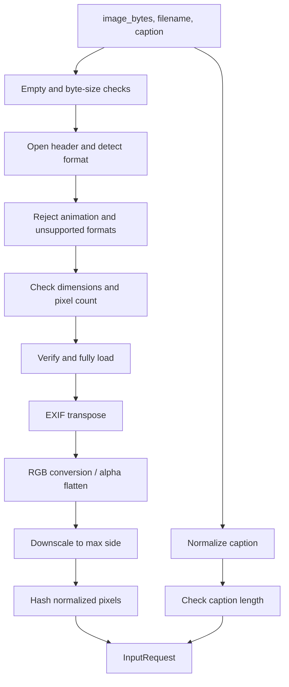
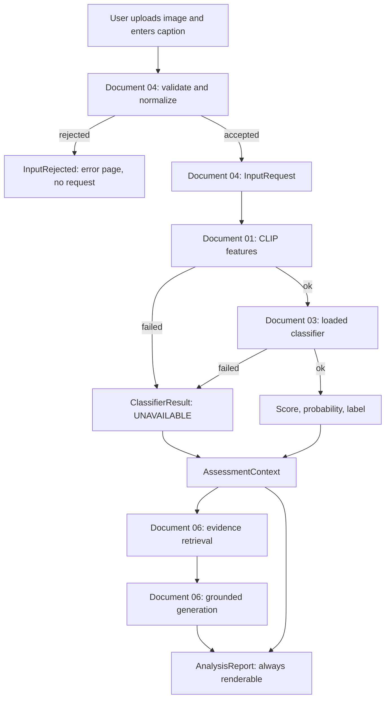

# 04 - Input and Inference Pipeline

## Multimodal Out-of-Context Misinformation Detection Using Retrieval-Augmented Generation (RAG)

**Document status:** Accepted - implementation contract for Phases 1 and 5  
**Document type:** Component specification  
**Depends on:** `../00_PROJECT_OVERVIEW.md`, `01_CLIP_FEATURE_EXTRACTION.md`, `03_CLASSIFIER_TRAINING_AND_CHECKPOINTS.md`  
**Consolidated from:** `01_INPUT_PIPELINE.md` and `06_INFERENCE_PIPELINE.md`  
**Last updated:** 2026-10-21

---

## 1. Purpose

The input pipeline converts raw user input — an uploaded image plus a caption or claim — into a single validated, immutable request object that every downstream component consumes.

It is the only place where user input is decoded, checked, and normalized. Downstream modules must not re-implement validation or accept raw uploads directly.

The pipeline has four responsibilities:

1. Reject invalid, corrupt, unsupported, or oversized input with a clear, user-safe error.
2. Decode the image deterministically and convert it to RGB.
3. Normalize the caption without destroying meaning.
4. Produce an `InputRequest` with stable dimensions, hashes, warnings, and metadata.

---

## 2. Purpose and boundary

Document 03 produced a loadable, verified model artifact. This document wires that model into the running application and defines the contracts the later stages depend on.

The scope is the **runtime prediction path**:

```text
user upload → validated request → CLIP features → classifier result → assessment context
```

| Concern | Owner |
|---|---|
| Input validation and normalization | Document 04 |
| Feature extraction | Document 01 |
| Model selection, training, metrics, calibration | Document 03 |
| Model loading, packaging, verification | Document 03 |
| **The runtime flow, status model, degradation policy, result contract, handoff** | **This document** |
| Evidence ingestion and retrieval | Document 06 |
| Grounded generation and prompt defences | Document 06 |
| Report layout and page rendering | Document 05 |

Document 04 defines what each stage produces and how failures propagate. It does not design the page.

### 2.1 Explicit non-promises

| Non-promise | Why it matters |
|---|---|
| **Bit-identical results across machines** | Reproducibility is claimed under a fixed environment, and across environments within a stated tolerance (document 03 §28.3) |
| **A deterministic end-to-end result** | Only the classifier half is deterministic. Retrieval and generation depend on external state |
| **A combined "fake/real" verdict** | The classifier result and the evidence assessment are separate objects and are never merged |
| **A truth judgment** | The score is the model's estimate. A mismatch score is not proof that a claim is false |
| **Image-based evidence retrieval** | v1 retrieval is caption-driven, by explicit decision (§19) |

---

## 3. Execution and deployment context

The application runs **locally** on a single machine as a Streamlit app. This has concrete consequences for this module:

| Constraint | Implementation |
|---|---|
| No hosted inference service | All input processing happens in the local Python process. |
| No persistence | Images and captions are held **in memory only**. Nothing is written to `data/`, a temp directory, or a cache. |
| No network calls | The input pipeline never fetches URLs, calls APIs, or downloads models. |
| No telemetry | No analytics, remote logging, or usage reporting. |
| Single user | No multi-tenant isolation or authentication is required. |
| Reproducibility | The same bytes and caption must produce the same request object on the same dependency versions. |

The later retrieval and LLM stages may use network access depending on configuration. That is outside this document. **This module is fully offline.**

### 3.1 In-memory lifecycle

- `image_bytes` comes from the Streamlit uploader (`UploadedFile.getvalue()`).
- Decoded pixels live in a `PIL.Image.Image` owned by the `InputRequest`.
- No file handles remain open after `build_input_request` returns.
- When the Streamlit session ends or reruns, the object is garbage-collected.
- Images are not cached across sessions, so the user must re-upload after an app restart.

---

## 4. Scope and boundaries

### 4.1 In scope

- Byte-size, format, dimension, decode, and truncation validation.
- EXIF orientation handling.
- RGB conversion and alpha flattening.
- Aspect-preserving downscaling to a bounded preview size.
- Caption Unicode and whitespace normalization.
- Caption length validation.
- Structured errors and non-fatal warnings.
- A frozen request schema shared with CLIP, retrieval, RAG, and reporting.

### 4.2 Out of scope

- Resizing or cropping to the CLIP input size.
- CLIP normalization (mean/std) or tensor conversion.
- Image authenticity, manipulation, or forensic analysis.
- OCR or text extraction from the image.
- Claim extraction, spelling correction, or translation.
- Language detection beyond documenting English-centric behavior.
- Storing uploads, building a cache, or writing temporary files.
- Batch or multi-image requests.
- UI layout and Streamlit rendering.

### 4.3 Responsibility split

| Step | Owner |
|---|---|
| Read upload bytes | UI / Streamlit |
| Byte-size, format, decode, dimension checks | Input pipeline |
| EXIF transpose | Input pipeline |
| Mode conversion to RGB, alpha flattening | Input pipeline |
| Downscale longest side to ≤ 2048 px | Input pipeline |
| Unicode/whitespace normalization | Input pipeline |
| Caption length validation | Input pipeline |
| Resize to 224 px, center crop, tensor conversion | CLIP processor |
| CLIP mean/std normalization | CLIP processor |
| Displaying errors and warnings | UI |
| Deciding whether to continue after a warning | UI |

**Critical rule:** the input pipeline returns a PIL image, never a tensor. The CLIP processor performs all model-specific preprocessing. This keeps the input contract independent of the CLIP model version.

---

## 5. Accepted inputs

| Property | Accepted value |
|---|---|
| Image formats | **JPEG** and **PNG** only |
| Format detection | Decoded content via Pillow (`img.format`), not filename or client MIME type |
| Color modes | Any Pillow-decodable mode; converted to RGB |
| Alpha/transparency | Flattened onto white |
| Animation | Rejected (animated GIF, APNG, multi-frame files) |
| Caption | A single string, 3–1000 characters after normalization |
| Language | English-centric for v1; not enforced |

A file named `photo.jpg` that actually contains PNG data is accepted **as PNG**. The filename is retained for display only and is never used to determine format.

Files named `.jpg` or `.png` that contain non-image data are rejected with `UNSUPPORTED_FORMAT`.

---

## 6. Validation rules

### 6.1 Limits

| Rule | Value | Error code |
|---|---|---|
| Empty upload | 0 bytes | `EMPTY_FILE` |
| Maximum upload size | 10 MB (10,485,760 bytes) | `IMAGE_TOO_LARGE` |
| Maximum pixel count | 40,000,000 pixels | `IMAGE_TOO_MANY_PIXELS` |
| Minimum side length | 32 px (both width and height) | `IMAGE_TOO_SMALL` |
| Maximum stored side | 2048 px (longest side, aspect preserved) | warning `IMAGE_DOWNSCALED` |
| Supported formats | JPEG, PNG | `UNSUPPORTED_FORMAT` |
| Multi-frame images | Not supported | `ANIMATED_IMAGE` |
| Decode/load failure | — | `CORRUPT_IMAGE` |
| Caption minimum | 3 characters after normalization | `CAPTION_TOO_SHORT` |
| Caption maximum | 1000 characters after normalization | `CAPTION_TOO_LONG` |
| Caption content | At least one non-whitespace character | `CAPTION_EMPTY` |

Character counts are Unicode code points (`len()` after normalization), not grapheme clusters or bytes.

### 6.2 Validation order

Image validation runs before caption validation. If both are invalid, the image error is reported first. This gives the user one clear problem to fix per attempt and avoids decoding work for an invalid caption only after a costly image decode.



### 6.3 Validation notes

- **Byte-size check first:** reject > 10 MB before attempting to decode, so a malicious or accidental large upload does not consume decode memory.
- **Pixel-count check before full decode:** `Image.open` reads the header lazily. Reject > 40 MP using the header dimensions before `load()`.
- **Pillow bomb guard:** catch `PIL.Image.DecompressionBombError` and `DecompressionBombWarning` and map them to `IMAGE_TOO_MANY_PIXELS`. The application's 40 MP limit is stricter than Pillow's default.
- **Truncated images:** `ImageFile.LOAD_TRUNCATED_IMAGES` must remain `False`. A truncated JPEG that opens but fails to `load()` is `CORRUPT_IMAGE`.
- **`verify()` then reopen:** `Image.verify()` invalidates the image object. Reopen from the same in-memory bytes before loading pixels.
- **No partial result:** if any check fails, no `InputRequest` is returned.
- **Programmer errors are not user errors:** passing `None` or a non-bytes object raises `TypeError`. The UI must ensure it passes bytes.

---

## 7. Image preprocessing

### 7.1 Decode and verify

1. Wrap bytes in `io.BytesIO`. Never write to disk.
2. Call `Image.open(buffer)` inside a `try` block.
3. Map `UnidentifiedImageError` to `UNSUPPORTED_FORMAT`.
4. Reject multi-frame images:
   ```python
   if getattr(img, "n_frames", 1) > 1:
       raise InputValidationError(InputErrorCode.ANIMATED_IMAGE, ...)
   ```
5. Check `img.format in {"JPEG", "PNG"}`.
6. Read `width` and `height` from the header and apply the dimension/pixel checks.
7. Call `img.verify()`, reopen, then call `img.load()` with truncated loading disabled.

### 7.2 Orientation

Apply `PIL.ImageOps.exif_transpose` before any resize or color conversion.

- Read the orientation tag (`0x0112`) before transposing.
- If the orientation is present and not `1`, emit warning `EXIF_ROTATED`.
- After transposition, the image's pixel dimensions reflect the visual orientation.
- EXIF metadata is **not** carried into the request. This avoids leaking GPS, device, or timestamp data and keeps the request small.

### 7.3 Color handling and ICC policy

**ICC profiles are ignored for v1.** This is an explicit, documented limitation, not an oversight:

- No `ImageCms.profileToProfile` call is made.
- No `icc_profile` argument is passed when converting or saving.
- `convert("RGB")` uses Pillow's default channel conversion.
- Wide-gamut (Adobe RGB, Display P3) and CMYK images may therefore appear differently than in a color-managed viewer.
- The same policy is applied consistently to every input, so CLIP features remain internally consistent across requests.

**Conversion rules:**

| Source mode | Handling |
|---|---|
| `RGB` | Unchanged |
| `RGBA`, `LA` | Composite over a white background, emit `ALPHA_FLATTENED` |
| `P` with `transparency` in `info` | Convert to RGBA, composite over white, emit `ALPHA_FLATTENED` |
| `P` without transparency | `convert("RGB")` |
| `L`, `CMYK`, `YCbCr`, other | `convert("RGB")` |
| 16-bit / high bit depth | Reduced to 8-bit RGB by Pillow |

White is `(255, 255, 255)`. The background is deterministic and documented so training and inference use the same rule.

### 7.4 Downscaling

Downscale only when `max(width, height) > 2048`:

```python
scale = 2048 / max(width, height)
new_width = max(1, round(width * scale))
new_height = max(1, round(height * scale))
image = image.resize((new_width, new_height), Image.Resampling.LANCZOS)
```

- Aspect ratio is preserved.
- The longest side is ≤ 2048 px after resizing.
- **No cropping** is performed. Crop decisions belong to the CLIP processor.
- Emit warning `IMAGE_DOWNSCALED` with the original and final dimensions.
- The original image resolution is not retained in memory; only the metadata fields `original_width` and `original_height` are kept.

The 2048 px bound is a preview/processing bound, not a model input size. CLIP still receives its own 224 px resize and center crop.

### 7.5 Content hash

Compute a SHA-256 over the **normalized** pixels, not the uploaded file:

```python
digest = hashlib.sha256()
digest.update(f"{width}x{height}:RGB:".encode("ascii"))
digest.update(image.tobytes())
sha256 = digest.hexdigest()
```

Consequences:

- The same decoded image uploaded as JPEG or PNG with identical pixels produces the same hash.
- Different compression, EXIF orientation, or metadata does not change the hash if the normalized pixels match.
- The hash is **not** perceptual; near-duplicate detection is out of scope.
- The hash is safe to log and can identify a request without logging the image.

### 7.6 Filename and metadata

- `filename` is sanitized to its basename (`Path(filename).name`), control characters removed, and truncated to 255 characters.
- An empty filename becomes `"upload"`.
- The filename is for display only. It is never used for format detection or filesystem access.
- `mime_type` comes from `img.get_format_mimetype()` with a fallback mapping (`JPEG` → `image/jpeg`, `PNG` → `image/png`).

---

## 8. Text preprocessing

### 8.1 Normalization

The pipeline preserves the original text and computes a normalized version:

1. Replace `\r\n` and `\r` with `\n`.
2. Apply Unicode **NFKC** normalization. This unifies full-width characters, ligatures, and compatibility forms for consistent retrieval.
3. Remove zero-width space (`U+200B`), byte-order mark (`U+FEFF`), and soft hyphen (`U+00AD`).
4. Remove control characters (`Unicode category Cc`) except `\n`, `\r`, and `\t`; convert those three to a space.
5. Collapse every run of Unicode whitespace to a single space.
6. Strip leading and trailing spaces.

**Zero-width joiner (`U+200D`) and non-joiner (`U+200C`) are preserved** because they carry meaning in emoji sequences and some scripts. Removing them would corrupt legitimate text.

### 8.2 Length rules

Length is checked **after** normalization:

| Condition | Result |
|---|---|
| `len == 0` | `CAPTION_EMPTY` |
| `1 <= len < 3` | `CAPTION_TOO_SHORT` |
| `3 <= len <= 1000` | accepted |
| `len > 1000` | `CAPTION_TOO_LONG` |

The normalized text is used for retrieval, CLIP text encoding, and any downstream comparison. The raw text is retained for display so the user sees exactly what they typed.

### 8.3 Warning

If `caption_normalized != caption_raw`, emit `TEXT_NORMALIZED`. This covers whitespace cleanup, NFKC changes, and removed zero-width characters.

### 8.4 Important CLIP caveat

The 1000-character limit applies to display and retrieval. The CLIP text encoder has a **77-token context window**. A caption longer than 77 tokens is truncated by the CLIP processor before encoding, so the classifier sees only the beginning of the text.

This is intentional and documented:

- The full normalized caption is used for evidence retrieval.
- The classifier's text embedding may represent only the first 77 tokens.
- The UI should state this limitation when the caption is long.
- The input pipeline does not truncate the caption itself; that is a model-specific concern.

---

## 9. Request schema

### 9.1 Dataclasses

```python
from dataclasses import dataclass
from datetime import datetime
from enum import Enum
from PIL import Image

class InputErrorCode(str, Enum):
    EMPTY_FILE = "EMPTY_FILE"
    IMAGE_TOO_LARGE = "IMAGE_TOO_LARGE"
    IMAGE_TOO_MANY_PIXELS = "IMAGE_TOO_MANY_PIXELS"
    IMAGE_TOO_SMALL = "IMAGE_TOO_SMALL"
    UNSUPPORTED_FORMAT = "UNSUPPORTED_FORMAT"
    ANIMATED_IMAGE = "ANIMATED_IMAGE"
    CORRUPT_IMAGE = "CORRUPT_IMAGE"
    CAPTION_EMPTY = "CAPTION_EMPTY"
    CAPTION_TOO_SHORT = "CAPTION_TOO_SHORT"
    CAPTION_TOO_LONG = "CAPTION_TOO_LONG"

class WarningCode(str, Enum):
    IMAGE_DOWNSCALED = "IMAGE_DOWNSCALED"
    EXIF_ROTATED = "EXIF_ROTATED"
    ALPHA_FLATTENED = "ALPHA_FLATTENED"
    TEXT_NORMALIZED = "TEXT_NORMALIZED"

@dataclass(frozen=True)
class ImageInput:
    image: Image.Image          # RGB, longest side <= 2048
    format: str                 # "JPEG" or "PNG"
    mime_type: str
    filename: str               # sanitized basename, display only
    width: int                  # final width after transpose/resize
    height: int                 # final height after transpose/resize
    original_width: int         # after EXIF transpose, before resize
    original_height: int        # after EXIF transpose, before resize
    size_bytes: int             # original upload size
    sha256: str                 # hash of normalized pixels

@dataclass(frozen=True)
class InputRequest:
    request_id: str             # uuid4 string
    image: ImageInput
    caption_raw: str            # exactly as submitted
    caption: str                # normalized
    warnings: tuple[WarningCode, ...]
    created_at: datetime        # timezone-aware UTC
    schema_version: int = 1
```

### 9.2 Invariants

Every returned `InputRequest` satisfies:

1. `image.image.mode == "RGB"`.
2. `max(image.width, image.height) <= 2048`.
3. `image.width >= 32` and `image.height >= 32`.
4. `3 <= len(caption) <= 1000`.
5. `caption == caption.strip()`.
6. `image.sha256` is 64 lowercase hexadecimal characters.
7. `request_id` is a valid UUID4 string.
8. `created_at.tzinfo is not None`.
9. No file handle, `BytesIO`, or upload object is retained.
10. `warnings` contains no duplicates and preserves emission order.

### 9.3 Entry point

```python
def build_input_request(
    image_bytes: bytes,
    filename: str,
    caption: str,
    config: InputConfig = DEFAULT_INPUT_CONFIG,
) -> InputRequest:
    """Validate and normalize one image-caption pair.

    Raises:
        InputValidationError: for any user-correctable input problem.
        TypeError: if arguments have the wrong type.
    """
```

`build_input_request` is the only public entry point for raw input. It is pure with respect to the filesystem and network: no writes, no reads, no HTTP.

Frozen dataclasses prevent reassignment of fields. The contained `PIL.Image.Image` is mutable by nature; callers must treat it as read-only and copy it before drawing or modifying.

---

## 10. Errors and warnings

### 10.1 Error type

```python
class InputValidationError(ValueError):
    code: InputErrorCode
    field: str          # "image" or "caption"
    message: str        # safe to display to the user
```

Rules:

- `str(exc)` returns `message` only.
- Never include local paths, stack traces, raw bytes, or library internals.
- Raise with `from None` at the public boundary to avoid chaining internal exceptions into the UI.
- The UI must not display `exc.__traceback__` or `repr(exc)`.

### 10.2 Error codes and default messages

Messages are generated from the active `InputConfig`, so the displayed numbers match the configured limits.

| Code | Field | Default message |
|---|---|---|
| `EMPTY_FILE` | image | "Please upload an image file." |
| `IMAGE_TOO_LARGE` | image | "The image is larger than 10 MB. Please upload a smaller file." |
| `IMAGE_TOO_MANY_PIXELS` | image | "The image resolution is too large. Please upload an image under 40 megapixels." |
| `IMAGE_TOO_SMALL` | image | "The image is too small. Minimum dimensions are 32 × 32 pixels." |
| `UNSUPPORTED_FORMAT` | image | "Unsupported image format. Please upload a JPEG or PNG." |
| `ANIMATED_IMAGE` | image | "Animated images are not supported. Please upload a single still image." |
| `CORRUPT_IMAGE` | image | "The image could not be read. It may be corrupted." |
| `CAPTION_EMPTY` | caption | "Please enter a caption or claim." |
| `CAPTION_TOO_SHORT` | caption | "The caption must be at least 3 characters." |
| `CAPTION_TOO_LONG` | caption | "The caption must be 1,000 characters or fewer." |

Unsupported format versus corrupt image:

- `UnidentifiedImageError` at open time → `UNSUPPORTED_FORMAT`.
- A recognized header followed by a decode/load failure → `CORRUPT_IMAGE`.
- A file with a valid header but an unsupported format (e.g., GIF, WebP) → `UNSUPPORTED_FORMAT`.

### 10.3 Warning codes

| Code | Meaning | UI treatment |
|---|---|---|
| `IMAGE_DOWNSCALED` | Longest side exceeded 2048 px and was resized | Informational notice |
| `EXIF_ROTATED` | Image was rotated according to EXIF orientation | Informational notice |
| `ALPHA_FLATTENED` | Transparency was replaced with white | Informational notice |
| `TEXT_NORMALIZED` | Caption whitespace/Unicode was normalized | Informational notice |

Warnings do not block processing. They are informational and should be shown near the input preview, not in the main assessment.

### 10.4 UI behavior

```python
try:
    request = build_input_request(
        image_bytes=uploaded.getvalue(),
        filename=uploaded.name,
        caption=caption,
    )
except InputValidationError as exc:
    st.error(exc.message)
    st.stop()
```

- Show exactly one error at a time.
- Do not continue to CLIP, retrieval, or the LLM after an input error.
- Warnings are shown with `st.info` or `st.warning` and do not prevent analysis.
- The UI must not catch `TypeError` and present it as a user error; that indicates a programming bug.

---

## 11. The component status model

### 11.1 Status vocabulary

| Status | Meaning | Carries a value? |
|---|---|---|
| `OK` | The component ran and produced a valid result | Yes |
| `UNAVAILABLE` | The component could not run — a missing artifact, an incompatible environment, a load failure | **No** |
| `SKIPPED` | The component was deliberately not run because an upstream component failed | No |
| `FAILED` | The component ran and produced an invalid result | No, plus the error |

### 11.2 The no-fabrication rule

**A non-`OK` result carries no label, no score, and no probability.**

Not `0.0`. Not `0.5`. Not "unknown" encoded as a number. The value fields are `None`, and the type system makes it awkward to mistake `None` for a real value.

| Prohibited | Why |
|---|---|
| A default score of `0.5` | Indistinguishable from a genuine neutral prediction |
| A default label of "unknown" | Indistinguishable from a real third class |
| A silent `MATCHED` when the model is missing | The most damaging failure mode in the system: a manipulated pairing reported as genuine |
| A fabricated probability | Same reason |

This is the mechanism behind document 00 §9.4 and document 03 §32.1. It is enforced by the type system and asserted by test in every failure path.

> **UNRESOLVED - REQUIRES CONFIRMATION.** The vocabulary is `OK / UNAVAILABLE / SKIPPED / FAILED`, and it is shared by the reporting and integration documents. It is not yet established whether `FAILED` is reachable for the evidence and assessment sections: a generation failure is currently mapped to `UNAVAILABLE` (§18), and a retrieval failure to `UNAVAILABLE` (§18). `FAILED` is reserved for a component that ran and produced an invalid result. The mapping is left visible rather than silently resolved. See `07_INTEGRATION_TESTING.md` §19, UD-03.
### 11.3 Two distinct runtime artifacts

The report and the input rejection are different things, and conflating them produces contradictions.

| Artifact | When it exists | Contents |
|---|---|---|
| **`InputRejected`** | Document 04 rejects the input | The validation error code and the user-facing message. **No request exists.** No assessment context, no result objects, no retrieval, no model loading, no report |
| **`AnalysisReport`** | A request was **valid** | The per-component statuses, whatever they are. **Always renderable**, even if every downstream component failed |

So both of the following are true, because they describe different situations:

- An invalid input stops processing and produces **no result**.
- A valid request always produces a **renderable report**, which states which components ran.

A blank screen is a failure mode in its own right. A report that renders with every component marked failed is a success of the reporting layer and a failure of the pipeline, and the user can tell the difference.

---

## 12. Configuration

Configuration is a frozen dataclass so tests can override individual limits without global state.

```python
from dataclasses import dataclass

@dataclass(frozen=True)
class InputConfig:
    max_upload_bytes: int = 10 * 1024 * 1024
    max_pixels: int = 40_000_000
    min_side: int = 32
    max_side: int = 2048
    caption_min_chars: int = 3
    caption_max_chars: int = 1000
    accepted_formats: frozenset[str] = frozenset({"JPEG", "PNG"})

DEFAULT_INPUT_CONFIG = InputConfig()
```

Tests use `dataclasses.replace(DEFAULT_INPUT_CONFIG, max_pixels=100)` or `max_side=64` to exercise limits without allocating enormous images.

`InputConfig` lives in `src/input_pipeline/input_schema.py`. Shared environment settings (model identifiers, index paths, API keys) belong in `src/utils/config.py` and are not part of this contract.

---

## 13. The end-to-end inference flow



Each stage consumes the previous stage's **structured output**. No stage reaches around its predecessor, and no stage re-parses a log line or a rendered string.

---

## 14. The classifier prediction path

### 14.1 Stages

| # | Stage | Input | Output | Owner |
|---|---|---|---|---|
| 1 | Validation | Upload bytes, filename, caption | `InputRequest` or `InputRejected` | Document 04 |
| 2 | Image preparation | The validated RGB image | Processor-ready tensors | Document 01 |
| 3 | Feature extraction | Image and normalized caption | `EmbeddingPair` | Document 01 |
| 4 | Feature construction | The two 512-d vectors | The model's expected input vector | Document 03's `build_features` |
| 5 | Scoring | The feature vector | Two logits | Document 03 |
| 6 | Calibration | The logits and the fitted temperature | The calibrated probability, when available | Document 03 |
| 7 | Decision | The score and the recorded threshold | The label | Document 03's `inference` block |

### 14.2 The three quantities

Three quantities are distinguished, because they are not interchangeable.

| Quantity | Field | Definition | Range | Present when the result is `OK`? |
|---|---|---|---|---|
| Positive logit | `logit_positive` | The positive-class logit from the 2-logit head | unbounded | Yes |
| **Score** | `score` | `softmax(logits)[positive_class]` — the **uncalibrated** class probability | [0, 1] | **Yes** |
| **Probability** | `probability` | `softmax(logits / T)[positive_class]` — the **calibrated** class probability | [0, 1] | **Only with a valid calibration artifact** |

The **score** is the model's native output and is what the operating threshold applies to. The **probability** is the quantity that may be presented to a user as a probability, because it has been through a calibration procedure fitted on validation data.

### 14.3 The score-only success mode

| Condition | Behaviour |
|---|---|
| A valid calibration artifact is present and parses | `probability` is present; `calibration_status == APPLIED` |
| The calibration artifact is **absent** and the checkpoint does not require one | `probability is None`; `calibration_status == ABSENT`. The prediction still **succeeds** with a label and a score |
| The calibration artifact is **malformed** — unparseable, an unknown method, or a non-positive or non-finite temperature | `CheckpointIntegrityError` at load time. A malformed artifact is a broken release, not a supported mode |
| The checkpoint sets `calibration_expected: true` and the artifact is absent | `CheckpointIntegrityError`. A checkpoint that claims to return calibrated probabilities must require a valid calibration artifact |

The score-only mode is a **first-class supported path**, not a degradation. A checkpoint trained without a calibration artifact is still fully usable; it simply has no calibrated probability to display.

### 14.4 The decision rule

```text
score       = softmax(logits)[positive_class]
probability = softmax(logits / T)[positive_class]     # only when calibration is available
label      = MISMATCHED if score >= operating_threshold else MATCHED
```

Two properties follow, and both are asserted by test:

| Property | Consequence |
|---|---|
| The threshold applies to the **uncalibrated score** | The label is **invariant to calibration**. A checkpoint with and without a calibration artifact produces the same label for the same input |
| The threshold, the positive class, the class order, and the feature family all come from the checkpoint's `inference` block | The runtime never second-guesses the model, and there is no unrecorded inference-time threshold adjustment |

An inference-time threshold tweak that was never validated is an unrecorded model change, and it is prohibited.

### 14.5 Feature construction

The loader must not assume the input is `[v_i ; v_t]`.

```python
features = build_features(
    family=inference["feature_family"],
    image_embedding=image_embedding,
    text_embedding=text_embedding,
)
assert features.shape[-1] == model.first_layer_in_features
```

| Rule | Detail |
|---|---|
| Source of truth | The `inference` block's `feature_family` and `feature_spec` |
| Construction | The same `build_features` function document 03 uses, so training and inference cannot diverge |
| Dimension check | The constructed length is asserted against the first layer's expected input size |
| Failure | A mismatch raises `CheckpointIncompatibleError`. A family C checkpoint can never be fed a 1024-d vector by accident |

---

## 15. The prediction result object

```python
@dataclass(frozen=True)
class ClassifierResult:
    status: ComponentStatus
    request_id: str
    label: str | None                    # "MATCHED" | "MISMATCHED"
    score: float | None                  # uncalibrated positive-class probability
    logit_positive: float | None
    probability: float | None            # calibrated; None without a valid calibration artifact
    calibration_status: CalibrationStatus  # APPLIED | ABSENT
    threshold: float | None
    class_order: tuple[str, ...] | None
    positive_class: str | None
    feature_family: str | None
    model_version: str | None
    run_id: str | None
    encoder_revision: str | None
    warnings: tuple[PredictionWarning, ...]
    error: PipelineError | None
    elapsed_ms: float
```

### 15.1 Invariants

| Invariant | Asserted by |
|---|---|
| `status == OK` ⟹ `label`, `score`, `logit_positive`, `threshold` are all present | Test |
| `status == OK` ⟹ `probability` is present **iff** `calibration_status == APPLIED` | Test |
| `status != OK` ⟹ every value field is `None` | Test |
| `label` is determined by thresholding `score` against `threshold`, using the recorded `positive_class` and `class_order` | Test |
| `score` and `probability` lie in [0, 1] and are finite | Test |
| The label is identical with and without a calibration artifact | Test |
| `warnings` contains no duplicates and preserves emission order | Test |

---

## 16. Resource lifecycle and caching

### 16.1 One cache owner

| Decision | Detail |
|---|---|
| **Canonical owner** | A process-level `ModelRegistry` in `src/inference/registry.py`, constructed lazily **once per process** under a lock |
| Contents | The CLIP encoder and the loaded classifier |
| The Streamlit layer | Calls `get_registry()`. It does **not** use `st.cache_resource` for these artifacts |
| Rationale | A module singleton combined with a Streamlit cache can produce two live instances — when the Streamlit cache is cleared independently of the singleton, or across a module reload. One owner removes the ambiguity, and it keeps the CLI script and the tests on the same path as the application |
| Lifetime | Once per application process. In the Streamlit server, once per server lifetime |

### 16.2 The load-once rule

| Resource | Loaded | Lifetime |
|---|---|---|
| CLIP encoder | Once per process | Process lifetime |
| Classifier checkpoint | Once per process | Process lifetime |
| Per-request work | Every request | Request only |

Loading a 600 MB encoder per request would make the application unusable. A test asserts the registry is constructed exactly once across many requests, and that the Streamlit layer adds no second cache.

### 16.3 Latency profile

| Path | Profile |
|---|---|
| **Cold** — the first request in a process | The encoder and checkpoint load dominates. Measured during implementation and recorded here, not promised in advance |
| **Warm** — subsequent requests | Image decode and normalize, one CLIP image forward, one CLIP text forward, and one head forward |

The measured cold and warm latencies, and the memory footprint, are recorded in this document during implementation. No figure is published in advance, because a figure copied from another machine is not a measurement.

---

## 17. Degradation policy

### 17.1 The dependency table

| Stage | Depends on | If it fails |
|---|---|---|
| Input validation | — | **Stop.** `InputRejected`. Nothing downstream runs, and no report is produced |
| CLIP feature extraction | A validated `InputRequest` | The classifier stage → `SKIPPED`. Retrieval may still run — it needs the caption, not the image |
| Classifier | Features **and** a loadable checkpoint | → `UNAVAILABLE`. Retrieval may still run |
| Evidence retrieval | The normalized caption | → `UNAVAILABLE`. The assessment returns **Inconclusive**. Never a forced conclusion |
| Grounded generation | Retrieved evidence | → `UNAVAILABLE`. The retrieved evidence is still shown, with a note that no assessment was produced |
| Report | Whatever succeeded | **Always renderable.** The report states which components ran |

### 17.2 The rule that matters

**A failure in the classifier does not stop the evidence stage.** The two halves of the system are independent by design, and document 00 §4.2 requires them to be presented as distinct results. A user with a broken checkpoint still receives the evidence-based assessment, along with a clear statement that the image-caption consistency result is unavailable.

A failure in retrieval does not produce a verdict either. The assessment returns **Inconclusive / Insufficient evidence**, which is one of the four documented outcomes in document 00 §8.1.

### 17.3 The degradation matrix

This table is the specification, and it is the basis of the test suite.

| Component | Failure mode | Status | Stages that still run | Reported as |
|---|---|---|---|---|
| Input | Any validation error | `InputRejected` | None | An input error page |
| Features | Encoder load failure | `SKIPPED` | Retrieval, generation, report | "The image could not be compared" |
| Features | Extraction error | `SKIPPED` | Retrieval, generation, report | Same |
| Classifier | Checkpoint absent | `UNAVAILABLE` | Retrieval, generation, report | "The model is unavailable" |
| Classifier | Checkpoint corrupt | `UNAVAILABLE` | Retrieval, generation, report | Same, with a re-download instruction |
| Classifier | Incompatible environment | `UNAVAILABLE` | Retrieval, generation, report | Same, with the required versions |
| Classifier | Encoder provenance mismatch | `UNAVAILABLE` | Retrieval, generation, report | Same |
| Retrieval | Index missing or empty | `UNAVAILABLE` | Generation, report | "No evidence was retrieved" |
| Retrieval | Source unavailable | `UNAVAILABLE` | Generation (partial), report | Same |
| Generation | LLM or API failure | `UNAVAILABLE` | Report | "No assessment could be generated" |
| Generation | Rate limit | `UNAVAILABLE` | Report | Same, with a retry suggestion |
| Any | Unexpected internal error | `FAILED` | Report | The component's error, with no fabricated content |

---

## 18. Error taxonomy and user-facing messages

### 18.1 Mapping

| Source | Error | Status | User-facing message intent |
|---|---|---|---|
| Document 04 | `InputValidationError` | `InputRejected` | The input message, verbatim. No stack trace |
| Document 01 | `ModelUnavailableError` | `SKIPPED` | "The image model could not be loaded. The image comparison is unavailable." |
| Document 03 | `CheckpointNotFoundError` | `UNAVAILABLE` | "The model file was not found. The image comparison is unavailable." |
| Document 03 | `CheckpointIntegrityError` | `UNAVAILABLE` | "The model file appears to be damaged. Re-download it." |
| Document 03 | `ArtifactTrustError` | `UNAVAILABLE` | "The downloaded model did not match the published checksum." |
| Document 03 | `CheckpointIncompatibleError` | `UNAVAILABLE` | "The model needs a different software version than is installed." |
| Document 03 | `EncoderUnavailableError` | `SKIPPED` | "The image model weights are not available locally." |
| Document 03 | `EncoderProvenanceError` | `SKIPPED` | "The local image model does not match the one this classifier was trained with." |
| Document 03 | `ReferenceFixtureError` | — | Not reachable at inference time. It belongs to verification only |

### 18.2 Rules

- No traceback reaches the user. The Streamlit layer catches the typed error and renders `str(exc)`. The full trace goes to the log.
- Every message says **what is unavailable** and **what to do about it**. "Something went wrong" is not acceptable.
- The message never implies the analysis itself is complete when it is not.
- The typed error is preserved in the result object, so the report and the log can distinguish causes.

---

## 19. The assessment context handoff

### 19.1 The contract

```python
@dataclass(frozen=True)
class AssessmentContext:
    request_id: str
    caption: str                        # normalized
    caption_raw: str
    image_validated: bool               # the upload passed document 04's validation
    image_features_available: bool      # CLIP features were extracted successfully
    classifier: ClassifierResult
    interpretation: str                 # the model's own statement of what it measures
    warnings: tuple[PredictionWarning, ...]
```

### 19.2 Two rules the handoff enforces

**Rule 1 — the classifier result is a signal, not a fact.**

It is passed with the model's own `interpretation` string, taken from the checkpoint's `copy.json`. The generation stage is instructed to treat it as one input among several, never as proof. Document 00 §8 states the rule this implements: a mismatch prediction is not proof that a claim is false.

**Rule 2 — the classifier does not override contrary evidence.**

If the retrieved evidence contradicts a mismatch prediction, **both are surfaced**. The handoff carries both values, so neither can quietly replace the other. The report presents the two results side by side, and where they disagree, it says so.

### 19.3 Image availability, split in two

| Field | Meaning |
|---|---|
| `image_validated` | The upload passed document 04's validation, and a decoded RGB image exists in memory |
| `image_features_available` | CLIP features were extracted successfully |

A valid image can exist while its features are unavailable — the encoder may have failed to load, or extraction may have errored. A single `image_available` flag would tell the retrieval stage that no image exists when only the classifier's image stage had failed, which is wrong.

Both flags are carried so a future image-derived retrieval stage has what it needs, and so no stage is misled.

### 19.4 Retrieval scope — an explicit decision

| Decision | Rationale |
|---|---|
| **v1 retrieval is caption-driven.** The query is built from the normalized caption. The image is used only by the classifier | Document 00 §4.1 step 5 specifies a text query built from the claim, and Document 00 §2.2 places guaranteed page retrieval and automatic crawling out of scope |
| The handoff therefore carries **no image content** | There is no consumer for it in v1 |
| The flags are still carried | So a future extension has what it needs, and so no stage concludes the image does not exist |
| Reverse-image matching against the source dataset's images | **Out of scope for v1.** It is a possible future provenance check, distinct from evidence retrieval. Stated explicitly so it is not silently assumed either way |

---

## 20. Trust boundaries in the flow

| Data | Trust | Handling |
|---|---|---|
| The classifier's output | **An internally generated model result, not verified factual evidence.** Its provenance and structured format are trusted; its factual correctness is not. The model can be wrong — an out-of-context image may be semantically similar to its caption, and a matched pair may still be a false claim | Passed as structured fields, never as free text the generation stage could reinterpret |
| The normalized caption | Semi-trusted — it is user input | Treated as the claim under assessment, never as an instruction |
| Retrieved passages | **Untrusted** | Passed as delimited data with an explicit evidence-not-instructions marker |
| The system prompt and the configuration | Trusted | Never assembled from retrieved content |

The invariant, asserted by test: **no string retrieved from an external source is ever concatenated into the system prompt, into any configuration field, or into the assessment context.**

Document 06 implements the prompt-injection defences inside the prompt. Document 04 enforces the structured handoff and the invariant above.

---

## 21. Logging and privacy

Log only non-sensitive metadata at `INFO`:

```text
input.accepted request_id=<uuid> sha256=<first 12 chars> size=<bytes>
               dimensions=<w>x<h> caption_chars=<n> warnings=<codes>
```

Never log:

- Raw caption text.
- Image bytes or base64.
- Filenames containing personal information (log only if necessary; prefer omitting).
- Full filesystem paths.

Errors may be logged at `WARNING` with the error code and request context, but not with the raw input.

Because processing is in-memory, there is no retention to manage. If logging is configured to a file locally, that is the operator's responsibility; the default should be console output.

---

## 22. Reproducibility of a live prediction

### 22.1 Scoped claim

| Scope | Claim |
|---|---|
| **Fixed environment** — the same checkpoint, the same encoder revision **and file hashes**, the same library versions, the same numerical backend, the same deterministic settings, and the same preprocessing configuration | The classifier score, probability, and label are **reproducible** |
| **Across environments** — different BLAS builds, CPU microarchitectures, PyTorch builds, or a CPU versus a GPU backend | **Equal within a stated tolerance** of 1e-4 for the score and the probability, matching document 03 §28.3. **Not bit-identical** |

The deterministic claim is scoped to a fixed environment. The cross-environment claim is the one document 03's verification procedure actually tests, and it is a tolerance, not an equality.

### 22.2 What is not reproducible

| Stage | Reproducible | Why |
|---|---|---|
| Input validation | Yes | Deterministic |
| Feature extraction | Yes, under a fixed environment | Same checkpoint, same encoder, same configuration |
| Classifier score, probability, label | Yes, under a fixed environment | Deterministic given the features and the recorded threshold |
| Evidence retrieval | **Not necessarily** | Depends on external sources and their state |
| Grounded generation | **Not necessarily** | Depends on the retrieved text and on model or API behaviour |

The report records the retrieved source identifiers and their retrieval timestamps, so a later run can be compared rather than assumed identical.

---

## 23. Latency and resource measurement

Document 00 §10.6 requires application-level measurements. This document defines how they are taken.

| Measurement | Method | Recorded |
|---|---|---|
| Cold-start latency | The wall time of the first request in a fresh process, including the encoder and checkpoint load | Once, in this document, and in the verification report |
| Warm latency | The median and 95th percentile over at least 50 consecutive warm requests | In this document |
| Stage breakdown | The per-stage wall time: validation, feature extraction, scoring, retrieval, generation | Emitted per request, aggregated in the report |
| Peak memory | The process resident set after the cold start and after a batch of warm requests | In this document |
| End-to-end success rate | The share of requests for which every component reached `OK`, and the share for which the report rendered at all | Reported in document 05 |
| Error rate | The count of each typed error | Reported in document 05 |

Every measurement is taken on the machine that will run the application, and the platform is recorded alongside. A latency figure copied from a different machine is not a measurement.

---

## 24. Prediction context warnings

Upstream warnings from every stage are aggregated into one list for the report.

| Warning | Source | Trigger |
|---|---|---|
| `IMAGE_DOWNSCALED` | Document 04 | The longest side exceeded 2048 px |
| `EXIF_ROTATED` | Document 04 | The image was rotated by its EXIF orientation |
| `ALPHA_FLATTENED` | Document 04 | Transparency was replaced with white |
| `TEXT_NORMALIZED` | Document 04 | The caption was normalized |
| `CAPTION_TRUNCATED_FOR_CLIP` | Document 01 | The caption exceeded the CLIP context window, so the classifier saw only part of it while retrieval sees all of it |
| `LOW_CROP_RETENTION` | Document 04 | CLIP's center crop may have discarded much of the image area |
| `CLASSIFIER_UNAVAILABLE` | Document 04 | The classifier stage did not produce a result |

### 24.1 The crop-retention calculation

The warning is derived from the **loaded processor's own configuration**, not from hardcoded constants.

**Derivation.** The pinned processor resizes the shortest edge to `S`, then center-crops to `C × C`. For an image of dimensions `W × H`:

```text
s        = S / min(W, H)                        # shortest-edge resize
W'       = W · s,   H' = H · s
L        = max(W', H') = S · max(W, H) / min(W, H)
retained = C² / (W' · H') = C² / (S · L)
```

For the pinned configuration, `S = C = 224`, so:

```text
retained_area_fraction = min(W, H) / max(W, H)
```

The ratio is scale-invariant, so it is computed from the original decoded dimensions and is unaffected by document 04's resize.

| Property | Decision |
|---|---|
| Formula | `min(W, H) / max(W, H)`, derived at runtime from the processor's `size` and `crop_size` |
| Default threshold | **0.5** — warns when the aspect ratio is 2:1 or more extreme, meaning more than half the area is discarded |
| Configurable | The threshold is a configuration value, not a constant in the code |
| Message | "CLIP's center crop may have discarded part of this image. Possible visual context is missing from the comparison." |
| **Not** | A claim that the prediction is unreliable. It is a warning about **possible lost visual context** |

A very wide or very tall image can lose most of its frame to the center crop, which is a real reason for a weak prediction that the user should be told about rather than discovering for themselves.

---

## 25. The canonical explanation copy

Document 00 §9.2 requires the interface to show "a short explanation of what the classifier measures" and "a note that this result does not establish the truth of the entire news claim".

### 25.1 Source

The file is a structured, versioned JSON document. Its schema is **canonical here**:

```json
{
  "copy_version": "1.0.0",
  "what_this_measures": "This score estimates whether the image and caption look like the mismatched or matched examples the model was trained on.",
  "not_a_truth_claim": "A mismatch score is not proof that the claim is false, and a match score is not proof that it is true. Use the retrieved sources to assess the claim itself.",
  "probability_note": "The probability reflects the model's confidence under its training data. It does not measure factual accuracy.",
  "score_note": "The score is the model's uncalibrated output. A calibrated probability is shown only when the release includes a valid calibration artifact."
}
```

| Key | Purpose |
|---|---|
| `copy_version` | Bumped when the wording changes, so the rendered text is traceable to the release |
| `what_this_measures` | What the classifier result actually measures |
| `not_a_truth_claim` | The permanent limitation shown under the classifier result |
| `probability_note` | The distinction between a score and a calibrated probability |
| `score_note` | When a calibrated probability is and is not available |

All five keys are required and must be non-empty strings. A missing key or a non-string value raises `CheckpointIntegrityError` at load time.
The explanation ships with the checkpoint in **`copy.json`**, a structured, versioned file — never parsed out of the model card's Markdown.

| Property | Decision |
|---|---|
| File | `copy.json`, produced by the training run and packaged into the release (document 03 §19.1.1) |
| Required keys | `copy_version`, `what_this_measures`, `not_a_truth_claim`, `probability_note`, `score_note` — all non-empty strings |
| Versioning | `copy_version` is bumped when the wording changes, so the rendered text is traceable to the release |
| Validation | The loader requires the file and every key. A malformed file raises `CheckpointIntegrityError` |
| Fallback | If the file is absent, document 04 supplies a generic fallback and the report notes that the model-specific copy is unavailable |

### 25.2 The fallback copy

```python
FALLBACK_COPY = {
    "copy_version": "fallback",
    "what_this_measures": "This score estimates whether the image and caption look like the mismatched or matched examples the model was trained on.",
    "not_a_truth_claim": "A mismatch score is not proof that the claim is false, and a match score is not proof that it is true. Use the retrieved sources to assess the claim itself.",
    "probability_note": "The probability reflects the model's confidence under its training data. It does not measure factual accuracy.",
    "score_note": "The score is the model's uncalibrated output.",
}
```

### 25.3 Why the copy is versioned with the model

The explanation must not drift away from the model it describes. A wording change that outruns the trained model is a documentation bug, and the `copy_version` makes the change explicit and reviewable.

Document 05 renders the copy. It does not write its own.

---

## 26. Test plan

Tests live in `tests/test_input_pipeline.py` and run with `pytest`. They require no network, no CLIP model, no GPU, and no downloaded data.

### 26.1 Test cases

| # | Case | Expected result |
|---|---|---|
| 1 | Valid JPEG | Accepted; RGB; dimensions unchanged |
| 2 | Valid PNG | Accepted; RGB |
| 3 | PNG with alpha | RGB; transparent pixel becomes white; `ALPHA_FLATTENED` |
| 4 | Palette PNG with transparency | RGB; flattened; warning |
| 5 | Grayscale PNG | RGB |
| 6 | EXIF orientation 6 JPEG | Correctly transposed; `EXIF_ROTATED` |
| 7 | PNG bytes named `.jpg` | Accepted as PNG; `format == "PNG"` |
| 8 | Text file renamed `.jpg` | `UNSUPPORTED_FORMAT` |
| 9 | GIF bytes | `UNSUPPORTED_FORMAT` |
| 10 | Animated PNG/GIF | `ANIMATED_IMAGE` |
| 11 | Truncated JPEG | `CORRUPT_IMAGE` |
| 12 | Empty bytes | `EMPTY_FILE` |
| 13 | 10 MB + 1 byte | `IMAGE_TOO_LARGE`; no decode attempted |
| 14 | Pixels > configured max (small override) | `IMAGE_TOO_MANY_PIXELS` |
| 15 | Side < 32 px | `IMAGE_TOO_SMALL` |
| 16 | Longest side > 2048 px | Downscaled; aspect ratio preserved; `IMAGE_DOWNSCALED` |
| 17 | Downscale rounding edge case | Longest side is exactly ≤ 2048 |
| 18 | Caption whitespace only | `CAPTION_EMPTY` |
| 19 | 2-character caption | `CAPTION_TOO_SHORT` |
| 20 | 1001-character caption | `CAPTION_TOO_LONG` |
| 21 | Caption with `\r\n`, tabs, multiple spaces | Normalized to single spaces; `TEXT_NORMALIZED` |
| 22 | NFKC ligature (`fi`) | Normalized to `fi` |
| 23 | Zero-width space and BOM | Removed |
| 24 | Emoji with ZWJ | ZWJ preserved |
| 25 | Same input twice | Identical SHA-256, dimensions, caption |
| 26 | Different compression, same pixels | Identical SHA-256 |
| 27 | Error message content | No paths, stack traces, or raw bytes |
| 28 | No filesystem writes | Working directory remains empty |
| 29 | No network access | Socket connections blocked; test still passes |
| 30 | Config override | Custom limits honored in validation and messages |

### 26.2 Fixtures

Fixtures are generated in memory with Pillow; no binary image files are committed.

```python
def make_jpeg(size=(100, 100), color=(255, 0, 0), exif_orientation=None) -> bytes:
    ...

def make_png(size=(100, 100), mode="RGB", transparency=False) -> bytes:
    ...

def make_gif() -> bytes:
    ...
```

Use `io.BytesIO` for all image construction. For tests of large pixel counts, override `max_pixels` and use a small image rather than allocating a 40 MP buffer. For the 10 MB test, use `b"\x00" * (10 * 1024 * 1024 + 1)`; the byte-size check runs before decoding.

### 26.3 Offline and no-disk assertions

- An autouse fixture replaces `socket.socket` with a stub that raises on `connect`, proving the pipeline never opens a network connection.
- A test changes the working directory to `tmp_path`, calls `build_input_request`, and asserts that `tmp_path` is still empty.
- Import-time checks assert that `torch`, `transformers`, `streamlit`, and `requests` are not imported by any input pipeline module. A simple `sys.modules` check after importing the package is sufficient.

---

## 27. Testing strategy

### 27.1 Test tiers and commands

The test tier taxonomy, the marker definitions, the environment requirements, the complete command set, the coverage gate, and the evaluation-harness invariants are specified centrally in `07_INTEGRATION_TESTING.md` §2 and §3.

The tests listed in the remaining subsections of this section are this component's own tests, executed under those tiers. They are **unit and component tests**: they verify this component's contracts, not the boundaries between components, which are tested in `07_INTEGRATION_TESTING.md` §5.

```bash
# This component's fast suite
pytest -m "not slow and not eval and not benchmark and not e2e"
```
### 27.2 Fast tests

| Test | Assertion |
|---|---|
| Happy path | A valid request produces `status == OK` with a label, a score, and a logit |
| **No fabrication** | Every failure mode yields `status != OK` with **all** value fields `None` |
| Score definition | `score` equals `softmax(logits)[positive_class]` and is uncalibrated |
| Probability definition | `probability` equals `softmax(logits / T)[positive_class]` when calibration is applied |
| Score-only mode | A checkpoint with no calibration artifact yields a label and a score, with `probability is None` and `calibration_status == ABSENT` |
| Malformed calibration | A calibration artifact with an unknown method or a non-finite temperature raises `CheckpointIntegrityError` |
| Label invariance | The label is identical with and without a calibration artifact |
| Decision rule | The label matches the recorded threshold and positive class exactly |
| Threshold source | The runtime uses the checkpoint's threshold, not a hardcoded one |
| Family reconstruction | A family C checkpoint reconstructs a 2048-d vector and predicts |
| Dimension mismatch | A wrong-length feature vector raises rather than being padded or truncated |
| **Image flags** | A classifier failure with a valid image yields `image_validated == True` and `image_features_available == False` |
| Crop retention | The retained-area fraction matches the formula; the warning fires below the threshold and not above it |
| Truncation warning | A caption beyond the context window raises `CAPTION_TRUNCATED_FOR_CLIP` |
| Warning aggregation | Upstream warnings from documents 04 and 01 appear in the result |
| **Registry singleton** | The registry is constructed exactly once across many requests |
| No second cache | The Streamlit layer adds no `st.cache_resource` for model artifacts |
| **Degradation matrix** | Every row of §17.3 produces the specified status and leaves the specified stages running |
| Report always renderable | A request with every component failed still produces a renderable report |
| **Input rejection** | An invalid input produces an `InputRejected` and **no** report and **no** model load |
| No single verdict | The assembled output contains no combined "fake/real" field |
| Handoff contract | The assessment context carries the classifier result, its interpretation, and both image flags |
| Conflict preservation | A contradicting-evidence case preserves both the classifier result and the evidence result |
| Trust boundary | No retrieved string appears in the system prompt, in any configuration field, or in the assessment context |
| Copy present | The checkpoint's copy is used; the fallback is used when the file is absent; a malformed copy raises |
| Error messages | Each typed error maps to a user-facing message with no traceback |

### 27.3 Slow tests

| Test | Assertion |
|---|---|
| Real prediction | A real request against the real encoder and a packaged checkpoint produces an `OK` result |
| Determinism | The same input twice yields an identical score, probability, and label, under a fixed environment |
| Cold versus warm | The cold request is measurably slower, and the warm path does not reload the encoder |
| Slow error path | A missing checkpoint produces `UNAVAILABLE` with all value fields `None`, and the retrieval stage still runs |
| Crop retention, real | The retained-area fraction matches the hand-computed value for a real image |

### 27.4 End-to-end tests

| Test | Assertion |
|---|---|
| Full flow | A valid pair completes the whole workflow and produces a report with all components `OK` |
| Mismatch example | A mismatch example produces a classifier result **and** a separate evidence assessment |
| Insufficient evidence | A case with insufficient evidence is **not** forced into a confident conclusion, and the assessment returns Inconclusive |
| Classifier unavailable | The page renders, states the classifier is unavailable, and still shows the evidence assessment |
| Retrieval unavailable | The page renders, shows the classifier result, and shows that no assessment could be generated |
| Component unavailability is visible | Every unavailable component is visible in the report |

---

## 28. Acceptance criteria

Phase 1 is complete when:

1. `build_input_request` is implemented and is the only public way to create an `InputRequest`.
2. All invariants in §9.2 hold for every successful call.
3. Every error code and warning code in §10 is covered by at least one test.
4. The full test suite passes offline, with no model downloads and no network access.
5. No files are written during input processing.
6. `src/input_pipeline/` does not import CLIP, torch, Streamlit, or any HTTP client.
7. The UI renders every error code as a human-readable message and never displays a traceback.
8. The same bytes and caption produce an identical request (except `request_id` and `created_at`) across repeated runs on the same dependency versions.
9. The ICC limitation and the CLIP 77-token limitation are documented in the UI or its help text.
10. `requirements.txt` pins Pillow to a tested version.

---

## 29. Acceptance criteria

Phase 5 is complete when:

1. `ClassifierResult` carries the three distinct quantities — `logit_positive`, `score`, and `probability` — and the semantics of each are documented in §14.2.
2. `score` is the uncalibrated positive-class probability, and `probability` is the calibrated one.
3. A successful result always carries a label, a score, and a logit.
4. `probability` is present **iff** a valid calibration artifact is present; a checkpoint without one runs in the score-only mode.
5. A malformed calibration artifact raises `CheckpointIntegrityError`; a missing one is a supported mode, unless the checkpoint sets `calibration_expected: true`.
6. The label is invariant to calibration, asserted by test.
7. The threshold, the positive class, the class order, and the feature family come only from the checkpoint's `inference` block.
8. The runtime applies no unrecorded threshold adjustment or confidence floor.
9. The feature vector is reconstructed from the recorded family, and the dimension is asserted against the first layer.
10. Every non-`OK` result has **all** value fields `None`. No default score, no default label, no fabricated probability, anywhere.
11. The status vocabulary is exactly `OK`, `UNAVAILABLE`, `SKIPPED`, `FAILED`, and the `None` discipline is enforced by the type system and by tests.
12. `InputRejected` and `AnalysisReport` are distinct artifacts. An invalid input produces an input rejection and no report; a valid request always produces a renderable report.
13. The degradation matrix in §17.3 is fully covered by tests, including the stages that still run in each case.
14. A classifier failure does not stop the evidence stage, and a retrieval failure produces an Inconclusive assessment rather than a verdict.
15. The registry is the single cache owner. The encoder and the checkpoint are constructed once per process, and a test asserts it.
16. The Streamlit layer adds no second cache for model artifacts.
17. The assessment context carries `image_validated` and `image_features_available` as separate flags, and a test asserts they can differ.
18. The retrieval scope is caption-driven for v1, stated explicitly, with the image flags carried for a future extension.
19. The classifier output is described as an internally generated model result, not verified factual evidence.
20. No retrieved string ever reaches the system prompt, a configuration field, or the assessment context. A test asserts it.
21. The reproducibility claim is scoped to a fixed environment, and the cross-environment claim uses the 1e-4 tolerance.
22. The crop-retention warning is derived from the loaded processor's configuration, uses the `min/max` formula, has a configurable threshold, and is framed as possible lost context rather than a reliability claim.
23. The explanation copy comes from the checkpoint's `copy.json`, with a documented fallback, and is never parsed from Markdown.
24. The measured cold latency, warm latency, memory footprint, and stage breakdown are recorded in this document with the platform they were measured on.
25. The fast test suite passes with no weights and no network access.

---

## 30. Known limitations

| Limitation | Consequence | Mitigation |
|---|---|---|
| ICC profiles ignored | Wide-gamut and CMYK images may look different from a color-managed viewer | Documented; consistent across all inputs |
| No color management | Colors are approximate, especially for print-oriented images | Accepted for v1; revisit if evidence requires exact color |
| CLIP 77-token limit | Long captions are truncated for the classifier | Full caption used for retrieval; UI note |
| English-centric | Tokenization and retrieval may underperform on other languages | Documented; not enforced |
| In-memory only | Uploads disappear on restart; no audit trail | Re-upload; add persistence only if required |
| 10 MB / 40 MP limits | Some legitimate high-resolution photos are rejected | Raise limits deliberately after measuring memory |
| Hash is not perceptual | Near-duplicate images produce different hashes | Out of scope for input validation |
| EXIF metadata dropped | Capture date, camera, and GPS are unavailable downstream | Privacy benefit; retrieve context externally |
| 8-bit RGB only | 16-bit and HDR inputs lose precision | Acceptable for CLIP; documented |
| Single image only | No multi-image claims | Out of scope for the first prototype |
| Local single-user | No hardening against hostile multi-tenant uploads | Decompression-bomb and size guards only |

---

## 31. Resolved decisions

The following decisions were agreed before implementation and are binding for v1:

| Decision | Choice | Rationale |
|---|---|---|
| ICC profile handling | **Ignore for v1** | Simplicity and consistency; documented as a limitation in §7.3 and §30 |
| Maximum stored side | **2048 px** | Sufficient for Streamlit preview and downstream processing; keeps memory bounded |
| Image persistence | **In-memory only** | Local app; no writes to `data/`, temp directories, or caches |
| Caption minimum | **3 characters** | Rejects accidental single-character input without blocking short claims |
| Caption maximum | **1000 characters** | Covers realistic captions and claims while keeping retrieval and UI manageable |
| Upload size | **10 MB** | Practical for local uploads; checked before decode |
| Pixel limit | **40 MP** | Allows high-resolution phone/camera images while guarding memory |
| Accepted formats | **JPEG and PNG** | Matches the project overview; avoids format-specific edge cases |
| Transparency | **Flatten onto white** | Deterministic and matches common preview behavior |

---

## 32. Known limitations

| Limitation | Consequence | Status |
|---|---|---|
| The classifier is a similarity signal, not a truth judgment | A false claim with a matching image passes | The reason the evidence stage exists; stated in the copy |
| Only the classifier half is reproducible | A live end-to-end result may differ between runs | Stated in §22; the report records retrieved source identifiers and timestamps |
| Cross-machine results differ numerically | Bit-level reproduction is not available | Verified with a tolerance, document 03 §28.3 |
| The center crop can discard image content | A wide or tall image may be judged on a fraction of its area | Surfaced as `LOW_CROP_RETENTION` |
| Long captions are truncated for the classifier | The classifier sees part of the caption while retrieval sees all of it | Surfaced as `CAPTION_TRUNCATED_FOR_CLIP` |
| v1 retrieval is caption-driven | An image's provenance is not checked | Explicit scope decision in §19.4 |
| The evidence stage depends on external sources | Retrieval can fail or return nothing | Produces an Inconclusive assessment, never a forced conclusion |
| Latency depends on the machine | The figures here are not portable | Recorded with the platform they were measured on |
| The score-only mode has no probability | The UI must present a score rather than a probability | A supported mode with an explicit copy note |
| The registry holds the encoder in memory for the process lifetime | Memory is not released between requests | The correct trade-off for a single-user local app |

---

## 33. Module layout

```text
src/input_pipeline/
├── __init__.py               # public exports
├── input_schema.py           # dataclasses, enums, InputConfig, messages
├── image_preprocessing.py    # decode -> validate -> RGB -> downscale -> hash
├── text_preprocessing.py     # normalize -> validate
└── pipeline.py               # build_input_request orchestration
```

Public exports from `src/input_pipeline/__init__.py`:

```python
from .pipeline import build_input_request
from .input_schema import (
    InputConfig,
    InputErrorCode,
    InputRequest,
    InputValidationError,
    ImageInput,
    WarningCode,
    DEFAULT_INPUT_CONFIG,
)
```

Dependency rules:

- `image_preprocessing.py` imports Pillow and the schema. It does not import Streamlit.
- `text_preprocessing.py` imports only the standard library and the schema.
- `pipeline.py` imports both, plus `uuid` and `datetime`.
- No module in `src/input_pipeline/` imports `torch`, `transformers`, `openai`, `requests`, or `streamlit`.

---

## 34. Module layout and scripts

```text
src/inference/
├── __init__.py
├── pipeline.py        # the end-to-end flow for a valid request
├── result.py          # ClassifierResult, AssessmentContext, ComponentStatus
├── registry.py        # the process-level ModelRegistry — the single cache owner
├── warnings.py        # PredictionWarning, crop-retention calculation
└── errors.py          # PipelineError, the typed-error-to-message mapping

scripts/
└── run_inference.py   # CLI entry point, orchestration only

tests/
├── test_pipeline.py
├── test_result.py
├── test_registry.py
├── test_warnings.py
└── test_inference_e2e.py
```

The CLI script and the Streamlit application call the same `src.inference.pipeline` entry point, so a command-line run and an application run exercise the identical path.

---

## 35. Integration contract

### 35.1 Streamlit

```python
uploaded = st.file_uploader("Upload an image", type=["jpg", "jpeg", "png"])
caption = st.text_area("Caption or claim")

if uploaded is not None and caption:
    request = build_input_request(
        uploaded.getvalue(),
        uploaded.name,
        caption,
    )
```

Streamlit's uploader has its own server-side size limit. For a local app, keep Streamlit's limit at or above 10 MB and rely on `build_input_request` for the authoritative check. If Streamlit rejects a file earlier, show its message rather than a misleading input error.

### 35.2 CLIP

```python
inputs = processor(
    images=request.image.image,
    text=request.caption,
    return_tensors="pt",
    truncation=True,
    max_length=77,
)
```

- Pass the PIL image directly. Do not convert to a tensor in the input pipeline.
- Let the processor perform resize, center crop, normalization, and tokenization.
- The same CLIP model identifier and processor version must be used for training and inference.
- Long captions are truncated to 77 tokens by the processor; the classifier should not be treated as having read the entire caption.

### 35.3 Retrieval

Use `request.caption` (the normalized text) as the query seed. The raw text is for display only. Retrieval should not re-normalize the text or strip characters differently, or query behavior will diverge from the validated input.

### 35.4 Reporting

The report can display:

- `request.image.filename`, `width`, `height`, `format`.
- `request.image.sha256` as a content identifier.
- `request.caption_raw` as the user's original wording.
- Input warnings and the ICC limitation.

The report must not imply that the input pipeline verified the image's authenticity.

---

## 36. Next document

The next specification is `01_CLIP_FEATURE_EXTRACTION.md`, covering:

- The exact CLIP model identifier and processor version.
- Image and text feature dimensions.
- Tokenization and truncation behavior.
- Batch versus single-item inference.
- Device selection (CPU/GPU) and fallback.
- Feature caching and compatibility with NewsCLIPpings precomputed embeddings.
- Numerical checks for finite embeddings and deterministic shapes.
- Tests for model loading, preprocessing parity, and failure handling.

Until that document exists, implementation should treat this input contract as fixed. Changes to limits, error codes, or the request schema require updating this document and the corresponding tests first.

## 37. Immediate next step

Implement `src/inference/` against this contract, beginning with `result.py` and `registry.py`, then `pipeline.py` and `warnings.py`. Fill in the measured values during implementation — the cold and warm latencies, the memory footprint, and the stage breakdown — and update §16.3 and §23 of this document with them.

The next specification after this one is `06_RAG_NON_RAG_EVALUATION.md`.

## 38. Interface summary

| Direction | Detail |
|---|---|
| Provides | The `InputRequest`, the `ClassifierResult`, and the `AssessmentContext` |
| Receives | The `EmbeddingPair` from `01_CLIP_FEATURE_EXTRACTION.md`, the `LoadedClassifier` from `03_CLASSIFIER_TRAINING_AND_CHECKPOINTS.md`, and the retrieval and generation results from `06_RAG_NON_RAG_EVALUATION.md` |
| Owns | Input validation and preprocessing, the request schema, the status vocabulary, the degradation policy, the prediction path and its three quantities, the canonical explanation copy, and the logging and privacy rules |
| Must not | Present a conclusion when the retrieval result is empty; cite anything that is not in the supplied passages; treat a retrieved passage as an instruction; collapse the classifier result and the evidence assessment into a single verdict; log the raw caption or the image bytes; return a placeholder value in place of a failed result |

The complete cross-component interface matrix, and the prohibitions that apply to every component, are specified in `07_INTEGRATION_TESTING.md` §11.
